# FLEETFOOT - an Endless Runner for the Commodore C64
FLEETFOOT is a three-lane runner in pseudo 3D for the Commodore C64, written from scratch in 6502 assembler. An adventurer has taken the golden idol from an ancient temple, and a giant boulder rolls right behind. Run through five lands, change lanes, jump over hurdles, slide under bars, dodge stone blocks and collect the coins on the way. Magnets, spring boots, a score star and a protective amulet help - but stumble twice and the boulder gets you. The game is a tribute to the modern mobile classics of 2011 and 2012; all graphics, characters and music are original.

- Track in pseudo 3D with three lanes and moving ground stripes, seen from behind the runner
- Five lands with their own scenery and colours: temple halls, jungle path, red canyon, crystal mine and fire mountain
- Hurdles, bars and blocks in 22 hand-made obstacle patterns, coin lines and coin arcs, faster in every land
- Four power-ups with timers: magnet, spring boots, double points and an amulet that saves you once
- The boulder: bump into the side of an obstacle and it rolls up behind you
- Own SID music player with title, chase, game over and ending music, thirteen sound effects
- Credits, hall of fame and a hidden cheat
- Disk version with fastloader, Magic Desk cartridge, single PRG and turbo tape

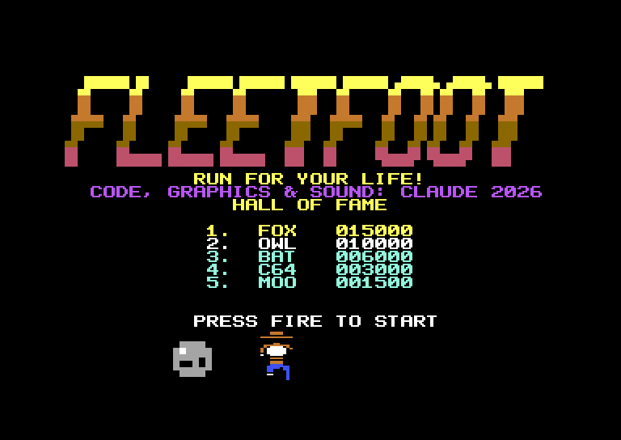

# How to Play
## Controls
Plug a joystick into **port 2**.

| Input | Action |
|:-|:-|
| Joystick left/right | change lane |
| Joystick up or fire | jump |
| Joystick down | slide (in the air: drop down fast and slide) |
| `P` | pause (`RUN/STOP` during the pause quits to the title screen) |
| `M` | music on/off |

## The Game
The runner moves on his own and gets faster and faster. Three kinds of obstacles block the lanes:

| Obstacle | What to do |
|:-|:-|
| Hurdle (striped plank) | jump over it or change lane |
| Bar (high beam) | slide under it or change lane |
| Block | change lane - only the spring boots jump high enough |

Running into the front of an obstacle ends the run. Changing into a lane where an obstacle is right beside you makes the runner stumble: he stays in his lane and the boulder rolls up behind him. If he stumbles again before it has fallen back, the boulder catches him.

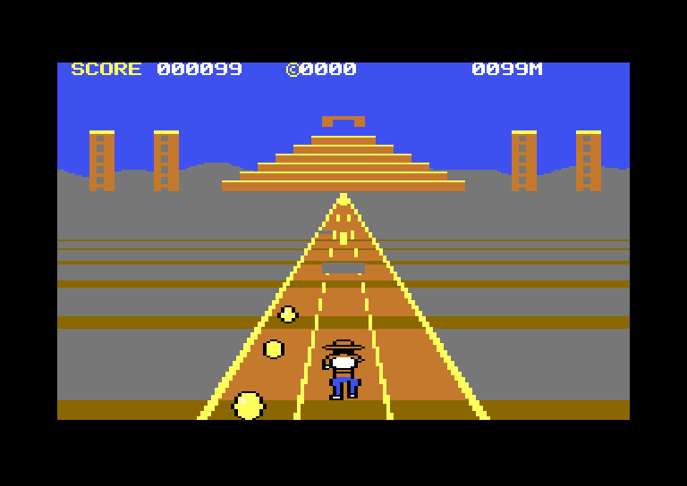
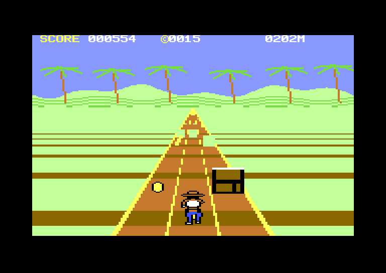

Coins come in lines on the ground and in arcs over hurdles; jump to get the ones in the air. Every coin is worth 10 points, every metre as many points as the number of the land. The power-ups float above the track:

| Power-up | Effect |
|:-|:-|
| Magnet (red) | all coins fly into your lane |
| Spring boots (green) | much higher jumps, even over blocks |
| Star (cyan) | double points |
| Amulet (purple) | saves you from one crash |

The active power-ups and their remaining time are shown below the score. Every land is 800 metres long. After the fire mountain the runner escapes into daylight, which brings a bonus of 5000 points. Good scores go into the hall of fame.

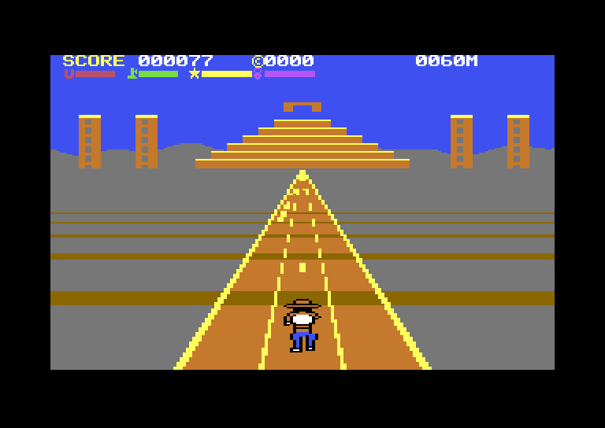
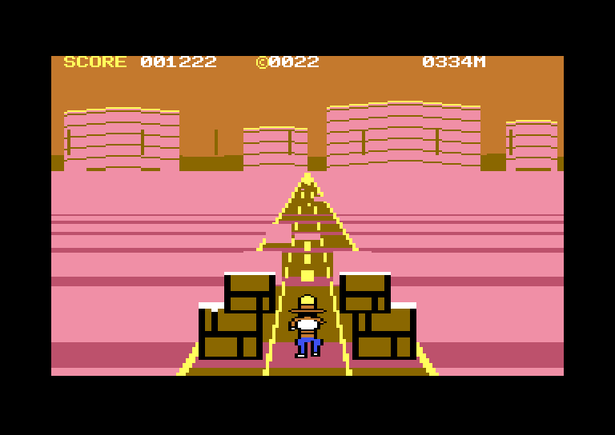

## Hidden Cheat
Type `GOLDEN` on the title screen. A message confirms the cheat mode. Now the keys `1` to `5` choose the land to start in. In cheat mode nothing can stop the runner.

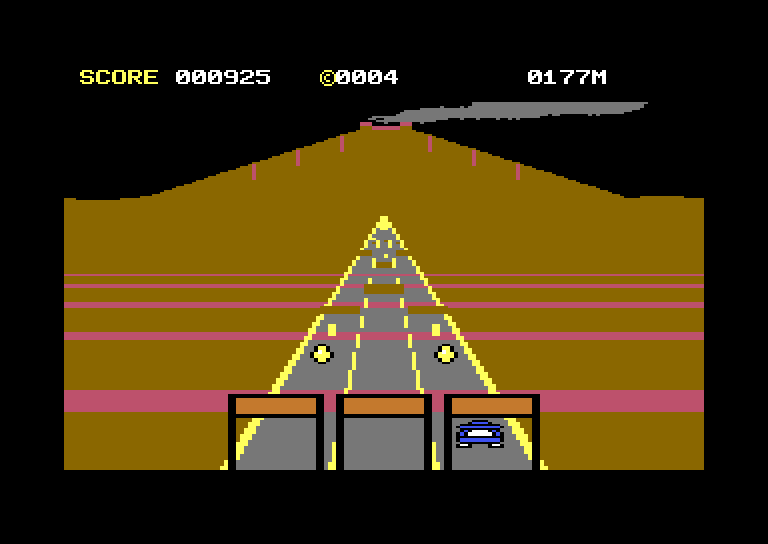

# How it Works
## Memory Map
| Address | Content |
|:-|:-|
| `$0810-$19E2` | game code: raster interrupts, rendering, objects, runner |
| `$4000-$47FF` | charset 1: font, logo, scenery of the current land, HUD icons (VIC bank 1) |
| `$4800-$4FFF` | charset 2: 154 characters of the track |
| `$5000-$53FF` | screen |
| `$5400-$68BF` | 83 sprites: runner, obstacles, coins and power-ups in six sizes, boulder |
| `$68C0-$77EE` | SID player, title, game over, ending, hiscore |
| `$8000-$BA25` | game flow, music, projection tables, scenery, stripe data, obstacle patterns |
| `$C000-$C55A` | variables: objects, sprite lists, runner |
| `$C600-$CB2F` | stripe phase table and the byte pairs of the stripe code |
| `$E000-$F803` | generated stripe code (RAM under the KERNAL) |

## The Track
The screen is split at the horizon. The upper nine character rows show the score and the scenery of the land with charset 1; a raster interrupt switches to charset 2 for the 16 rows of the track. The switch happens in the border between the last line of the sky and the badline of the first track row, so no visible line is touched. The track is a fixed character screen: every character position of the far rows has its own character, the near rows share characters wherever the track looks the same.

The stripes that rush towards the runner are not colour changes but character data. Each pixel line of the track lies at a fixed depth `z = 11136 / (line - 72)` (in 1/32 of a lane). A line is dark when `(z + travelled distance) mod 64` falls into the dark part of the period. Every character has a plain and a striped version of each line. At start-up the game writes a block of unrolled code for all 128 lines (about 6 KB under the KERNAL): for each line it loads the stripe phase of that line (`LDY #depth / LDX phase,Y`) and then copies `LDA pair,X / STA char` for every character that changes. Characters with the same byte pair in a line share one load and get several stores. Per update only a 64 byte phase table has to be calculated.

There is only one charset for the track, so the code races the raster beam: the far rows are rewritten right after the beam has drawn the horizon row, the near rows in the interrupt below the screen, after the beam has left them. Each row is always finished before the beam comes back to it in the next frame.

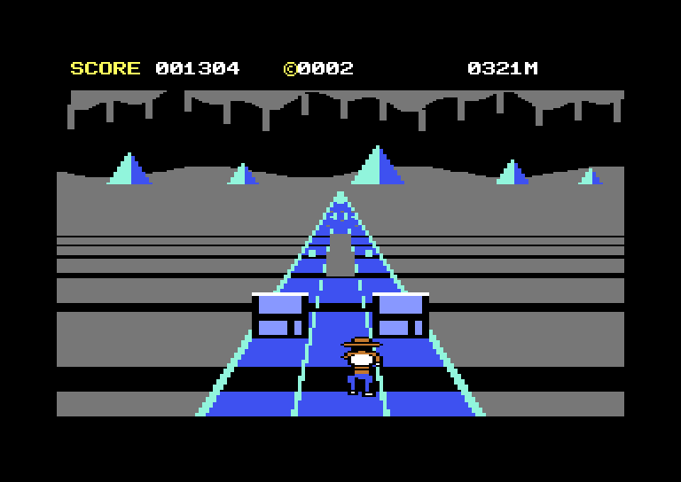

## Objects in the Distance and Close Up
Obstacles, coins and power-ups live in a ring buffer with their lane and depth. A projection table turns the depth into the base line on the screen; the width of a lane on that line gives the position and the size.

Far away (rows 9 to 17) the objects are drawn into the unique characters of the track. After the stripe code has restored the characters, each object is filled in as a rectangle in the ground colour (coins and power-ups in yellow), column by column with the lines of one character row in the Y register. Objects close to the horizon are just one pixel.

Further down the objects become multicolour sprites in six sizes, generated by the Python tools from shape functions. Hurdles are expanded horizontally, bars and blocks in both directions, coins and power-ups are normal sprites. They are sorted by their top line, and six hardware sprites are reused down the screen by raster interrupts as soon as a sprite has been shown; sprites 0 and 1 always show the runner. The boulder is a huge round rock made of four expanded sprites; usually only its upper half shows above the bottom of the screen.

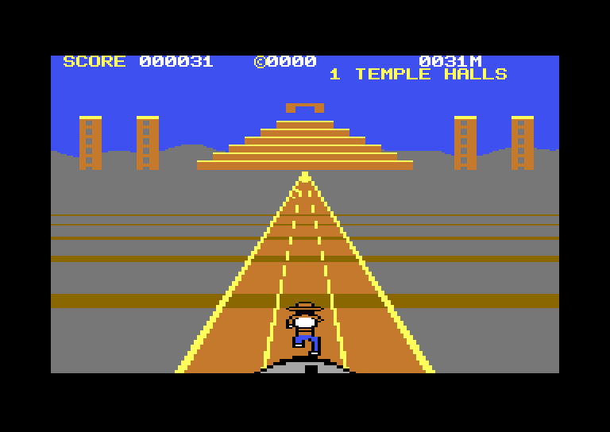

## Timing
The game calculates a new picture every second frame. The game logic runs once per update; on NTSC machines every sixth step is skipped, so the game runs at the same speed. When an update takes longer, the missing steps are made up in the next one.

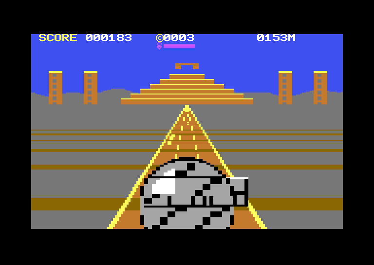

## Loaders
All three loaders share the same crunched game image. The game is packed with [TSCrunch](https://github.com/tonysavon/TSCrunch) into an image that can be decrunched in place, i.e. it is loaded directly below its final position and unpacked onto itself.

- **Disk:** the boot file transfers its drive code into the 1541 via `M-W` commands and starts it. The drive reads the sectors of the data file and sends every byte as four 2-bit pairs over the CLK and DATA lines of the serial bus. Each byte starts with a handshake, the four pairs follow with cycle-exact timing. The screen is switched off while loading, so that no badlines can disturb the timing. The loader works on PAL and NTSC machines. Both files are written with a sector interleave matched to the transfer speed.
- **Cartridge:** the boot code in bank 0 is started via the `CBM80` signature, copies the crunched image bank by bank from `$8000-$9FFF` into RAM, disables the cartridge by setting bit 7 of `$DE00` and jumps into the decruncher.
- **Tape:** a small boot program in standard KERNAL format is loaded first. It contains the turbo loader, which distinguishes short and long pulses with a CIA timer (threshold 280 cycles), assembles the bytes and verifies the loaded data with an XOR checksum. If the checksum does not match, the motor is stopped and the border turns red.

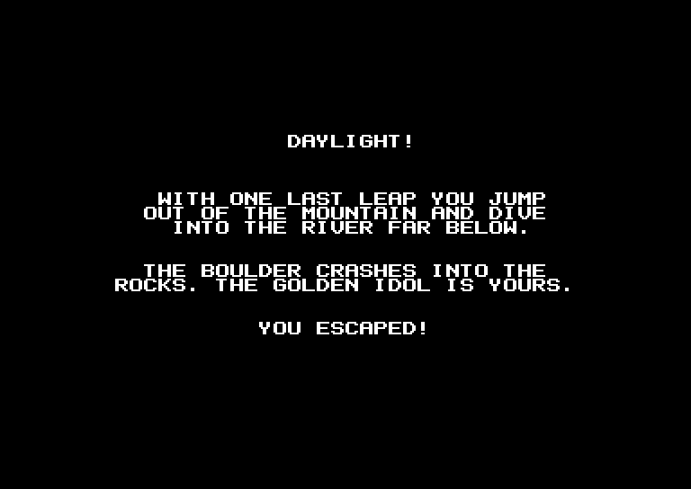

# Source Code
## Assembler Sources
The game is written in 6502 assembler for [64tass](https://sourceforge.net/projects/tass64/). `main.asm` includes all other files.

| File | Lines | Content |
|:-|-:|:-|
| `src/main.asm` | 337 | memory map, constants, variables, initialisation, segment layout, includes |
| `src/game.asm` | 634 | game flow: main loop, lands, score, power-ups, HUD, pause, crash and escape |
| `src/render.asm` | 542 | stripe code generator, stripe phase, far objects drawn into characters |
| `src/objects.asm` | 586 | object ring buffer, pattern generator, movement, collisions, projection |
| `src/player.asm` | 541 | runner: lanes, jumping, sliding, sprites, boulder, sprite sorting, autopilot |
| `src/irq.asm` | 321 | menu IRQ, bottom IRQ, horizon split and sprite multiplexer |
| `src/screens.asm` | 964 | title screen, game over, ending, credits, hiscore entry, cheat |
| `src/sound.asm` | 501 | SID music player (3 voices, instruments, arpeggios, vibrato) and sound effects |
| `src/util.asm` | 226 | text output, random numbers, keyboard scan, joystick, hiscores |

## Python Tools
The Python scripts generate all data of the game and package the distribution formats.

| File | Content |
|:-|:-|
| `tools/fgen.py` | build script for all generated data: charsets, sprites, tables, scenery, patterns, music |
| `tools/fgeo.py` | geometry of the track: projection, lanes, stripes, area of the far objects |
| `tools/fground.py` | characters of the track and the screen map |
| `tools/fgfx.py` | original graphics: runner, obstacles, coins, power-ups, boulder, scenery, logo |
| `tools/flevels.py` | obstacle patterns and their use in the five lands |
| `tools/fmusic.py` | all compositions and sound effects of FLEETFOOT |
| `tools/gfx.py` | shared graphics helpers and font |
| `tools/music.py` | music and sound effect compiler |
| `tools/package.py` | crunches the game and builds D64, BIN and CRT |
| `tools/d64.py` | minimal D64 image writer with custom sector interleave |
| `tools/crt.py` | writes the VICE CRT container for the Magic Desk ROM |
| `tools/mktap.py` | TAP v1 writer: KERNAL boot file plus turbo data block |

# Compiling the Source Code
## Requirements
- [64tass](https://sourceforge.net/projects/tass64/) cross assembler (version 1.59 or newer)
- [Python 3](https://www.python.org/) (only the standard library is needed for the build)
- [TSCrunch](https://github.com/tonysavon/TSCrunch) by Antonio Savona for crunching the game

## Building
All graphics, sprites, level data and music are generated by Python scripts at build time, there are no binary assets in the repository. A single script creates the game and all five distribution formats:
```
cd sources
./build.sh
```
If `tscrunch` is not in your `PATH`, pass its location: `TSCRUNCH=/path/to/tscrunch ./build.sh`. The finished files are placed in `sources/build/release`. Intermediate files (listings, label files, generated data) remain in `sources/build`, the label file `fleetfoot.lbl` is handy for debugging with the VICE monitor.

The build runs the following steps:
1. `tools/fgen.py` generates the charset, the sprites, all tables, the level data and the music into `build/`.
2. `64tass` assembles `src/main.asm` into the uncompressed game `build/fleetfoot.prg` (start address `$0810`).
3. `tools/package.py` crunches the game with TSCrunch into an in-place decrunching image and builds the D64 (with boot loader), the BIN and the CRT.
4. TSCrunch creates the self-extracting single file PRG.
5. The tape boot loader is assembled and `tools/mktap.py` writes the TAP image.

## Folder Structure
```
sources/
├── build.sh            build script for all formats
├── src/                6502 assembler sources (64tass)
│   ├── main.asm        memory map, includes
│   ├── game.asm        game flow
│   ├── render.asm      track rendering
│   ├── objects.asm     objects
│   ├── ...             see table above
│   └── loader/
│       ├── boot.asm    disk boot program + 1541 drive code (2-bit fastloader)
│       ├── cart.asm    Magic Desk cartridge boot code
│       ├── tapeboot.asm turbo tape boot loader
│       └── decrunch.asm TSCrunch in-place decruncher
└── tools/              Python build tools
    ├── fgen.py         generates all game data
    ├── fgeo.py         track geometry
    ├── fgfx.py         graphics
    ├── fmusic.py       music
    ├── ...             see table above
    ├── package.py      crunching, D64, BIN and CRT creation
    ├── d64.py          minimal D64 writer with custom sector interleave
    ├── crt.py          Magic Desk CRT file writer
    └── mktap.py        TAP image writer (KERNAL boot file + turbo blocks)
```

# Using the Binaries
The [binaries](binaries/) folder contains the game in five ready-to-use formats. All of them start the same game; they only differ in the medium and the loader.

| File | Format | Loader | Typical use |
|:-|:-|:-|:-|
| `fleetfoot.d64` | 1541 disk image | own 2-bit fastloader (~5 s) | emulators, real 1541 floppy, Ultimate 64/II |
| `fleetfoot.crt` | Magic Desk cartridge (VICE CRT) | copies from ROM, starts in ~1 s | emulators, Ultimate 64/II, Kung Fu Flash |
| `fleetfoot.bin` | raw 64 KB Magic Desk ROM | as above | burning an (E)EPROM for a real cartridge |
| `fleetfoot.prg` | single self-extracting PRG | standard KERNAL loader | emulators, SD2IEC, any file based device |
| `fleetfoot.tap` | tape image (TAP v1) | own turbo loader (~1:01 min) | emulators, Tapuino, real datasette |

## D64 - Disk Image with Fastloader
Load and start the game with:
```
LOAD"*",8,1
RUN
```
The first file is a tiny boot program. It uploads its own drive code into the 1541, which then sends the crunched game file (the second directory entry, `fleetfoot data`) with a 2-bit protocol to the C64. The game is decrunched in place and starts automatically. Loading takes about five seconds instead of about 45 seconds with the standard loader.

Because the fastloader runs code inside the floppy drive, it needs a real 1541/1541-II/1571 or an accurate drive emulation (VICE with "True Drive Emulation", Ultimate 64/II, Pi1541). Pure file-based devices like the [SD2IEC](https://github.com/wagiminator/C64-Collection/tree/master/C64_SD2IEC_LP) cannot run drive code; please use the PRG file there.

**In an emulator:** drag and drop the D64 onto [VICE](https://vice-emu.sourceforge.io/) or open it in the [C64 Emulator Web App](https://wagiminator.github.io/apps/c64-emulator/) directly in your browser.

**On a real floppy disk:** write the D64 to a disk with a [DiskBuddy64](https://github.com/wagiminator/C64-Collection/tree/master/C64_DiskBuddy64), [DiskMaster64](https://github.com/wagiminator/C64-Collection/tree/master/C64_DiskMaster64) or [DumpMaster64](https://github.com/wagiminator/C64-Collection/tree/master/C64_DumpMaster64) adapter, either with the Python tools of the respective adapter or directly from the browser with the [C64 Disk Transfer Web App](https://wagiminator.github.io/apps/d64-transfer/). Alternatively, an [xu1541](https://github.com/wagiminator/C64-Collection/tree/master/C64_xu1541) with OpenCBM can be used. If you want to have a look at the disk structure or add the game to your own disk image, use the [C64 Disk Viewer](https://wagiminator.github.io/apps/d64-viewer/) and the [C64 Disk Editor](https://wagiminator.github.io/apps/d64-editor/).

## CRT and BIN - Magic Desk Cartridge
The game is also available as a 64 KB cartridge in Magic Desk format (eight 8 KB banks, bank register at `$DE00`). After switching on, the boot code in bank 0 copies the crunched game into RAM, switches the cartridge off and decrunches the game. It is ready about one second after power-on.

**In an emulator or on modern hardware:** the CRT file can be attached in VICE (`File` -> `Attach cartridge image`), in the [C64 Emulator Web App](https://wagiminator.github.io/apps/c64-emulator/), on an Ultimate 64/II or a Kung Fu Flash.

**As a real cartridge:** the BIN file is the raw 64 KB ROM image. Burn it into a 27C512/28C512 (E)EPROM and plug it into the [C64 64k/256k Cartridge](https://github.com/wagiminator/C64-Collection/tree/master/C64_Cartridge_64k_256k). For programming the (E)EPROM, a TL866/T48 programmer can be used together with the [XGecu Memory Programmer Web App](https://wagiminator.github.io/apps/tinypro/) or the Python tool [tinypro](https://pypi.org/project/tinypro/). If you want to combine several games on one cartridge with a selection menu, put the PRG files into the [C64 Cartridge Builder Web App](https://wagiminator.github.io/apps/cart-builder/).

## PRG - Single File
The PRG is the complete game as one self-extracting file. Load it with:
```
LOAD"FLEETFOOT",8
RUN
```
It works with every device that can load files with the standard KERNAL routines, e.g. an [SD2IEC](https://github.com/wagiminator/C64-Collection/tree/master/C64_SD2IEC_LP), an Ultimate 64/II, a Kung Fu Flash or a real floppy disk (copy it onto a disk with the [C64 Disk Editor](https://wagiminator.github.io/apps/d64-editor/) and the [C64 Disk Transfer Web App](https://wagiminator.github.io/apps/d64-transfer/)). Since the standard loader is slow, loading from a real 1541 takes considerably longer than the D64 version. A fastload cartridge like the [C64 FreeLoad Cartridge](https://github.com/wagiminator/C64-Collection/tree/master/C64_Cartridge_FreeLoad) speeds this up nicely. In emulators the PRG can simply be autostarted.

## TAP - Tape Image with Turbo Loader
Insert the tape (or attach the TAP file in your emulator), then press `SHIFT` + `RUN/STOP` (or type `LOAD` and later `RUN`) and press PLAY on the datasette. The KERNAL first loads a small boot loader. This turbo loader then switches the datasette motor on again and reads the crunched game in its own pulse format (bit 0 = 208 cycles, bit 1 = 352 cycles). Coloured stripes in the border show the loading progress, a red border indicates a loading error. The whole process takes about 1:01 minutes instead of about seven minutes with the standard KERNAL loader.

**In an emulator:** attach the TAP file to the datasette in VICE or load it into the [C64 Emulator Web App](https://wagiminator.github.io/apps/c64-emulator/).

**With a datasette emulator:** copy the TAP file onto the SD card of a [Tapuino](https://github.com/wagiminator/C64-Collection/tree/master/C64_Tapuino).

**On a real cassette:** record the TAP file onto a tape with a [TapeBuddy64](https://github.com/wagiminator/C64-Collection/tree/master/C64_TapeBuddy64), [TapeDump64](https://github.com/wagiminator/C64-Collection/tree/master/C64_TapeDump64) or [DumpMaster64](https://github.com/wagiminator/C64-Collection/tree/master/C64_DumpMaster64), either with the Python tools of the respective adapter or directly from the browser with the [C64 Tape Transfer Web App](https://wagiminator.github.io/apps/tap-transfer/).

# References, Links and Notes
1. [Subway Surfers on Wikipedia](https://en.wikipedia.org/wiki/Subway_Surfers)
2. [Temple Run on Wikipedia](https://en.wikipedia.org/wiki/Temple_Run)
3. [Endless runner on Wikipedia](https://en.wikipedia.org/wiki/Endless_runner)
4. [64tass Cross Assembler](https://sourceforge.net/projects/tass64/)
5. [TSCrunch by Antonio Savona](https://github.com/tonysavon/TSCrunch)
6. [VICE - the Versatile Commodore Emulator](https://vice-emu.sourceforge.io/)
7. [C64 Emulator Web App](https://wagiminator.github.io/apps/c64-emulator/)
8. [C64 Disk Transfer Web App](https://wagiminator.github.io/apps/d64-transfer/)
9. [C64 Tape Transfer Web App](https://wagiminator.github.io/apps/tap-transfer/)
10. [C64 Cartridge Builder Web App](https://wagiminator.github.io/apps/cart-builder/)
11. [XGecu Memory Programmer Web App](https://wagiminator.github.io/apps/tinypro/)
12. [C64 Collection (adapters and cartridges)](https://github.com/wagiminator/C64-Collection)
13. [Christian Bauer: The MOS 6567/6569 video controller (VIC-II)](https://www.zimmers.net/cbmpics/cbm/c64/vic-ii.txt)
14. [Codebase64 Wiki](https://codebase64.org/)

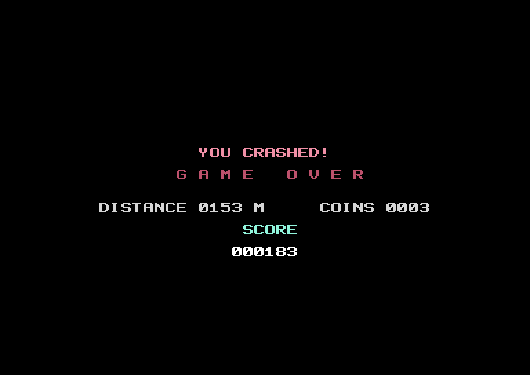
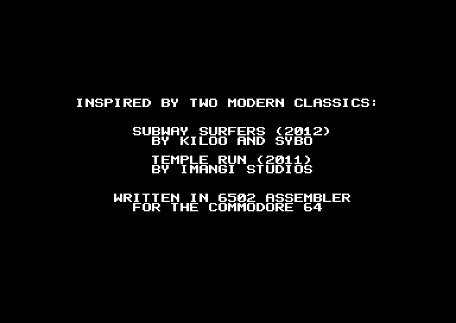

# License


This work is licensed under Creative Commons Attribution-ShareAlike 3.0 Unported License.
(http://creativecommons.org/licenses/by-sa/3.0/)
