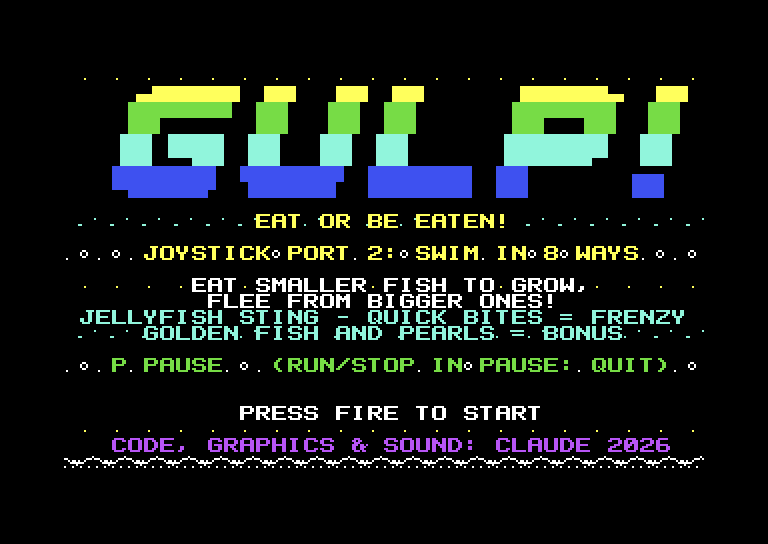
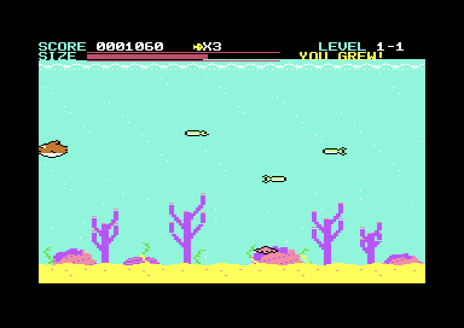
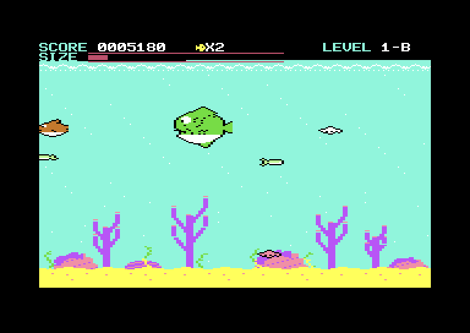
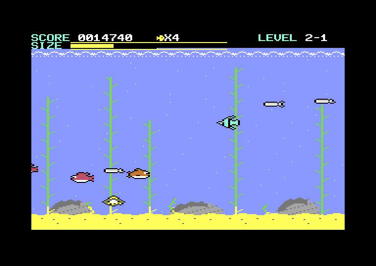
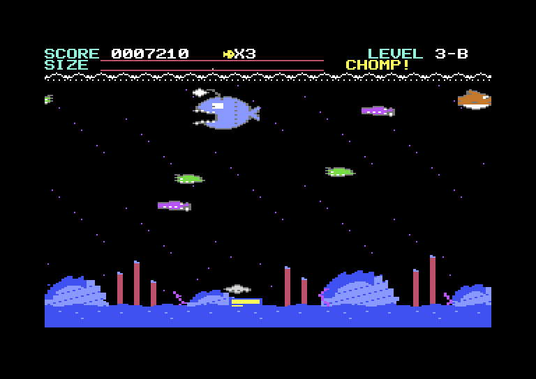

# GULP! - Eat or be Eaten on the Commodore C64
GULP! is an underwater feeding game for the Commodore C64, written from scratch in 6502 assembler. You are a small and very hungry fish. Eat the fish that are smaller than you, grow bigger and avoid everything that is bigger than you. Three zones from the coral reef to the deep sea are waiting, each one ending in a boss level against a giant hunter. The game is a tribute to the casual classic of 2004, all fish, graphics and music are original.

- Three zones with two feeding levels and one boss level each
- Grow in three sizes, smooth movement with inertia in eight directions
- Nine kinds of fish, predators, jellyfish, golden fish and a clam with pearls
- FRENZY multiplier for quick bites in a row
- Three bosses: BIG BRUTUS, the GIANT SQUID and the LANTERN BEAST
- Sprite multiplexer with up to 32 virtual sprites, animated water surface
- Ending sequence and hiscore table
- Disk version with fastloader, Magic Desk cartridge, single PRG and turbo tape



# How to Play
## Controls
Plug a joystick into **port 2**.

| Input | Action |
|:-|:-|
| Joystick | swim in eight directions (with inertia) |
| `P` | pause |
| `RUN/STOP` (during pause) | quit the game and return to the title screen |

## The Game
Eat fish that are at most as big as you, flee from the bigger ones. Every bite fills the growth bar (SIZE). Twice during a level you grow to the next size, when the bar is full the level is complete.

- Jellyfish sting and stun you for a moment, you drift helplessly towards the ground.
- Predators (barracuda, shark, eel) hunt you, always keep out of their way.
- Quick bites in a row raise the FRENZY multiplier up to x4.
- A golden fish is worth 250 points and lots of growth.
- The clam on the sea floor opens from time to time: its pearl is worth 500 points.
- An extra life is awarded every 10000 points.

| Zone | Name | Boss |
|:-:|:-|:-|
| 1 | The Coral Reef | BIG BRUTUS, a giant grouper |
| 2 | The Kelp Forest | the GIANT SQUID |
| 3 | The Deep Sea | the LANTERN BEAST, an anglerfish |

In the boss level you are already big. Fill the bar and you start to blink: POWER BITE! Now you can bite the boss (3, 4 or 5 bites are needed). Without power, every contact with the boss is deadly. After the last boss the ending follows. Good scores are entered into the hall of fame with your initials; the table is kept until the computer is switched off.

## Hidden Cheat
Type `SUSHI` on the title screen. A red message confirms the cheat mode. You are now invincible, the keys `1` to `3` on the title screen select the start zone and `N` during the game skips the current level or boss.



# How it Works
## Memory Map
| Address | Content |
|:-|:-|
| `$0810-$3FFF` | game code |
| `$4000-$47FF` | multicolour charset for the seabed scenery and the HUD (VIC bank 1) |
| `$4800-$4BFF` | screen |
| `$4C00-$7FFF` | sprite data (139 frames) |
| `$8000-$BFFF` | title/ending screens, music player, scenery, generated tables, music |

## Sprites
Everything that swims is a sprite: the player in three sizes, nine kinds of fish, predators made of two sprites, bosses made of four sprites (48 x 42 pixels), jellyfish, clam, pearls and bubbles. All 139 sprite frames are drawn procedurally by `tools/ggfx.py` and automatically mirrored for both swimming directions. Outlines use the shared multicolour register `$D025`, highlights `$D026`, the body colour is the individual sprite colour.

## Sprite Multiplexer
Up to 32 virtual sprites are sorted per frame with a bucket sort by their Y coordinate and distributed to the eight hardware sprites by a chain of raster interrupts. The sprite lists are double buffered: the main loop prepares the next frame while the interrupts display the current one. A separate raster interrupt draws the black HUD rows at the top of the screen.

## Fish Behaviour
Each fish has a type, a size class, a speed and a swimming pattern. Normal fish cross the screen on a gently wobbling sine path, jellyfish bob up and down, predators follow the height of the player. Eating is decided by comparing the size classes, the bounding boxes are tested in software. The growth bar, the size changes and the FRENZY timer are handled in `player.asm` and `fish.asm`.

## Scenery
The seabed of each zone (corals, kelp, tube worms, rocks, treasure chest) is made of multicolour characters. `tools/gscene.py` draws the scenery, cuts it into characters, removes duplicates and stores the result compactly. The water surface at the top is animated as well.

## Loaders
All three loaders share the same crunched game image. The game is packed with [TSCrunch](https://github.com/tonysavon/TSCrunch) into an image that can be decrunched in place, i.e. it is loaded directly below its final position and unpacked onto itself.

- **Disk:** the boot file transfers its drive code into the 1541 via `M-W` commands and starts it. The drive reads the sectors of the data file and sends every byte as four 2-bit pairs over the CLK and DATA lines of the serial bus. Each byte starts with a handshake, the four pairs follow with cycle-exact timing. The screen is switched off while loading, so that no badlines can disturb the timing. The loader works on PAL and NTSC machines. Both files are written with a sector interleave matched to the transfer speed.
- **Cartridge:** the boot code in bank 0 is started via the `CBM80` signature, copies the crunched image bank by bank from `$8000-$9FFF` into RAM, disables the cartridge by setting bit 7 of `$DE00` and jumps into the decruncher.
- **Tape:** a small boot program in standard KERNAL format is loaded first. It contains the turbo loader, which distinguishes short and long pulses with a CIA timer (threshold 280 cycles), assembles the bytes and verifies the loaded data with an XOR checksum. If the checksum does not match, the motor is stopped and the border turns red.



# Source Code
## Assembler Sources
The game is written in 6502 assembler for [64tass](https://sourceforge.net/projects/tass64/). `main.asm` includes all other files.

| File | Lines | Content |
|:-|-:|:-|
| `src/main.asm` | 283 | memory map, constants, variables, segment layout, includes |
| `src/game.asm` | 695 | game flow: zones, levels, boss levels, lives, pause, cheat keys |
| `src/player.asm` | 374 | player fish: inertia movement, three sizes, stun, death |
| `src/fish.asm` | 806 | fish: spawning, swimming patterns, eating, jellyfish, clam, bubbles |
| `src/boss.asm` | 271 | the giant hunters (4 sprites, 48 x 42 pixels) and the POWER BITE |
| `src/hud.asm` | 218 | score, lives, level, growth bar and messages |
| `src/irq.asm` | 440 | menu IRQ, game IRQ with sprite multiplexer and HUD rows |
| `src/screens.asm` | 932 | title screen, stage intro, game over, ending, credits, hiscore entry |
| `src/sound.asm` | 495 | SID music player (3 voices, instruments, arpeggios, vibrato) and sound effects on voice 3 |
| `src/util.asm` | 227 | text output, BCD score handling, random numbers, keyboard scan, joystick |

## Python Tools
The Python scripts generate all data of the game and package the distribution formats.

| File | Content |
|:-|:-|
| `tools/ggen.py` | build script for all generated data: charset, sprites, scenery, tables |
| `tools/gfx.py` | shared graphics helpers and font |
| `tools/ggfx.py` | original sea creatures: player, fish, predators, bosses, jellyfish, clam, title logo |
| `tools/gscene.py` | seabed scenery per zone (multicolour characters, deduplicated) |
| `tools/music.py` | music and sound effect compiler |
| `tools/gmusic.py` | all compositions of GULP! |
| `tools/package.py` | crunches the game and builds D64, BIN and CRT |
| `tools/d64.py` | minimal D64 image writer with custom sector interleave |
| `tools/crt.py` | writes the VICE CRT container for the Magic Desk ROM |
| `tools/mktap.py` | TAP v1 writer: KERNAL boot file plus turbo data block |

# Compiling the Source Code
## Requirements
- [64tass](https://sourceforge.net/projects/tass64/) cross assembler (version 1.59 or newer)
- [Python 3](https://www.python.org/) (only the standard library is needed for the build)
- [TSCrunch](https://github.com/tonysavon/TSCrunch) by Antonio Savona for crunching the game

## Building
All graphics, sprites, level data and music are generated by Python scripts at build time, there are no binary assets in the repository. A single script creates the game and all five distribution formats:
```
cd sources
./build.sh
```
If `tscrunch` is not in your `PATH`, pass its location: `TSCRUNCH=/path/to/tscrunch ./build.sh`. The finished files are placed in `sources/build/release`. Intermediate files (listings, label files, generated data) remain in `sources/build`, the label file `gulp.lbl` is handy for debugging with the VICE monitor.

The build runs the following steps:
1. `tools/ggen.py` generates the charset, the sprites, all tables, the level data and the music into `build/`.
2. `64tass` assembles `src/main.asm` into the uncompressed game `build/gulp.prg` (start address `$0810`).
3. `tools/package.py` crunches the game with TSCrunch into an in-place decrunching image and builds the D64 (with boot loader), the BIN and the CRT.
4. TSCrunch creates the self-extracting single file PRG.
5. The tape boot loader is assembled and `tools/mktap.py` writes the TAP image.

## Folder Structure
```
sources/
├── build.sh            build script for all formats
├── src/                6502 assembler sources (64tass)
│   ├── main.asm        memory map, includes
│   ├── game.asm        game flow
│   ├── fish.asm        fish behaviour
│   ├── player.asm      player fish
│   ├── ...             see table above
│   └── loader/
│       ├── boot.asm    disk boot program + 1541 drive code (2-bit fastloader)
│       ├── cart.asm    Magic Desk cartridge boot code
│       ├── tapeboot.asm turbo tape boot loader
│       └── decrunch.asm TSCrunch in-place decruncher
└── tools/              Python build tools
    ├── ggen.py         generates all game data
    ├── ggfx.py         sprites
    ├── gscene.py       scenery
    ├── gmusic.py       music
    ├── gfx.py          graphics helpers
    ├── music.py        music compiler
    ├── package.py      crunching, D64, BIN and CRT creation
    ├── d64.py          minimal D64 writer with custom sector interleave
    ├── crt.py          Magic Desk CRT file writer
    └── mktap.py        TAP image writer (KERNAL boot file + turbo blocks)
```

# Using the Binaries
The [binaries](binaries/) folder contains the game in five ready-to-use formats. All of them start the same game; they only differ in the medium and the loader.

| File | Format | Loader | Typical use |
|:-|:-|:-|:-|
| `gulp.d64` | 1541 disk image | own 2-bit fastloader (~5 s) | emulators, real 1541 floppy, Ultimate 64/II |
| `gulp.crt` | Magic Desk cartridge (VICE CRT) | copies from ROM, starts in ~1 s | emulators, Ultimate 64/II, Kung Fu Flash |
| `gulp.bin` | raw 64 KB Magic Desk ROM | as above | burning an (E)EPROM for a real cartridge |
| `gulp.prg` | single self-extracting PRG | standard KERNAL loader | emulators, SD2IEC, any file based device |
| `gulp.tap` | tape image (TAP v1) | own turbo loader (~1:02 min) | emulators, Tapuino, real datasette |

## D64 - Disk Image with Fastloader
Load and start the game with:
```
LOAD"*",8,1
RUN
```
The first file is a tiny boot program. It uploads its own drive code into the 1541, which then sends the crunched game file (the second directory entry, `gulp data`) with a 2-bit protocol to the C64. The game is decrunched in place and starts automatically. Loading takes about five seconds instead of about 45 seconds with the standard loader.

Because the fastloader runs code inside the floppy drive, it needs a real 1541/1541-II/1571 or an accurate drive emulation (VICE with "True Drive Emulation", Ultimate 64/II, Pi1541). Pure file-based devices like the [SD2IEC](https://github.com/wagiminator/C64-Collection/tree/master/C64_SD2IEC_LP) cannot run drive code; please use the PRG file there.

**In an emulator:** drag and drop the D64 onto [VICE](https://vice-emu.sourceforge.io/) or open it in the [C64 Emulator Web App](https://wagiminator.github.io/apps/c64-emulator/) directly in your browser.

**On a real floppy disk:** write the D64 to a disk with a [DiskBuddy64](https://github.com/wagiminator/C64-Collection/tree/master/C64_DiskBuddy64), [DiskMaster64](https://github.com/wagiminator/C64-Collection/tree/master/C64_DiskMaster64) or [DumpMaster64](https://github.com/wagiminator/C64-Collection/tree/master/C64_DumpMaster64) adapter, either with the Python tools of the respective adapter or directly from the browser with the [C64 Disk Transfer Web App](https://wagiminator.github.io/apps/d64-transfer/). Alternatively, an [xu1541](https://github.com/wagiminator/C64-Collection/tree/master/C64_xu1541) with OpenCBM can be used. If you want to have a look at the disk structure or add the game to your own disk image, use the [C64 Disk Viewer](https://wagiminator.github.io/apps/d64-viewer/) and the [C64 Disk Editor](https://wagiminator.github.io/apps/d64-editor/).

## CRT and BIN - Magic Desk Cartridge
The game is also available as a 64 KB cartridge in Magic Desk format (eight 8 KB banks, bank register at `$DE00`). After switching on, the boot code in bank 0 copies the crunched game into RAM, switches the cartridge off and decrunches the game. It is ready about one second after power-on.

**In an emulator or on modern hardware:** the CRT file can be attached in VICE (`File` -> `Attach cartridge image`), in the [C64 Emulator Web App](https://wagiminator.github.io/apps/c64-emulator/), on an Ultimate 64/II or a Kung Fu Flash.

**As a real cartridge:** the BIN file is the raw 64 KB ROM image. Burn it into a 27C512/28C512 (E)EPROM and plug it into the [C64 64k/256k Cartridge](https://github.com/wagiminator/C64-Collection/tree/master/C64_Cartridge_64k_256k). For programming the (E)EPROM, a TL866/T48 programmer can be used together with the [XGecu Memory Programmer Web App](https://wagiminator.github.io/apps/tinypro/) or the Python tool [tinypro](https://pypi.org/project/tinypro/). If you want to combine several games on one cartridge with a selection menu, put the PRG files into the [C64 Cartridge Builder Web App](https://wagiminator.github.io/apps/cart-builder/).

## PRG - Single File
The PRG is the complete game as one self-extracting file. Load it with:
```
LOAD"GULP",8
RUN
```
It works with every device that can load files with the standard KERNAL routines, e.g. an [SD2IEC](https://github.com/wagiminator/C64-Collection/tree/master/C64_SD2IEC_LP), an Ultimate 64/II, a Kung Fu Flash or a real floppy disk (copy it onto a disk with the [C64 Disk Editor](https://wagiminator.github.io/apps/d64-editor/) and the [C64 Disk Transfer Web App](https://wagiminator.github.io/apps/d64-transfer/)). Since the standard loader is slow, loading from a real 1541 takes considerably longer than the D64 version. A fastload cartridge like the [C64 FreeLoad Cartridge](https://github.com/wagiminator/C64-Collection/tree/master/C64_Cartridge_FreeLoad) speeds this up nicely. In emulators the PRG can simply be autostarted.

## TAP - Tape Image with Turbo Loader
Insert the tape (or attach the TAP file in your emulator), then press `SHIFT` + `RUN/STOP` (or type `LOAD` and later `RUN`) and press PLAY on the datasette. The KERNAL first loads a small boot loader. This turbo loader then switches the datasette motor on again and reads the crunched game in its own pulse format (bit 0 = 208 cycles, bit 1 = 352 cycles). Coloured stripes in the border show the loading progress, a red border indicates a loading error. The whole process takes about 1:02 minutes instead of about seven minutes with the standard KERNAL loader.

**In an emulator:** attach the TAP file to the datasette in VICE or load it into the [C64 Emulator Web App](https://wagiminator.github.io/apps/c64-emulator/).

**With a datasette emulator:** copy the TAP file onto the SD card of a [Tapuino](https://github.com/wagiminator/C64-Collection/tree/master/C64_Tapuino).

**On a real cassette:** record the TAP file onto a tape with a [TapeBuddy64](https://github.com/wagiminator/C64-Collection/tree/master/C64_TapeBuddy64), [TapeDump64](https://github.com/wagiminator/C64-Collection/tree/master/C64_TapeDump64) or [DumpMaster64](https://github.com/wagiminator/C64-Collection/tree/master/C64_DumpMaster64), either with the Python tools of the respective adapter or directly from the browser with the [C64 Tape Transfer Web App](https://wagiminator.github.io/apps/tap-transfer/).

# References, Links and Notes
1. [64tass Cross Assembler](https://sourceforge.net/projects/tass64/)
2. [TSCrunch by Antonio Savona](https://github.com/tonysavon/TSCrunch)
3. [VICE - the Versatile Commodore Emulator](https://vice-emu.sourceforge.io/)
4. [C64 Emulator Web App](https://wagiminator.github.io/apps/c64-emulator/)
5. [C64 Disk Transfer Web App](https://wagiminator.github.io/apps/d64-transfer/)
6. [C64 Tape Transfer Web App](https://wagiminator.github.io/apps/tap-transfer/)
7. [C64 Cartridge Builder Web App](https://wagiminator.github.io/apps/cart-builder/)
8. [XGecu Memory Programmer Web App](https://wagiminator.github.io/apps/tinypro/)
9. [C64 Collection (adapters and cartridges)](https://github.com/wagiminator/C64-Collection)
10. [Christian Bauer: The MOS 6567/6569 video controller (VIC-II)](https://www.zimmers.net/cbmpics/cbm/c64/vic-ii.txt)
11. [Codebase64 Wiki](https://codebase64.org/)




# License


This work is licensed under Creative Commons Attribution-ShareAlike 3.0 Unported License.
(http://creativecommons.org/licenses/by-sa/3.0/)
