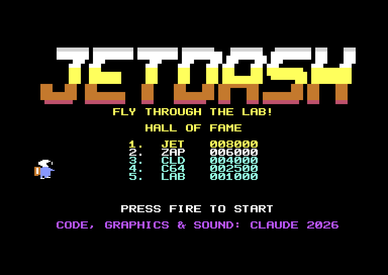
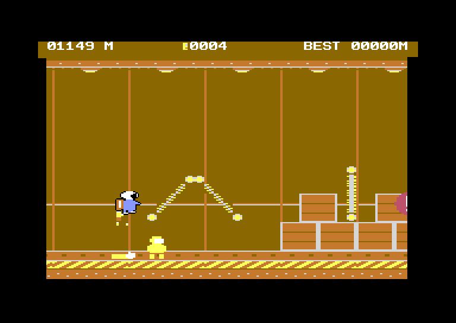
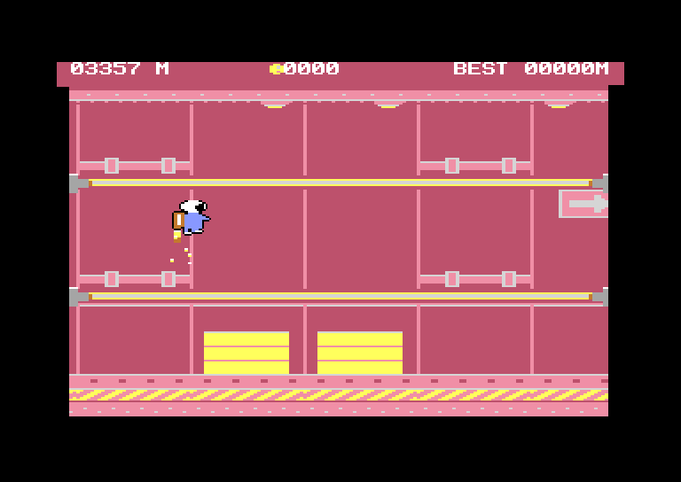
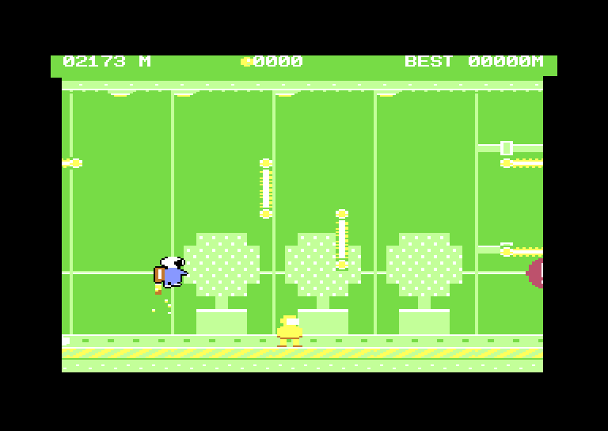
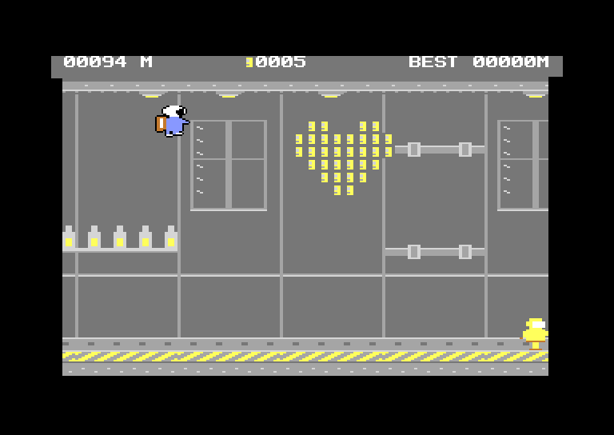
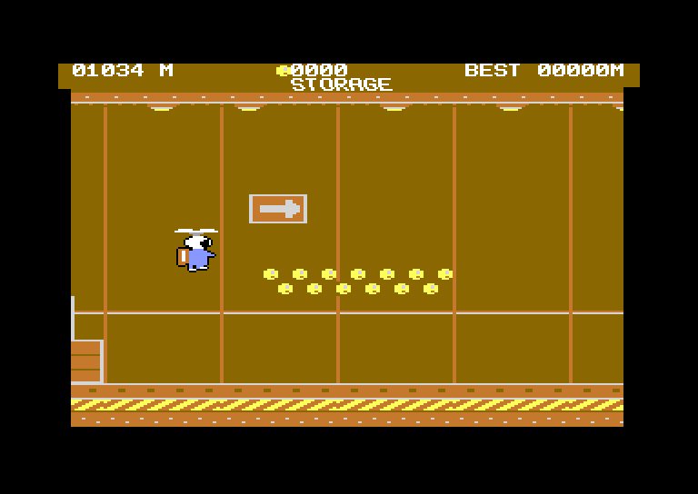
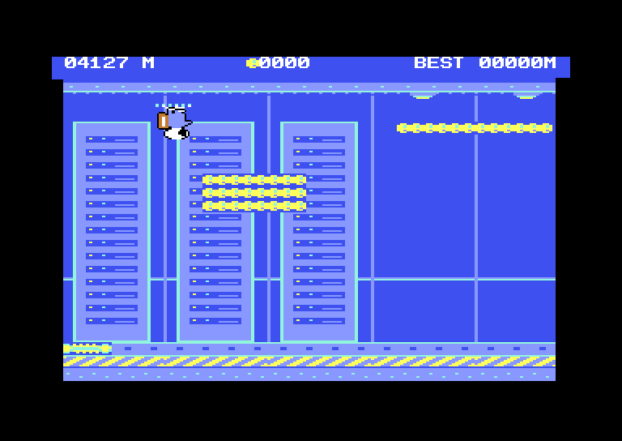
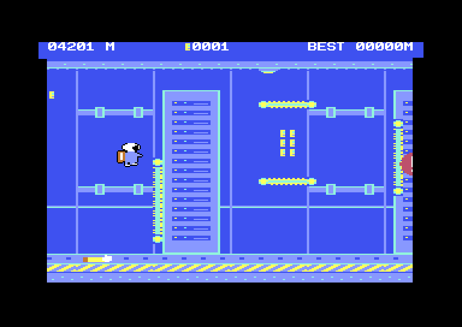
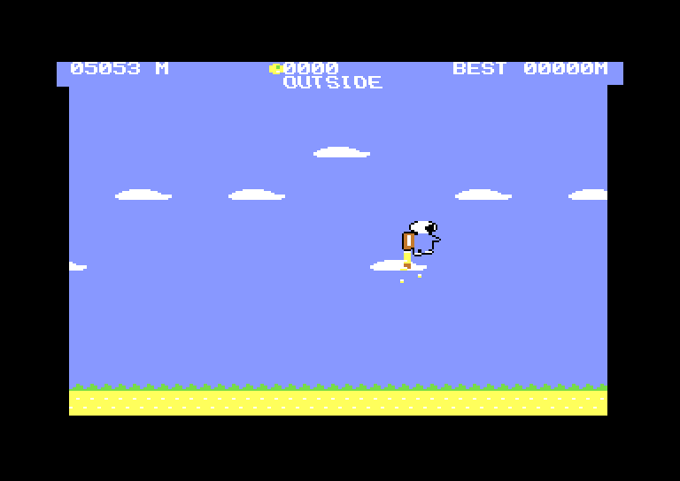
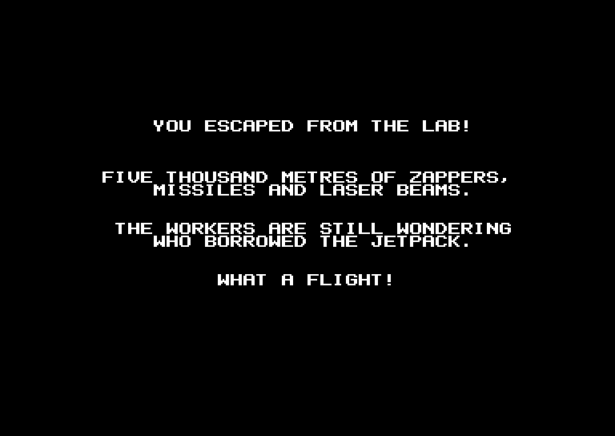

# JETDASH - Fly through the Lab on the Commodore C64
JETDASH is a side-scrolling jetpack game for the Commodore C64, written from scratch in 6502 assembler. A courier with a borrowed jetpack races through a secret research facility: hold the fire button to fly up, let go to drop, and dodge zappers, homing missiles and laser beams while collecting coins. Gadget boxes give you a copter or a gravity belt, the lab workers in their hazmat suits are knocked over by your exhaust, and after five thousand metres and five zones the exit to the open sky is waiting. The game is a tribute to the modern mobile classic of 2011; all graphics, characters and music are original.

- Smooth horizontal scrolling with two screens and generated copy code
- Endless, procedurally generated corridor: coin formations, zappers in all directions, laser sequences and missile waves
- Pixel-exact collision with the zappers
- Two vehicles from gadget boxes: copter (tap fire) and gravity belt (fire flips gravity); each one absorbs a hit
- Five zones with their own colours and decorations, from the lab to the server hall, and an ending outside
- Own SID music player with in-game music (can be switched off), sound effects
- Credits, hall of fame and a hidden cheat
- Disk version with fastloader, Magic Desk cartridge, single PRG and turbo tape



# How to Play
## Controls
Plug a joystick into **port 2**.

| Input | Action |
|:-|:-|
| Fire (hold) | jetpack: fly up; release to drop |
| Fire (tap) | copter: flap upwards |
| Fire | gravity belt: flip gravity (when standing on the floor or the ceiling) |
| `P` | pause (`RUN/STOP` during the pause quits to the title screen) |
| `M` | music on/off |

## The Game
The corridor scrolls to the left all by itself and gets faster the farther you get. You only control the height: the jetpack lifts you while the fire button is held, gravity pulls you back down when you let go. There is no safe height: the dangers come at every level of the corridor.

| Danger / item | Effect |
|:-|:-|
| coin | 10 points at the end of the run |
| zapper | an electric bar between two nodes, horizontal, vertical or diagonal: touching the beam is fatal |
| missile | a warning sign at the right edge follows your height, then locks on and the missile shoots across the screen |
| laser | a dotted line marks the beam for a moment, then it fires across the whole width |
| gadget box | a green box with a question mark: gives you a copter or a gravity belt |
| worker | harmless; your exhaust knocks them over |

In a vehicle a hit only destroys the vehicle: you continue with the jetpack and are invulnerable for two seconds. Every 1000 metres you pass a bulkhead into the next zone: lab, storage, greenhouse, reactor and server hall. After 5000 metres you leave the facility and the ending begins. At the end of a run the score is the distance in metres plus ten points per coin; good scores go into the hall of fame, and the best distance is shown in the top line.



## Hidden Cheat
Type `ROCKET` on the title screen. A red message confirms the cheat mode. Now the keys `1` to `5` choose the zone you start in, and `6` starts just before the exit. In cheat mode zappers, missiles and lasers are harmless.



# How it Works
## Memory Map
| Address | Content |
|:-|:-|
| `$0810-$207F` | game code |
| `$4000-$47FF` | menu charset: font and logo (VIC bank 1) |
| `$4800-$4BFF` | screen A |
| `$4C00-$4FFF` | screen B |
| `$5000-$5C7F` | 50 sprites: courier, flame, rotor, workers, missile, warning, box, explosion, laser emitters |
| `$6000-$67FF` | game charset: font, coins, zappers, lasers, lab tiles |
| `$6800-$77BF` | SID player, sound effects, title, game over, ending and hiscore screens |
| `$8000-$9CAF` | music, tiles, patterns, laser sequences, difficulty tables |
| `$A800-$BC7F` | generated copy code screen B to A |
| `$C000-$C1FF` | variables |
| `$E000-$F47F` | generated copy code screen A to B (RAM under the KERNAL) |

## Scrolling
The playfield is a multicolour character screen of 23 rows below a two-row status line. It scrolls with the hardware fine scroll of `$D016`. Two screens are used alternately. While one is shown, the other is prepared as a copy shifted left by one column: at the start the game generates two blocks of copy code with one `LDA`/`STA` pair for each of the 874 cells. Each block is split into two halves, so the copying is spread over two frames. Then the generator writes the new column at the right edge. When the fine scroll has run through all eight pixels, an interrupt below the playfield swaps the screens and sets the sprites in the same frame. A second interrupt above the playfield switches from the unscrolled status line to the scrolled playfield. The game moves at most two pixels per frame, so there are always at least four frames for the two copy halves.

Colour RAM never moves: every playfield cell has the same colour (yellow). All other colours come from the three shared multicolour registers: `$D021` is the wall, `$D022` the structure and `$D023` the light details. A new zone therefore only changes three registers.



## Generator
The corridor is built from tiles 8 columns wide and 23 rows high: plain walls, windows, pipes, signs and one decoration per zone (shelves, crates, plants, barrels, server racks). Each tile is chosen at random from the zone's set. A ring buffer remembers the tile of every column, so a collected coin can be replaced by the right piece of background. On top of the tiles the generator places patterns from four pools: coin formations, and easy, medium and hard zapper arrangements. Each pattern is stored column by column and gets a random base row. Sixteen difficulty levels control the speed, the gaps between patterns, the mix of the pools and the chance of laser sequences and missile waves. For a laser sequence the generator first leaves 48 empty columns, so the screen is clear when the beams arrive.



## Collisions
Coins are found by reading the screen cells under the courier. Zappers are tested pixel by pixel: six points of the courier are looked up in the displayed screen. If a point lies on a zapper character, the multicolour pixel pair in the charset decides whether it really touches the beam. Missiles, the gadget box and workers are compared by position, lasers by their row. The zapper beams and coins are animated by rewriting their eight charset bytes.



## Sprites
The courier is a hires sprite for the black outline and the visor on top of a multicolour sprite for the body. A third sprite shows the jetpack flame, the copter rotor or the glow of the gravity belt. Two sprites are used for the workers, two for the missiles and one for the gadget box or the explosion. During a laser sequence the worker and missile sprites become the laser emitters at both edges of the screen. On NTSC machines every sixth game step is skipped, so the game runs at the same speed as on PAL.



## Loaders
All three loaders share the same crunched game image. The game is packed with [TSCrunch](https://github.com/tonysavon/TSCrunch) into an image that can be decrunched in place, i.e. it is loaded directly below its final position and unpacked onto itself.

- **Disk:** the boot file transfers its drive code into the 1541 via `M-W` commands and starts it. The drive reads the sectors of the data file and sends every byte as four 2-bit pairs over the CLK and DATA lines of the serial bus. Each byte starts with a handshake, the four pairs follow with cycle-exact timing. The screen is switched off while loading, so that no badlines can disturb the timing. The loader works on PAL and NTSC machines. Both files are written with a sector interleave matched to the transfer speed.
- **Cartridge:** the boot code in bank 0 is started via the `CBM80` signature, copies the crunched image bank by bank from `$8000-$9FFF` into RAM, disables the cartridge by setting bit 7 of `$DE00` and jumps into the decruncher.
- **Tape:** a small boot program in standard KERNAL format is loaded first. It contains the turbo loader, which distinguishes short and long pulses with a CIA timer (threshold 280 cycles), assembles the bytes and verifies the loaded data with an XOR checksum. If the checksum does not match, the motor is stopped and the border turns red.



# Source Code
## Assembler Sources
The game is written in 6502 assembler for [64tass](https://sourceforge.net/projects/tass64/). `main.asm` includes all other files.

| File | Lines | Content |
|:-|-:|:-|
| `src/main.asm` | 316 | memory map, constants, variables, initialisation, segment layout, includes |
| `src/game.asm` | 764 | game flow: start, main loop, distance and speed, zones, HUD, pause, autopilot for testing |
| `src/scroll.asm` | 285 | copy code generator, preparation of the hidden screen, fine scroll, background lookup |
| `src/gen.asm` | 269 | level generator: tiles, coin and zapper patterns, laser sequences, spawning |
| `src/player.asm` | 574 | jetpack, copter, gravity belt, crash, coins and pixel-exact zapper collisions, hero sprites |
| `src/hazards.asm` | 765 | missiles, lasers, workers, gadget box and explosion |
| `src/irq.asm` | 153 | menu IRQ and the two game IRQs (screen swap and status line split) |
| `src/screens.asm` | 943 | title screen, game over, ending, credits, hiscore entry, cheat |
| `src/sound.asm` | 500 | SID music player (3 voices, instruments, arpeggios, vibrato) and sound effects |
| `src/util.asm` | 208 | text output, random numbers, keyboard scan, joystick, hiscores |

## Python Tools
The Python scripts generate all data of the game and package the distribution formats.

| File | Content |
|:-|:-|
| `tools/jgen.py` | build script for all generated data: charsets, tiles, patterns, sprites, tables, music |
| `tools/jgfx.py` | original graphics: lab tiles, coins, zappers, lasers, courier, workers, missiles, logo |
| `tools/jmusic.py` | all compositions and sound effects of JETDASH |
| `tools/gfx.py` | shared graphics helpers and font |
| `tools/music.py` | music and sound effect compiler |
| `tools/package.py` | crunches the game and builds D64, BIN and CRT |
| `tools/d64.py` | minimal D64 image writer with custom sector interleave |
| `tools/crt.py` | writes the VICE CRT container for the Magic Desk ROM |
| `tools/mktap.py` | TAP v1 writer: KERNAL boot file plus turbo data block |

# Compiling the Source Code
## Requirements
- [64tass](https://sourceforge.net/projects/tass64/) cross assembler (version 1.59 or newer)
- [Python 3](https://www.python.org/) (only the standard library is needed for the build)
- [TSCrunch](https://github.com/tonysavon/TSCrunch) by Antonio Savona for crunching the game

## Building
All graphics, sprites, level data and music are generated by Python scripts at build time, there are no binary assets in the repository. A single script creates the game and all five distribution formats:
```
cd sources
./build.sh
```
If `tscrunch` is not in your `PATH`, pass its location: `TSCRUNCH=/path/to/tscrunch ./build.sh`. The finished files are placed in `sources/build/release`. Intermediate files (listings, label files, generated data) remain in `sources/build`, the label file `jetdash.lbl` is handy for debugging with the VICE monitor.

The build runs the following steps:
1. `tools/jgen.py` generates the charset, the sprites, all tables, the level data and the music into `build/`.
2. `64tass` assembles `src/main.asm` into the uncompressed game `build/jetdash.prg` (start address `$0810`).
3. `tools/package.py` crunches the game with TSCrunch into an in-place decrunching image and builds the D64 (with boot loader), the BIN and the CRT.
4. TSCrunch creates the self-extracting single file PRG.
5. The tape boot loader is assembled and `tools/mktap.py` writes the TAP image.

## Folder Structure
```
sources/
├── build.sh            build script for all formats
├── src/                6502 assembler sources (64tass)
│   ├── main.asm        memory map, includes
│   ├── game.asm        game flow
│   ├── scroll.asm      scrolling
│   ├── gen.asm         level generator
│   ├── ...             see table above
│   └── loader/
│       ├── boot.asm    disk boot program + 1541 drive code (2-bit fastloader)
│       ├── cart.asm    Magic Desk cartridge boot code
│       ├── tapeboot.asm turbo tape boot loader
│       └── decrunch.asm TSCrunch in-place decruncher
└── tools/              Python build tools
    ├── jgen.py         generates all game data
    ├── jgfx.py         graphics
    ├── jmusic.py       music
    ├── gfx.py          graphics helpers
    ├── music.py        music compiler
    ├── package.py      crunching, D64, BIN and CRT creation
    ├── d64.py          minimal D64 writer with custom sector interleave
    ├── crt.py          Magic Desk CRT file writer
    └── mktap.py        TAP image writer (KERNAL boot file + turbo blocks)
```

# Using the Binaries
The [binaries](binaries/) folder contains the game in five ready-to-use formats. All of them start the same game; they only differ in the medium and the loader.

| File | Format | Loader | Typical use |
|:-|:-|:-|:-|
| `jetdash.d64` | 1541 disk image | own 2-bit fastloader (~5 s) | emulators, real 1541 floppy, Ultimate 64/II |
| `jetdash.crt` | Magic Desk cartridge (VICE CRT) | copies from ROM, starts in ~1 s | emulators, Ultimate 64/II, Kung Fu Flash |
| `jetdash.bin` | raw 64 KB Magic Desk ROM | as above | burning an (E)EPROM for a real cartridge |
| `jetdash.prg` | single self-extracting PRG | standard KERNAL loader | emulators, SD2IEC, any file based device |
| `jetdash.tap` | tape image (TAP v1) | own turbo loader (~0:54 min) | emulators, Tapuino, real datasette |

## D64 - Disk Image with Fastloader
Load and start the game with:
```
LOAD"*",8,1
RUN
```
The first file is a tiny boot program. It uploads its own drive code into the 1541, which then sends the crunched game file (the second directory entry, `jetdash data`) with a 2-bit protocol to the C64. The game is decrunched in place and starts automatically. Loading takes about five seconds instead of about 45 seconds with the standard loader.

Because the fastloader runs code inside the floppy drive, it needs a real 1541/1541-II/1571 or an accurate drive emulation (VICE with "True Drive Emulation", Ultimate 64/II, Pi1541). Pure file-based devices like the [SD2IEC](https://github.com/wagiminator/C64-Collection/tree/master/C64_SD2IEC_LP) cannot run drive code; please use the PRG file there.

**In an emulator:** drag and drop the D64 onto [VICE](https://vice-emu.sourceforge.io/) or open it in the [C64 Emulator Web App](https://wagiminator.github.io/apps/c64-emulator/) directly in your browser.

**On a real floppy disk:** write the D64 to a disk with a [DiskBuddy64](https://github.com/wagiminator/C64-Collection/tree/master/C64_DiskBuddy64), [DiskMaster64](https://github.com/wagiminator/C64-Collection/tree/master/C64_DiskMaster64) or [DumpMaster64](https://github.com/wagiminator/C64-Collection/tree/master/C64_DumpMaster64) adapter, either with the Python tools of the respective adapter or directly from the browser with the [C64 Disk Transfer Web App](https://wagiminator.github.io/apps/d64-transfer/). Alternatively, an [xu1541](https://github.com/wagiminator/C64-Collection/tree/master/C64_xu1541) with OpenCBM can be used. If you want to have a look at the disk structure or add the game to your own disk image, use the [C64 Disk Viewer](https://wagiminator.github.io/apps/d64-viewer/) and the [C64 Disk Editor](https://wagiminator.github.io/apps/d64-editor/).

## CRT and BIN - Magic Desk Cartridge
The game is also available as a 64 KB cartridge in Magic Desk format (eight 8 KB banks, bank register at `$DE00`). After switching on, the boot code in bank 0 copies the crunched game into RAM, switches the cartridge off and decrunches the game. It is ready about one second after power-on.

**In an emulator or on modern hardware:** the CRT file can be attached in VICE (`File` -> `Attach cartridge image`), in the [C64 Emulator Web App](https://wagiminator.github.io/apps/c64-emulator/), on an Ultimate 64/II or a Kung Fu Flash.

**As a real cartridge:** the BIN file is the raw 64 KB ROM image. Burn it into a 27C512/28C512 (E)EPROM and plug it into the [C64 64k/256k Cartridge](https://github.com/wagiminator/C64-Collection/tree/master/C64_Cartridge_64k_256k). For programming the (E)EPROM, a TL866/T48 programmer can be used together with the [XGecu Memory Programmer Web App](https://wagiminator.github.io/apps/tinypro/) or the Python tool [tinypro](https://pypi.org/project/tinypro/). If you want to combine several games on one cartridge with a selection menu, put the PRG files into the [C64 Cartridge Builder Web App](https://wagiminator.github.io/apps/cart-builder/).

## PRG - Single File
The PRG is the complete game as one self-extracting file. Load it with:
```
LOAD"JETDASH",8
RUN
```
It works with every device that can load files with the standard KERNAL routines, e.g. an [SD2IEC](https://github.com/wagiminator/C64-Collection/tree/master/C64_SD2IEC_LP), an Ultimate 64/II, a Kung Fu Flash or a real floppy disk (copy it onto a disk with the [C64 Disk Editor](https://wagiminator.github.io/apps/d64-editor/) and the [C64 Disk Transfer Web App](https://wagiminator.github.io/apps/d64-transfer/)). Since the standard loader is slow, loading from a real 1541 takes considerably longer than the D64 version. A fastload cartridge like the [C64 FreeLoad Cartridge](https://github.com/wagiminator/C64-Collection/tree/master/C64_Cartridge_FreeLoad) speeds this up nicely. In emulators the PRG can simply be autostarted.

## TAP - Tape Image with Turbo Loader
Insert the tape (or attach the TAP file in your emulator), then press `SHIFT` + `RUN/STOP` (or type `LOAD` and later `RUN`) and press PLAY on the datasette. The KERNAL first loads a small boot loader. This turbo loader then switches the datasette motor on again and reads the crunched game in its own pulse format (bit 0 = 208 cycles, bit 1 = 352 cycles). Coloured stripes in the border show the loading progress, a red border indicates a loading error. The whole process takes about 0:54 minutes instead of about seven minutes with the standard KERNAL loader.

**In an emulator:** attach the TAP file to the datasette in VICE or load it into the [C64 Emulator Web App](https://wagiminator.github.io/apps/c64-emulator/).

**With a datasette emulator:** copy the TAP file onto the SD card of a [Tapuino](https://github.com/wagiminator/C64-Collection/tree/master/C64_Tapuino).

**On a real cassette:** record the TAP file onto a tape with a [TapeBuddy64](https://github.com/wagiminator/C64-Collection/tree/master/C64_TapeBuddy64), [TapeDump64](https://github.com/wagiminator/C64-Collection/tree/master/C64_TapeDump64) or [DumpMaster64](https://github.com/wagiminator/C64-Collection/tree/master/C64_DumpMaster64), either with the Python tools of the respective adapter or directly from the browser with the [C64 Tape Transfer Web App](https://wagiminator.github.io/apps/tap-transfer/).

# References, Links and Notes
1. [Jetpack Joyride on Wikipedia](https://en.wikipedia.org/wiki/Jetpack_Joyride)
2. [64tass Cross Assembler](https://sourceforge.net/projects/tass64/)
3. [TSCrunch by Antonio Savona](https://github.com/tonysavon/TSCrunch)
4. [VICE - the Versatile Commodore Emulator](https://vice-emu.sourceforge.io/)
5. [C64 Emulator Web App](https://wagiminator.github.io/apps/c64-emulator/)
6. [C64 Disk Transfer Web App](https://wagiminator.github.io/apps/d64-transfer/)
7. [C64 Tape Transfer Web App](https://wagiminator.github.io/apps/tap-transfer/)
8. [C64 Cartridge Builder Web App](https://wagiminator.github.io/apps/cart-builder/)
9. [XGecu Memory Programmer Web App](https://wagiminator.github.io/apps/tinypro/)
10. [C64 Collection (adapters and cartridges)](https://github.com/wagiminator/C64-Collection)
11. [Christian Bauer: The MOS 6567/6569 video controller (VIC-II)](https://www.zimmers.net/cbmpics/cbm/c64/vic-ii.txt)
12. [Codebase64 Wiki](https://codebase64.org/)




# License


This work is licensed under Creative Commons Attribution-ShareAlike 3.0 Unported License.
(http://creativecommons.org/licenses/by-sa/3.0/)
