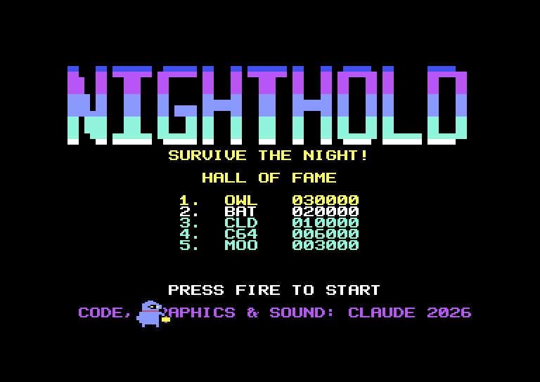
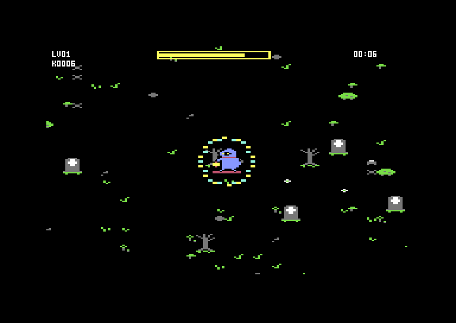
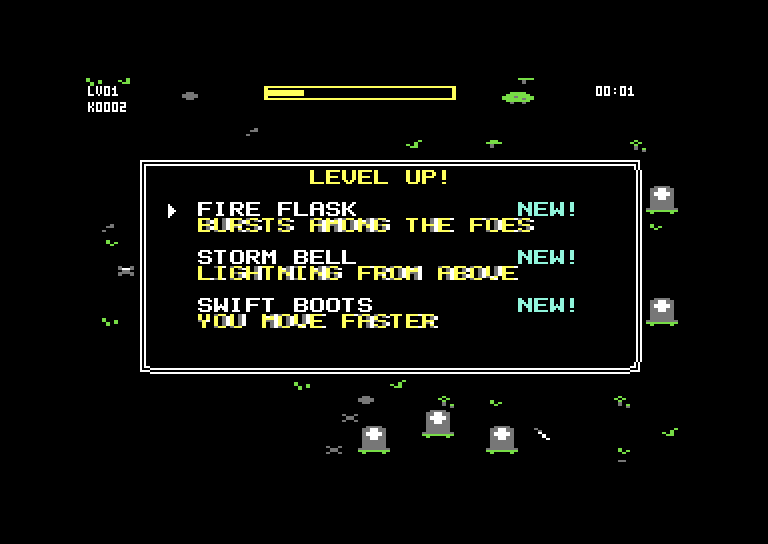
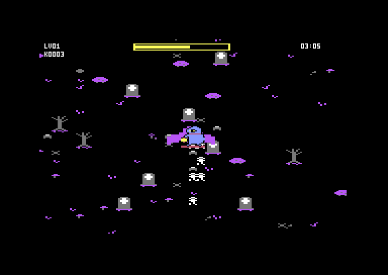
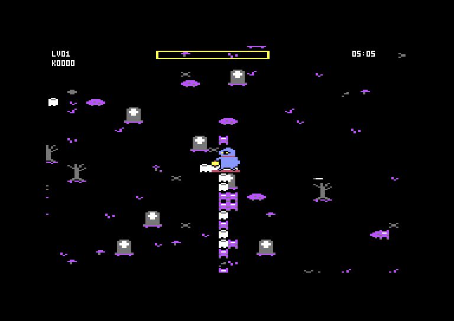
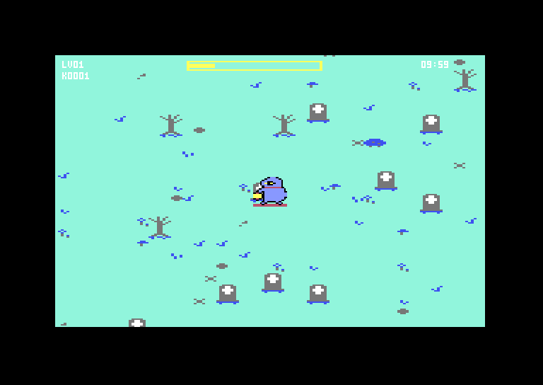
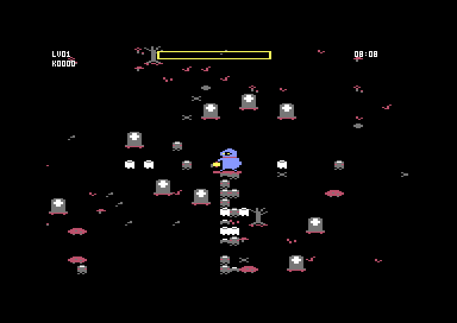
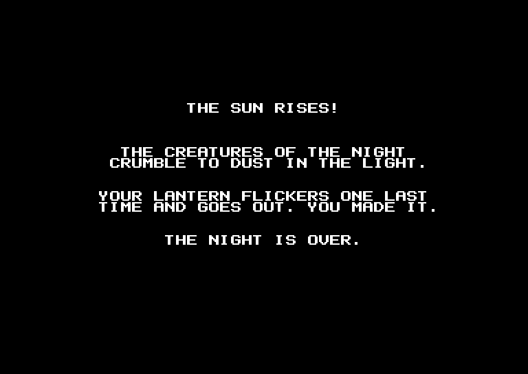
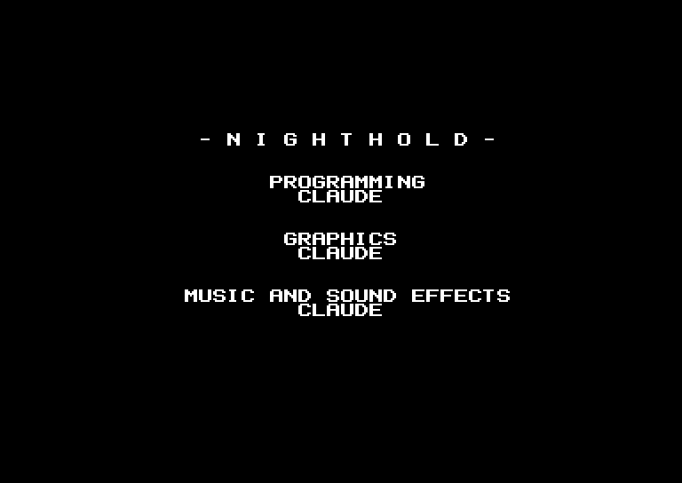
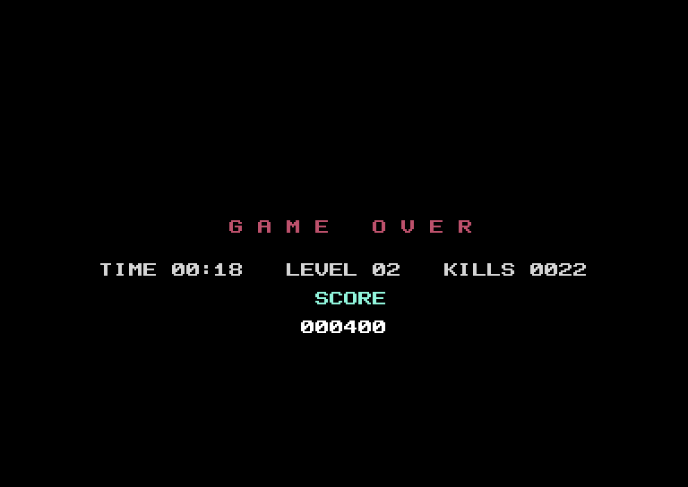

# NIGHTHOLD - a Horde Survival Game for the Commodore C64
NIGHTHOLD is a horde survival game for the Commodore C64, written from scratch in 6502 assembler. A lonely wanderer with a lantern has to survive one night on a haunted heath. Bats, zombies, skeletons, ghosts, ghouls and wraiths come out of the darkness in ever growing hordes. You only walk - your weapons fight on their own. Collect the gems the creatures leave behind, level up and choose new weapons and items, until the hero is surrounded by a whirl of knives, orbs, lightning and fire. Hold out ten minutes until dawn. The game is a tribute to the modern indie classic of 2022; all graphics, creatures and music are original.

- Smooth eight-way scrolling over a large wrapping map with graves, trees and bushes
- Up to 80 creatures at once in six kinds, plus three huge boss sprites at minutes 3, 6 and 9
- Five weapons and four items, each with several levels, chosen in a level-up menu
- The night slowly changes its colours from green to purple to blood red
- Health, experience, time, level and kills shown in sprites, so the whole screen stays free for the hordes
- Own SID music player with title, night, boss, dawn and game over music, sixteen sound effects
- Credits, hall of fame and a hidden cheat
- Disk version with fastloader, Magic Desk cartridge, single PRG and turbo tape



# How to Play
## Controls
Plug a joystick into **port 2**.

| Input | Action |
|:-|:-|
| Joystick | walk in eight directions |
| Joystick up/down, fire | choose an item in the level-up menu |
| `P` | pause (`RUN/STOP` during the pause quits to the title screen) |
| `M` | music on/off |

## The Game
The weapons attack automatically. At the start you only have the silver knives, which fly towards the nearest creature. Every creature you defeat leaves a gem; walk over it to collect experience. When the bar at the top is full, the game stops and offers three random choices: a new weapon, a new item or the next level of one you already have. Each level-up also heals a little.




| Weapon | Effect |
|:-|:-|
| Silver knives | thrown at the nearest creature, more knives per level, from level 5 they pierce |
| Lantern glow | a ring of light that burns every creature close to the hero, wider and stronger per level |
| Storm bell | lightning strikes random creatures on the screen |
| Spirit orbs | orbs that circle around the hero, up to four |
| Fire flask | bursts among the creatures and burns everything in the area |

| Item | Effect |
|:-|:-|
| Swift boots | the hero walks faster |
| Hourglass | all weapons reload faster |
| Lodestone | gems fly to you from further away |
| Iron heart | more maximum health, heals at once |

Weapons reach level 5, items level 3. Creatures that touch the hero hurt him; the health bar is drawn below the hero. Now and then a creature drops a heart that restores health. With every minute the night gets darker, new kinds of creatures appear and the hordes grow larger and faster. At minutes 3, 6 and 9 a boss joins the hunt: a giant bat, the ghoul king and finally the lord of the night. A defeated boss leaves a chest with a free level-up.




When the timer reaches ten minutes, the sun rises and all creatures crumble to dust. Every second survived is worth 10 points, every creature 10 points, a boss 1000 points and the dawn 5000 points. Good scores go into the hall of fame.



## Hidden Cheat
Type `CANDLE` on the title screen. A message confirms the cheat mode. Now the keys `0` to `9` choose the minute at which the night begins. In cheat mode the hero cannot be hurt.



# How it Works
## Memory Map
| Address | Content |
|:-|:-|
| `$0810-$16AC` | game code: drawing, creatures, text, input |
| `$4000-$47FF` | menu charset: font and logo (VIC bank 1) |
| `$4800-$4BFF` | screen A (also the menu screen) |
| `$4C00-$4FFF` | screen B |
| `$5000-$57BF` | 31 sprites: hero, aura, three bosses, status sprites |
| `$6000-$67FF` | game charset: font, ground, graves, trees, creatures, gems, weapons |
| `$6800-$7699` | SID player, title, game over, ending, hiscore |
| `$8000-$99FF` | map: 64 x 64 cells in rows of 104 bytes |
| `$9A00-$B9A4` | music, tables, weapons, game flow |
| `$C000-$C4EF` | variables: creatures, gems, knives, effects |
| `$E000-$EFFF` | occupancy grid of the creatures (RAM under the KERNAL) |

## Scrolling
The screen is a 40 x 25 window into a map of 64 x 64 cells that wraps around at the edges. Each map row is stored with the first 40 cells repeated at its end (104 bytes), so the window never has to be split horizontally. Two screens are used. Every second frame, while one screen is shown, the game rebuilds the other one completely: a fully unrolled `LDA (src),Y / STA (dst),Y` loop copies the 25 rows of the map window, then gems, creatures, effects, knives and orbs are drawn on top as characters. The fine scroll registers `$D016` and `$D011` shift the screen by the remaining 0 to 7 pixels in both directions, and the raster interrupt switches `$D018`, both scroll registers and the sprite pointers together in the frame after the new screen is finished. As the whole screen is rebuilt anyway, the colour RAM never has to move: the ground, the decorations and the creatures share the multicolour charset colours, which change with the time of night.

## Creatures
The creatures are characters, not sprites, so there can be many of them. Each has its own position on the map, hit points and a beat counter. A creature only thinks on its beat (fast bats more often than slow zombies), so the work is spread over the updates. It tries to step diagonally towards the hero, then along one axis, and every fourth beat sideways, which lets a horde flow around graves and around each other. The 64 x 64 occupancy grid under the KERNAL stores which creature stands on which cell, so blocking tests, knife hits, the lantern glow and the spirit orbs are simple table lookups instead of loops over all creatures. Creatures that fall too far behind are removed and come back from the edge of the screen. New creatures are spawned outside the visible window according to a wave table per minute that sets the kinds, the maximum number and the spawn interval.

## Sprites
The hero consists of a hires sprite for the outline and a multicolour sprite for the body; the health bar is copied into the body sprite whenever it changes. Expanded sprites show the lantern glow and the bosses. Four more sprites at the top show the time, level, kills and the experience bar; their digits are drawn with a tiny 3 x 5 font. The game logic of the next update runs before the game waits for the screen switch, so the creatures, weapons and drawing share two frames without a visible slowdown. On NTSC machines the game clock counts 60 frames per second, so the night lasts ten real minutes there too.



## Loaders
All three loaders share the same crunched game image. The game is packed with [TSCrunch](https://github.com/tonysavon/TSCrunch) into an image that can be decrunched in place, i.e. it is loaded directly below its final position and unpacked onto itself.

- **Disk:** the boot file transfers its drive code into the 1541 via `M-W` commands and starts it. The drive reads the sectors of the data file and sends every byte as four 2-bit pairs over the CLK and DATA lines of the serial bus. Each byte starts with a handshake, the four pairs follow with cycle-exact timing. The screen is switched off while loading, so that no badlines can disturb the timing. The loader works on PAL and NTSC machines. Both files are written with a sector interleave matched to the transfer speed.
- **Cartridge:** the boot code in bank 0 is started via the `CBM80` signature, copies the crunched image bank by bank from `$8000-$9FFF` into RAM, disables the cartridge by setting bit 7 of `$DE00` and jumps into the decruncher.
- **Tape:** a small boot program in standard KERNAL format is loaded first. It contains the turbo loader, which distinguishes short and long pulses with a CIA timer (threshold 280 cycles), assembles the bytes and verifies the loaded data with an XOR checksum. If the checksum does not match, the motor is stopped and the border turns red.



# Source Code
## Assembler Sources
The game is written in 6502 assembler for [64tass](https://sourceforge.net/projects/tass64/). `main.asm` includes all other files.

| File | Lines | Content |
|:-|-:|:-|
| `src/main.asm` | 310 | memory map, constants, variables, initialisation, segment layout, includes |
| `src/game.asm` | 1461 | game flow: hero, camera, time, bosses, level-up menu, dawn, pause, autopilot |
| `src/enemy.asm` | 725 | creatures: waves, spawning, movement, damage, gems, hearts, experience, effects |
| `src/weapon.asm` | 774 | weapons and items: knives, glow, bell, orbs, flask, boss hit tests |
| `src/draw.asm` | 713 | screen rebuild: map window, objects, palette, status sprites, health bar |
| `src/irq.asm` | 119 | menu IRQ and game IRQ with screen switch, fine scroll and sprites |
| `src/screens.asm` | 939 | title screen, game over, ending, credits, hiscore entry, cheat |
| `src/sound.asm` | 501 | SID music player (3 voices, instruments, arpeggios, vibrato) and sound effects |
| `src/util.asm` | 226 | text output, random numbers, keyboard scan, joystick, hiscores |

## Python Tools
The Python scripts generate all data of the game and package the distribution formats.

| File | Content |
|:-|:-|
| `tools/ngen.py` | build script for all generated data: charsets, map, sprites, tables, music |
| `tools/ngfx.py` | original graphics: ground, graves, trees, creatures, weapons, hero, bosses, logo |
| `tools/nmusic.py` | all compositions and sound effects of NIGHTHOLD |
| `tools/gfx.py` | shared graphics helpers and font |
| `tools/music.py` | music and sound effect compiler |
| `tools/package.py` | crunches the game and builds D64, BIN and CRT |
| `tools/d64.py` | minimal D64 image writer with custom sector interleave |
| `tools/crt.py` | writes the VICE CRT container for the Magic Desk ROM |
| `tools/mktap.py` | TAP v1 writer: KERNAL boot file plus turbo data block |

# Compiling the Source Code
## Requirements
- [64tass](https://sourceforge.net/projects/tass64/) cross assembler (version 1.59 or newer)
- [Python 3](https://www.python.org/) (only the standard library is needed for the build)
- [TSCrunch](https://github.com/tonysavon/TSCrunch) by Antonio Savona for crunching the game

## Building
All graphics, sprites, level data and music are generated by Python scripts at build time, there are no binary assets in the repository. A single script creates the game and all five distribution formats:
```
cd sources
./build.sh
```
If `tscrunch` is not in your `PATH`, pass its location: `TSCRUNCH=/path/to/tscrunch ./build.sh`. The finished files are placed in `sources/build/release`. Intermediate files (listings, label files, generated data) remain in `sources/build`, the label file `nighthold.lbl` is handy for debugging with the VICE monitor.

The build runs the following steps:
1. `tools/ngen.py` generates the charset, the sprites, all tables, the level data and the music into `build/`.
2. `64tass` assembles `src/main.asm` into the uncompressed game `build/nighthold.prg` (start address `$0810`).
3. `tools/package.py` crunches the game with TSCrunch into an in-place decrunching image and builds the D64 (with boot loader), the BIN and the CRT.
4. TSCrunch creates the self-extracting single file PRG.
5. The tape boot loader is assembled and `tools/mktap.py` writes the TAP image.

## Folder Structure
```
sources/
├── build.sh            build script for all formats
├── src/                6502 assembler sources (64tass)
│   ├── main.asm        memory map, includes
│   ├── game.asm        game flow
│   ├── enemy.asm       creatures
│   ├── weapon.asm      weapons and items
│   ├── ...             see table above
│   └── loader/
│       ├── boot.asm    disk boot program + 1541 drive code (2-bit fastloader)
│       ├── cart.asm    Magic Desk cartridge boot code
│       ├── tapeboot.asm turbo tape boot loader
│       └── decrunch.asm TSCrunch in-place decruncher
└── tools/              Python build tools
    ├── ngen.py         generates all game data
    ├── ngfx.py         graphics
    ├── nmusic.py       music
    ├── gfx.py          graphics helpers
    ├── music.py        music compiler
    ├── package.py      crunching, D64, BIN and CRT creation
    ├── d64.py          minimal D64 writer with custom sector interleave
    ├── crt.py          Magic Desk CRT file writer
    └── mktap.py        TAP image writer (KERNAL boot file + turbo blocks)
```

# Using the Binaries
The [binaries](binaries/) folder contains the game in five ready-to-use formats. All of them start the same game; they only differ in the medium and the loader.

| File | Format | Loader | Typical use |
|:-|:-|:-|:-|
| `nighthold.d64` | 1541 disk image | own 2-bit fastloader (~5 s) | emulators, real 1541 floppy, Ultimate 64/II |
| `nighthold.crt` | Magic Desk cartridge (VICE CRT) | copies from ROM, starts in ~1 s | emulators, Ultimate 64/II, Kung Fu Flash |
| `nighthold.bin` | raw 64 KB Magic Desk ROM | as above | burning an (E)EPROM for a real cartridge |
| `nighthold.prg` | single self-extracting PRG | standard KERNAL loader | emulators, SD2IEC, any file based device |
| `nighthold.tap` | tape image (TAP v1) | own turbo loader (~0:56 min) | emulators, Tapuino, real datasette |

## D64 - Disk Image with Fastloader
Load and start the game with:
```
LOAD"*",8,1
RUN
```
The first file is a tiny boot program. It uploads its own drive code into the 1541, which then sends the crunched game file (the second directory entry, `nighthold data`) with a 2-bit protocol to the C64. The game is decrunched in place and starts automatically. Loading takes about five seconds instead of about 45 seconds with the standard loader.

Because the fastloader runs code inside the floppy drive, it needs a real 1541/1541-II/1571 or an accurate drive emulation (VICE with "True Drive Emulation", Ultimate 64/II, Pi1541). Pure file-based devices like the [SD2IEC](https://github.com/wagiminator/C64-Collection/tree/master/C64_SD2IEC_LP) cannot run drive code; please use the PRG file there.

**In an emulator:** drag and drop the D64 onto [VICE](https://vice-emu.sourceforge.io/) or open it in the [C64 Emulator Web App](https://wagiminator.github.io/apps/c64-emulator/) directly in your browser.

**On a real floppy disk:** write the D64 to a disk with a [DiskBuddy64](https://github.com/wagiminator/C64-Collection/tree/master/C64_DiskBuddy64), [DiskMaster64](https://github.com/wagiminator/C64-Collection/tree/master/C64_DiskMaster64) or [DumpMaster64](https://github.com/wagiminator/C64-Collection/tree/master/C64_DumpMaster64) adapter, either with the Python tools of the respective adapter or directly from the browser with the [C64 Disk Transfer Web App](https://wagiminator.github.io/apps/d64-transfer/). Alternatively, an [xu1541](https://github.com/wagiminator/C64-Collection/tree/master/C64_xu1541) with OpenCBM can be used. If you want to have a look at the disk structure or add the game to your own disk image, use the [C64 Disk Viewer](https://wagiminator.github.io/apps/d64-viewer/) and the [C64 Disk Editor](https://wagiminator.github.io/apps/d64-editor/).

## CRT and BIN - Magic Desk Cartridge
The game is also available as a 64 KB cartridge in Magic Desk format (eight 8 KB banks, bank register at `$DE00`). After switching on, the boot code in bank 0 copies the crunched game into RAM, switches the cartridge off and decrunches the game. It is ready about one second after power-on.

**In an emulator or on modern hardware:** the CRT file can be attached in VICE (`File` -> `Attach cartridge image`), in the [C64 Emulator Web App](https://wagiminator.github.io/apps/c64-emulator/), on an Ultimate 64/II or a Kung Fu Flash.

**As a real cartridge:** the BIN file is the raw 64 KB ROM image. Burn it into a 27C512/28C512 (E)EPROM and plug it into the [C64 64k/256k Cartridge](https://github.com/wagiminator/C64-Collection/tree/master/C64_Cartridge_64k_256k). For programming the (E)EPROM, a TL866/T48 programmer can be used together with the [XGecu Memory Programmer Web App](https://wagiminator.github.io/apps/tinypro/) or the Python tool [tinypro](https://pypi.org/project/tinypro/). If you want to combine several games on one cartridge with a selection menu, put the PRG files into the [C64 Cartridge Builder Web App](https://wagiminator.github.io/apps/cart-builder/).

## PRG - Single File
The PRG is the complete game as one self-extracting file. Load it with:
```
LOAD"NIGHTHOLD",8
RUN
```
It works with every device that can load files with the standard KERNAL routines, e.g. an [SD2IEC](https://github.com/wagiminator/C64-Collection/tree/master/C64_SD2IEC_LP), an Ultimate 64/II, a Kung Fu Flash or a real floppy disk (copy it onto a disk with the [C64 Disk Editor](https://wagiminator.github.io/apps/d64-editor/) and the [C64 Disk Transfer Web App](https://wagiminator.github.io/apps/d64-transfer/)). Since the standard loader is slow, loading from a real 1541 takes considerably longer than the D64 version. A fastload cartridge like the [C64 FreeLoad Cartridge](https://github.com/wagiminator/C64-Collection/tree/master/C64_Cartridge_FreeLoad) speeds this up nicely. In emulators the PRG can simply be autostarted.

## TAP - Tape Image with Turbo Loader
Insert the tape (or attach the TAP file in your emulator), then press `SHIFT` + `RUN/STOP` (or type `LOAD` and later `RUN`) and press PLAY on the datasette. The KERNAL first loads a small boot loader. This turbo loader then switches the datasette motor on again and reads the crunched game in its own pulse format (bit 0 = 208 cycles, bit 1 = 352 cycles). Coloured stripes in the border show the loading progress, a red border indicates a loading error. The whole process takes about 0:56 minutes instead of about seven minutes with the standard KERNAL loader.

**In an emulator:** attach the TAP file to the datasette in VICE or load it into the [C64 Emulator Web App](https://wagiminator.github.io/apps/c64-emulator/).

**With a datasette emulator:** copy the TAP file onto the SD card of a [Tapuino](https://github.com/wagiminator/C64-Collection/tree/master/C64_Tapuino).

**On a real cassette:** record the TAP file onto a tape with a [TapeBuddy64](https://github.com/wagiminator/C64-Collection/tree/master/C64_TapeBuddy64), [TapeDump64](https://github.com/wagiminator/C64-Collection/tree/master/C64_TapeDump64) or [DumpMaster64](https://github.com/wagiminator/C64-Collection/tree/master/C64_DumpMaster64), either with the Python tools of the respective adapter or directly from the browser with the [C64 Tape Transfer Web App](https://wagiminator.github.io/apps/tap-transfer/).

# References, Links and Notes
1. [Vampire Survivors on Wikipedia](https://en.wikipedia.org/wiki/Vampire_Survivors)
2. [Bullet heaven on Wikipedia](https://en.wikipedia.org/wiki/Bullet_heaven)
3. [64tass Cross Assembler](https://sourceforge.net/projects/tass64/)
4. [TSCrunch by Antonio Savona](https://github.com/tonysavon/TSCrunch)
5. [VICE - the Versatile Commodore Emulator](https://vice-emu.sourceforge.io/)
6. [C64 Emulator Web App](https://wagiminator.github.io/apps/c64-emulator/)
7. [C64 Disk Transfer Web App](https://wagiminator.github.io/apps/d64-transfer/)
8. [C64 Tape Transfer Web App](https://wagiminator.github.io/apps/tap-transfer/)
9. [C64 Cartridge Builder Web App](https://wagiminator.github.io/apps/cart-builder/)
10. [XGecu Memory Programmer Web App](https://wagiminator.github.io/apps/tinypro/)
11. [C64 Collection (adapters and cartridges)](https://github.com/wagiminator/C64-Collection)
12. [Christian Bauer: The MOS 6567/6569 video controller (VIC-II)](https://www.zimmers.net/cbmpics/cbm/c64/vic-ii.txt)
13. [Codebase64 Wiki](https://codebase64.org/)



# License


This work is licensed under Creative Commons Attribution-ShareAlike 3.0 Unported License.
(http://creativecommons.org/licenses/by-sa/3.0/)
