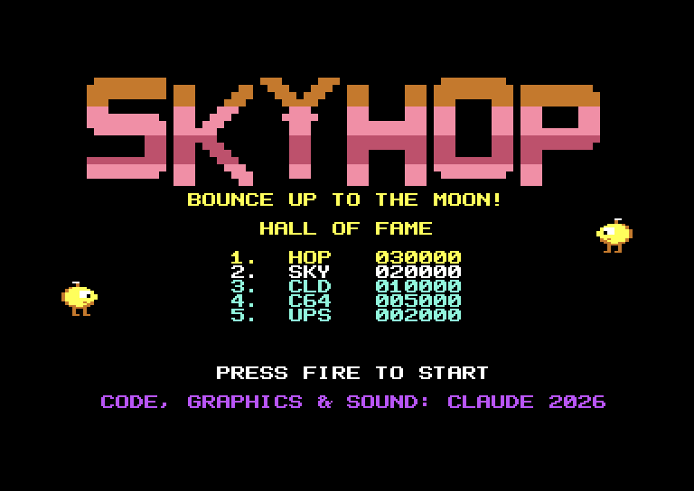
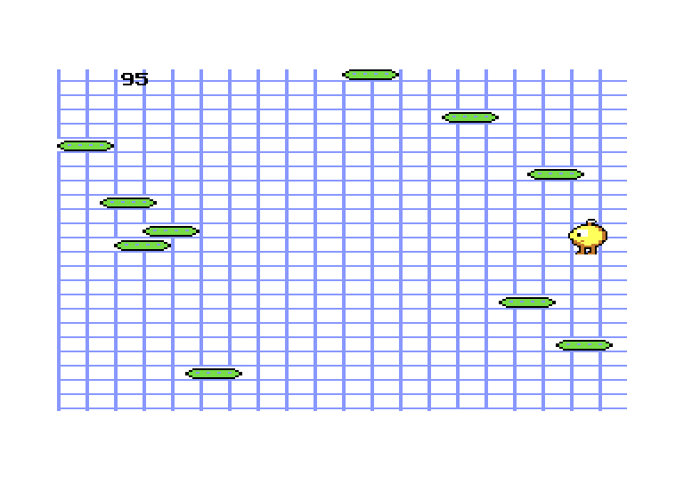
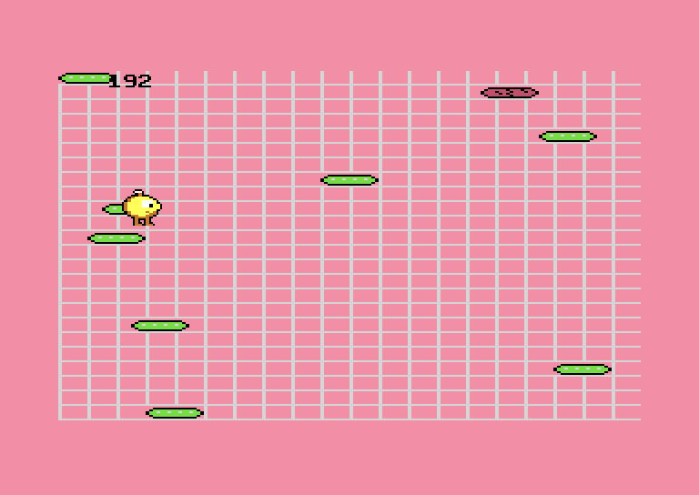
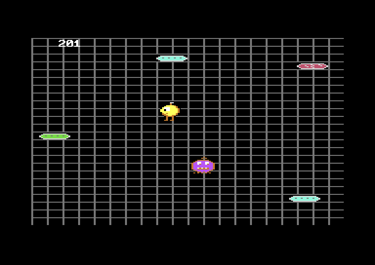
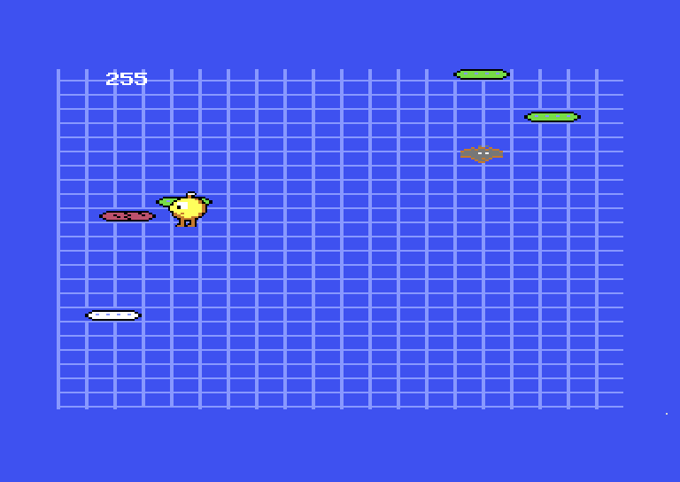
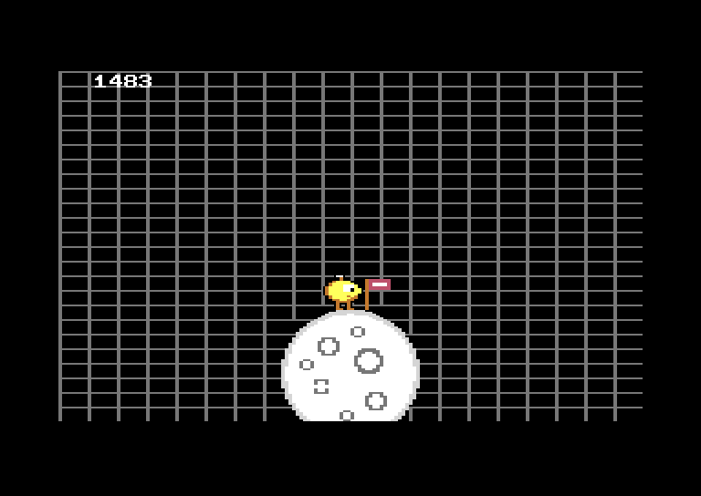
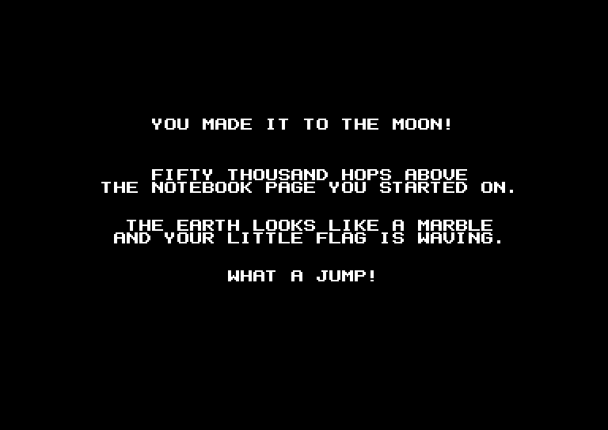

# SKYHOP - Bounce up to the Moon on the Commodore C64
SKYHOP is an endless jumping game for the Commodore C64, written from scratch in 6502 assembler. A little yellow hopper bounces from platform to platform, higher and higher, from a notebook page through the day sky, the sunset and the night up into space, until the moon comes into sight. Springs, propeller hats and jetpacks send it flying, monsters have to be stomped or shot, black holes must be avoided, and one wrong step means a long fall. The game is a tribute to the modern mobile classic of 2009; all graphics, levels and music are original.

- Smooth vertical scrolling over a checkered paper background, double-buffered screens
- Endless, procedurally generated tower of platforms that gets harder the higher you climb
- Normal, moving, breaking and vanishing platforms, springs, propeller hats and jetpacks
- Three kinds of monsters, bullets, wrap-around at the screen edges
- Five sky zones with their own colours and an ending on the moon at 50000 points
- Own SID music player with in-game music (can be switched off), sound effects
- Credits, hall of fame and a hidden cheat
- Disk version with fastloader, Magic Desk cartridge, single PRG and turbo tape



# How to Play
## Controls
Plug a joystick into **port 2**.

| Input | Action |
|:-|:-|
| Left / right | move; leave the screen on one side to come back on the other |
| Fire | shoot upwards |
| `P` | pause (`RUN/STOP` during the pause quits to the title screen) |
| `M` | music on/off |

## The Game
The hopper jumps all by itself whenever it lands on a platform; you only steer it left and right. The screen follows it upwards but never down: whoever misses the platforms and falls out of the bottom of the screen has lost. Your score is the height you have reached.

| Object | Effect |
|:-|:-|
| green platform | a normal jump |
| cyan platform | moves to and fro |
| red platform | cracked: it breaks under your feet, no jump |
| white platform | carries you only once, then it vanishes |
| spring | a jump three times as high |
| propeller hat | flies you up for three seconds |
| jetpack | flies you up even faster |
| purple blob, bat | jump on them to squash them, or shoot them; touching them from the side or from below is fatal |
| black hole | swallows everything, even bullets: keep away |

The higher you get, the farther apart the platforms are and the more moving, breaking and vanishing platforms and monsters appear. The sky changes on the way: from the notebook page (0) into the day sky (5000), the sunset (12000), the night (22000) and finally space (35000). At 50000 points the moon is waiting: land on it to plant your flag and see the ending. While flying with a hat or a jetpack you cannot be hurt and you simply ram the monsters out of the way. Good scores are entered into the hall of fame with your initials; the table is kept until the computer is switched off.



## Hidden Cheat
Type `SPRING` on the title screen. A red message confirms the cheat mode. Now the keys `1` to `6` choose the start height: `1` to `5` start in one of the five sky zones, `6` just below the moon. In cheat mode a safety net throws the hopper back up when it falls out of the screen, and monsters and black holes are harmless.



# How it Works
## Memory Map
| Address | Content |
|:-|:-|
| `$0810-$1DBF` | game code |
| `$4000-$47FF` | charset: font, logo, paper, platforms, items and moon (VIC bank 1) |
| `$4800-$4BFF` | screen A |
| `$4C00-$4FFF` | screen B |
| `$5000-$5B3F` | 45 sprites: hopper, monsters, bullet, flag and the score sprites |
| `$6000-$6EFF` | SID player, sound effects, title, game over, ending and hiscore screens |
| `$8000-$8D2F` | music, shapes, difficulty tables, generated data |
| `$C000-$C3FF` | variables |

## Scrolling and Drawing
The playfield is a multicolour character screen in 24-row mode, scrolled with the hardware fine scroll of `$D011`. The camera position in pixels selects the fine scroll (camera & 7) and the world row shown at the top of the screen (camera / 8). The paper is a single character with a horizontal grid line, alternating with a second one that adds a vertical line on every other column, so the paper looks the same in every row and never needs to be redrawn while scrolling.

Everything on the paper is an object in a list of 24 slots: platforms, springs, items and the moon. Each object type has a shape of characters (a moving platform has four shapes, shifted by one multicolour pixel each). Two screens are used alternately: every frame the game compares where each object should be on the hidden screen with where it was drawn there two frames ago, erases the old cells (paper) and draws the new ones. Only the few changed cells are written, so even a coarse scroll step costs very little time. A raster interrupt below the playfield then shows the new screen, sets the fine scroll and the sprite registers in one go, so everything moves without tearing.

The colours come from the multicolour registers: `$D021` is the paper, `$D022` the grid lines, `$D023` the outlines of all objects and colour RAM the fill colour of each object. Changing the sky zone therefore only means changing three registers.



## Physics and Generation
The hopper has a vertical speed in 8.8 fixed point and is pulled down by gravity every frame. Platforms only count when the feet cross their top from above, so the hopper jumps through them from below. Horizontal movement uses acceleration and friction; the x position wraps around at the screen edges, and a second pair of sprites shows the part that already appears on the other side.

The tower is generated on the fly above the screen. Sixteen difficulty levels (one every 3072 pixels) define the gaps between the platforms (from 24 to 80 pixels, a jump reaches about 107), the chances for moving, vanishing and breaking platforms, for springs and items, and the distance between monsters. A main platform is always reachable from the previous one; breaking platforms are only decoys in between. Objects that have left the screen at the bottom free their slots again.

## Sprites
The hopper consists of a hires sprite for the black outline and the eyes on top of a multicolour sprite for the body. The score is drawn into two hires sprites with the digits of the character set, alternately for both screens. One sprite is used for the monster (there is never more than one on the screen), one for the bullet and two for the wrap-around copy of the hopper. On NTSC machines every sixth game step is skipped, so the game runs at the same speed as on PAL.

## Loaders
All three loaders share the same crunched game image. The game is packed with [TSCrunch](https://github.com/tonysavon/TSCrunch) into an image that can be decrunched in place, i.e. it is loaded directly below its final position and unpacked onto itself.

- **Disk:** the boot file transfers its drive code into the 1541 via `M-W` commands and starts it. The drive reads the sectors of the data file and sends every byte as four 2-bit pairs over the CLK and DATA lines of the serial bus. Each byte starts with a handshake, the four pairs follow with cycle-exact timing. The screen is switched off while loading, so that no badlines can disturb the timing. The loader works on PAL and NTSC machines. Both files are written with a sector interleave matched to the transfer speed.
- **Cartridge:** the boot code in bank 0 is started via the `CBM80` signature, copies the crunched image bank by bank from `$8000-$9FFF` into RAM, disables the cartridge by setting bit 7 of `$DE00` and jumps into the decruncher.
- **Tape:** a small boot program in standard KERNAL format is loaded first. It contains the turbo loader, which distinguishes short and long pulses with a CIA timer (threshold 280 cycles), assembles the bytes and verifies the loaded data with an XOR checksum. If the checksum does not match, the motor is stopped and the border turns red.



# Source Code
## Assembler Sources
The game is written in 6502 assembler for [64tass](https://sourceforge.net/projects/tass64/). `main.asm` includes all other files.

| File | Lines | Content |
|:-|-:|:-|
| `src/main.asm` | 320 | memory map, constants, variables, initialisation, segment layout, includes |
| `src/game.asm` | 362 | game flow: start, main loop, zones, moving/breaking/vanishing platforms, pause, music key, moon ending |
| `src/world.asm` | 691 | object list, platform generator, desired shapes, drawing and erasing on the hidden screen |
| `src/player.asm` | 774 | controls, physics, landing, springs, items, shooting, falling, camera, autopilot for testing |
| `src/monster.asm` | 246 | monsters, stomping, bullets |
| `src/hud.asm` | 362 | score sprites and the sprite shadow registers |
| `src/irq.asm` | 121 | menu IRQ and the game IRQ that swaps screens and sprites |
| `src/screens.asm` | 940 | title screen, game over, ending, credits, hiscore entry, cheat |
| `src/sound.asm` | 500 | SID music player (3 voices, instruments, arpeggios, vibrato) and sound effects |
| `src/util.asm` | 209 | text output, BCD score, random numbers, keyboard scan, joystick, hiscores |

## Python Tools
The Python scripts generate all data of the game and package the distribution formats.

| File | Content |
|:-|:-|
| `tools/hgen.py` | build script for all generated data: charset, sprites, shapes, difficulty tables, music |
| `tools/hgfx.py` | original graphics: paper, platforms, springs, items, moon, hopper, monsters, logo |
| `tools/hmusic.py` | all compositions and sound effects of SKYHOP |
| `tools/gfx.py` | shared graphics helpers and font |
| `tools/music.py` | music and sound effect compiler |
| `tools/package.py` | crunches the game and builds D64, BIN and CRT |
| `tools/d64.py` | minimal D64 image writer with custom sector interleave |
| `tools/crt.py` | writes the VICE CRT container for the Magic Desk ROM |
| `tools/mktap.py` | TAP v1 writer: KERNAL boot file plus turbo data block |

# Compiling the Source Code
## Requirements
- [64tass](https://sourceforge.net/projects/tass64/) cross assembler (version 1.59 or newer)
- [Python 3](https://www.python.org/) (only the standard library is needed for the build)
- [TSCrunch](https://github.com/tonysavon/TSCrunch) by Antonio Savona for crunching the game

## Building
All graphics, sprites, level data and music are generated by Python scripts at build time, there are no binary assets in the repository. A single script creates the game and all five distribution formats:
```
cd sources
./build.sh
```
If `tscrunch` is not in your `PATH`, pass its location: `TSCRUNCH=/path/to/tscrunch ./build.sh`. The finished files are placed in `sources/build/release`. Intermediate files (listings, label files, generated data) remain in `sources/build`, the label file `skyhop.lbl` is handy for debugging with the VICE monitor.

The build runs the following steps:
1. `tools/hgen.py` generates the charset, the sprites, all tables, the level data and the music into `build/`.
2. `64tass` assembles `src/main.asm` into the uncompressed game `build/skyhop.prg` (start address `$0810`).
3. `tools/package.py` crunches the game with TSCrunch into an in-place decrunching image and builds the D64 (with boot loader), the BIN and the CRT.
4. TSCrunch creates the self-extracting single file PRG.
5. The tape boot loader is assembled and `tools/mktap.py` writes the TAP image.

## Folder Structure
```
sources/
├── build.sh            build script for all formats
├── src/                6502 assembler sources (64tass)
│   ├── main.asm        memory map, includes
│   ├── game.asm        game flow
│   ├── world.asm       platforms and drawing
│   ├── player.asm      hopper physics
│   ├── ...             see table above
│   └── loader/
│       ├── boot.asm    disk boot program + 1541 drive code (2-bit fastloader)
│       ├── cart.asm    Magic Desk cartridge boot code
│       ├── tapeboot.asm turbo tape boot loader
│       └── decrunch.asm TSCrunch in-place decruncher
└── tools/              Python build tools
    ├── hgen.py         generates all game data
    ├── hgfx.py         graphics
    ├── hmusic.py       music
    ├── gfx.py          graphics helpers
    ├── music.py        music compiler
    ├── package.py      crunching, D64, BIN and CRT creation
    ├── d64.py          minimal D64 writer with custom sector interleave
    ├── crt.py          Magic Desk CRT file writer
    └── mktap.py        TAP image writer (KERNAL boot file + turbo blocks)
```

# Using the Binaries
The [binaries](binaries/) folder contains the game in five ready-to-use formats. All of them start the same game; they only differ in the medium and the loader.

| File | Format | Loader | Typical use |
|:-|:-|:-|:-|
| `skyhop.d64` | 1541 disk image | own 2-bit fastloader (~5 s) | emulators, real 1541 floppy, Ultimate 64/II |
| `skyhop.crt` | Magic Desk cartridge (VICE CRT) | copies from ROM, starts in ~1 s | emulators, Ultimate 64/II, Kung Fu Flash |
| `skyhop.bin` | raw 64 KB Magic Desk ROM | as above | burning an (E)EPROM for a real cartridge |
| `skyhop.prg` | single self-extracting PRG | standard KERNAL loader | emulators, SD2IEC, any file based device |
| `skyhop.tap` | tape image (TAP v1) | own turbo loader (~0:50 min) | emulators, Tapuino, real datasette |

## D64 - Disk Image with Fastloader
Load and start the game with:
```
LOAD"*",8,1
RUN
```
The first file is a tiny boot program. It uploads its own drive code into the 1541, which then sends the crunched game file (the second directory entry, `skyhop data`) with a 2-bit protocol to the C64. The game is decrunched in place and starts automatically. Loading takes about five seconds instead of about 45 seconds with the standard loader.

Because the fastloader runs code inside the floppy drive, it needs a real 1541/1541-II/1571 or an accurate drive emulation (VICE with "True Drive Emulation", Ultimate 64/II, Pi1541). Pure file-based devices like the [SD2IEC](https://github.com/wagiminator/C64-Collection/tree/master/C64_SD2IEC_LP) cannot run drive code; please use the PRG file there.

**In an emulator:** drag and drop the D64 onto [VICE](https://vice-emu.sourceforge.io/) or open it in the [C64 Emulator Web App](https://wagiminator.github.io/apps/c64-emulator/) directly in your browser.

**On a real floppy disk:** write the D64 to a disk with a [DiskBuddy64](https://github.com/wagiminator/C64-Collection/tree/master/C64_DiskBuddy64), [DiskMaster64](https://github.com/wagiminator/C64-Collection/tree/master/C64_DiskMaster64) or [DumpMaster64](https://github.com/wagiminator/C64-Collection/tree/master/C64_DumpMaster64) adapter, either with the Python tools of the respective adapter or directly from the browser with the [C64 Disk Transfer Web App](https://wagiminator.github.io/apps/d64-transfer/). Alternatively, an [xu1541](https://github.com/wagiminator/C64-Collection/tree/master/C64_xu1541) with OpenCBM can be used. If you want to have a look at the disk structure or add the game to your own disk image, use the [C64 Disk Viewer](https://wagiminator.github.io/apps/d64-viewer/) and the [C64 Disk Editor](https://wagiminator.github.io/apps/d64-editor/).

## CRT and BIN - Magic Desk Cartridge
The game is also available as a 64 KB cartridge in Magic Desk format (eight 8 KB banks, bank register at `$DE00`). After switching on, the boot code in bank 0 copies the crunched game into RAM, switches the cartridge off and decrunches the game. It is ready about one second after power-on.

**In an emulator or on modern hardware:** the CRT file can be attached in VICE (`File` -> `Attach cartridge image`), in the [C64 Emulator Web App](https://wagiminator.github.io/apps/c64-emulator/), on an Ultimate 64/II or a Kung Fu Flash.

**As a real cartridge:** the BIN file is the raw 64 KB ROM image. Burn it into a 27C512/28C512 (E)EPROM and plug it into the [C64 64k/256k Cartridge](https://github.com/wagiminator/C64-Collection/tree/master/C64_Cartridge_64k_256k). For programming the (E)EPROM, a TL866/T48 programmer can be used together with the [XGecu Memory Programmer Web App](https://wagiminator.github.io/apps/tinypro/) or the Python tool [tinypro](https://pypi.org/project/tinypro/). If you want to combine several games on one cartridge with a selection menu, put the PRG files into the [C64 Cartridge Builder Web App](https://wagiminator.github.io/apps/cart-builder/).

## PRG - Single File
The PRG is the complete game as one self-extracting file. Load it with:
```
LOAD"SKYHOP",8
RUN
```
It works with every device that can load files with the standard KERNAL routines, e.g. an [SD2IEC](https://github.com/wagiminator/C64-Collection/tree/master/C64_SD2IEC_LP), an Ultimate 64/II, a Kung Fu Flash or a real floppy disk (copy it onto a disk with the [C64 Disk Editor](https://wagiminator.github.io/apps/d64-editor/) and the [C64 Disk Transfer Web App](https://wagiminator.github.io/apps/d64-transfer/)). Since the standard loader is slow, loading from a real 1541 takes considerably longer than the D64 version. A fastload cartridge like the [C64 FreeLoad Cartridge](https://github.com/wagiminator/C64-Collection/tree/master/C64_Cartridge_FreeLoad) speeds this up nicely. In emulators the PRG can simply be autostarted.

## TAP - Tape Image with Turbo Loader
Insert the tape (or attach the TAP file in your emulator), then press `SHIFT` + `RUN/STOP` (or type `LOAD` and later `RUN`) and press PLAY on the datasette. The KERNAL first loads a small boot loader. This turbo loader then switches the datasette motor on again and reads the crunched game in its own pulse format (bit 0 = 208 cycles, bit 1 = 352 cycles). Coloured stripes in the border show the loading progress, a red border indicates a loading error. The whole process takes about 0:50 minutes instead of about seven minutes with the standard KERNAL loader.

**In an emulator:** attach the TAP file to the datasette in VICE or load it into the [C64 Emulator Web App](https://wagiminator.github.io/apps/c64-emulator/).

**With a datasette emulator:** copy the TAP file onto the SD card of a [Tapuino](https://github.com/wagiminator/C64-Collection/tree/master/C64_Tapuino).

**On a real cassette:** record the TAP file onto a tape with a [TapeBuddy64](https://github.com/wagiminator/C64-Collection/tree/master/C64_TapeBuddy64), [TapeDump64](https://github.com/wagiminator/C64-Collection/tree/master/C64_TapeDump64) or [DumpMaster64](https://github.com/wagiminator/C64-Collection/tree/master/C64_DumpMaster64), either with the Python tools of the respective adapter or directly from the browser with the [C64 Tape Transfer Web App](https://wagiminator.github.io/apps/tap-transfer/).

# References, Links and Notes
1. [Doodle Jump on Wikipedia](https://en.wikipedia.org/wiki/Doodle_Jump)
2. [64tass Cross Assembler](https://sourceforge.net/projects/tass64/)
3. [TSCrunch by Antonio Savona](https://github.com/tonysavon/TSCrunch)
4. [VICE - the Versatile Commodore Emulator](https://vice-emu.sourceforge.io/)
5. [C64 Emulator Web App](https://wagiminator.github.io/apps/c64-emulator/)
6. [C64 Disk Transfer Web App](https://wagiminator.github.io/apps/d64-transfer/)
7. [C64 Tape Transfer Web App](https://wagiminator.github.io/apps/tap-transfer/)
8. [C64 Cartridge Builder Web App](https://wagiminator.github.io/apps/cart-builder/)
9. [XGecu Memory Programmer Web App](https://wagiminator.github.io/apps/tinypro/)
10. [C64 Collection (adapters and cartridges)](https://github.com/wagiminator/C64-Collection)
11. [Christian Bauer: The MOS 6567/6569 video controller (VIC-II)](https://www.zimmers.net/cbmpics/cbm/c64/vic-ii.txt)
12. [Codebase64 Wiki](https://codebase64.org/)




# License


This work is licensed under Creative Commons Attribution-ShareAlike 3.0 Unported License.
(http://creativecommons.org/licenses/by-sa/3.0/)
