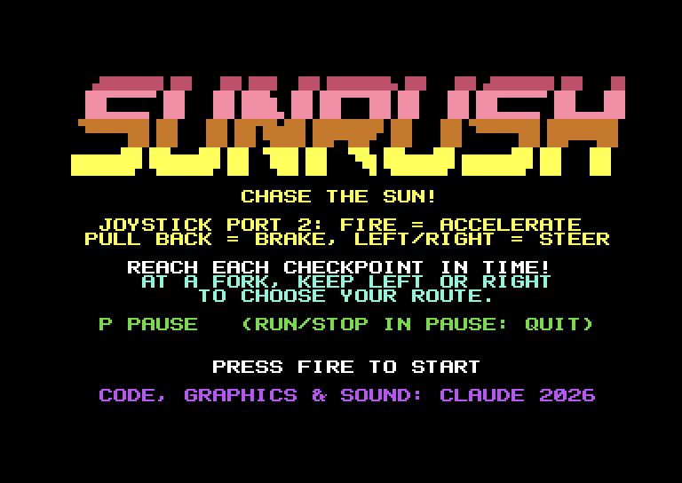
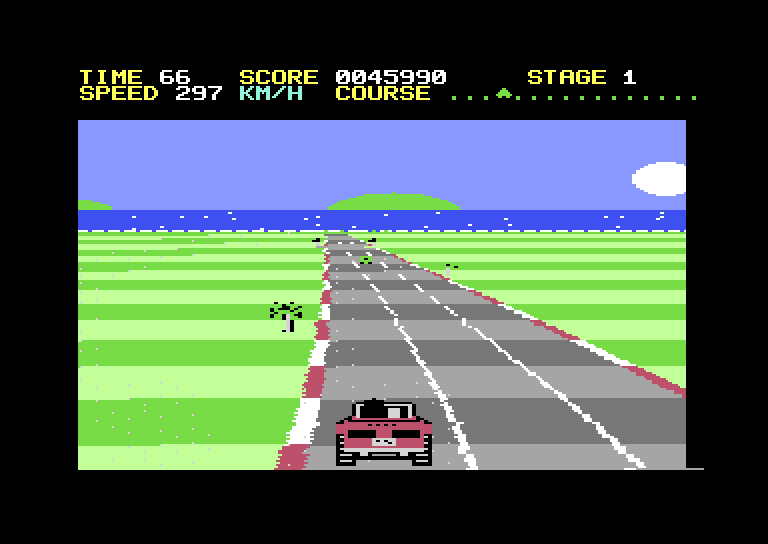
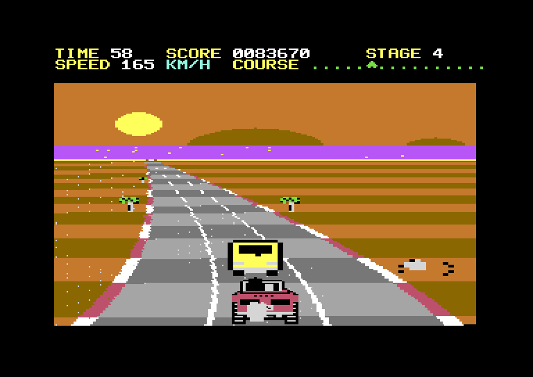
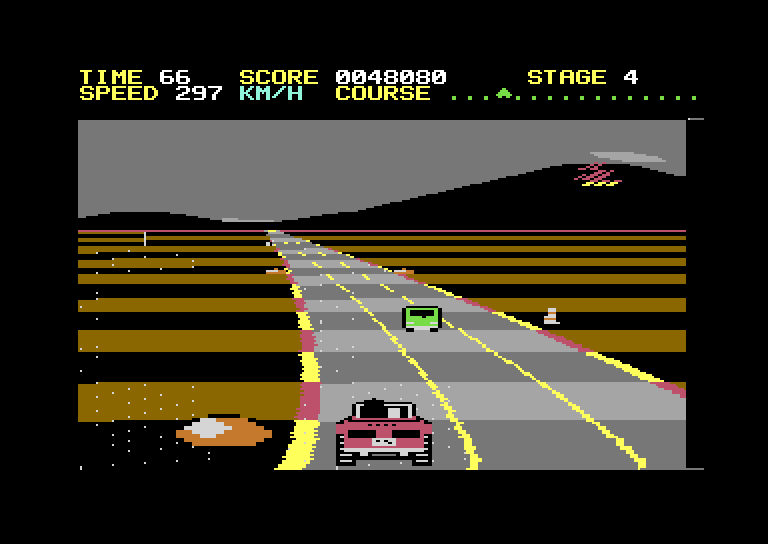
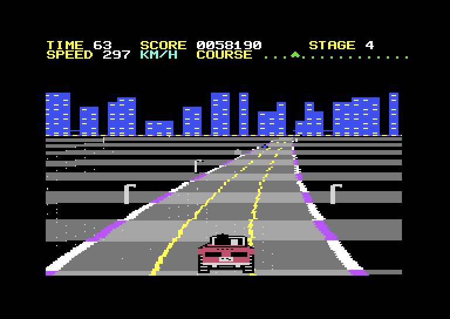
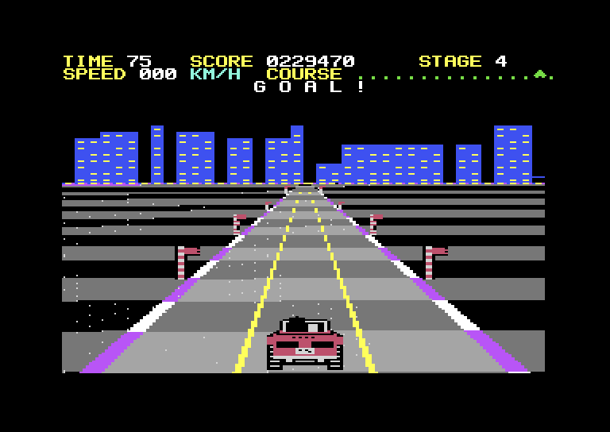

# SUNRUSH - Chase the Sun on the Commodore C64
SUNRUSH is a pseudo 3D arcade racing game for the Commodore C64, written from scratch in 6502 assembler. Take the wheel of an open roadster, turn on the radio and race against the clock along a sunny coast, through canyons, snow-covered passes and volcanic wastelands to one of four goals. At every checkpoint the road forks: keep left or right and choose your own route across the country. The game is a tribute to the legendary arcade racer of 1986, all graphics, tracks and music are original.

- Ten stages in four legs, arranged as a pyramid: eight different routes to four goals with their own ending
- Road forks at every checkpoint, time extension for each reached checkpoint
- Smooth curves, a striped road surface and alternating grass, kerb and lane colours changed on every single raster line
- Sheared road templates keep the road edges smooth even in the sharpest bends
- Centrifugal force that grows with the square of the speed
- Roadside objects and traffic cars as scaled multicolour sprites in five sizes, collisions with both
- Five kinds of scenery (sea, mesas, hills, skyline, volcano) in ten colour schemes, panning with the curves
- Radio select before the race: three tunes or the pure engine sound
- Own SID music player with seven songs, sound effects and a rumbling engine sound
- Ending sequences, credits and hiscore table
- Disk version with fastloader, Magic Desk cartridge, single PRG and turbo tape



# How to Play
## Controls
Plug a joystick into **port 2**.

| Input | Action |
|:-|:-|
| Fire | accelerate |
| Pull back | brake |
| Left / right | steer |
| Up / down and fire (radio screen) | choose a radio station and start the race |
| `P` | pause |
| `RUN/STOP` (during pause) | quit the race and return to the title screen |

## The Race
Before the start you tune in the radio: BEACH BREEZE, NIGHT HIGHWAY, SUMMER SKIES or just the sound of your engine. After the countdown the clock starts ticking. Each stage ends at a checkpoint; reaching it before the time runs out extends your time and leads you to the next stage. If the timer reaches zero, the race is over.

Shortly before every checkpoint, signs announce a fork of the road and show the names of the two following stages. The side of the road your car is on when you pass the checkpoint decides your route: keep left for the left stage, keep right for the right one. The stages are arranged like a pyramid, from one starting stage to four possible goals:

| Leg | Stages (left to right) |
|:-:|:-|
| 1 | PALM COAST |
| 2 | RED CANYON - PINE VALLEY |
| 3 | OLD TOWN - LAKESIDE - SNOW PASS |
| 4 | SUNSET BAY - TULIP PLAINS - VOLCANO ROAD - NEON CITY |

Each of the four final stages ends at its own goal (HARBOUR LIGHTS, WINDMILL MEADOW, FIRE MOUNTAIN and NEON SKYLINE) with its own ending text. The stages on the right side of the pyramid tend to be harder, with sharper curves and more traffic.

In the curves the car is pushed outwards, the more the faster you go: in sharp bends at top speed you have to steer hard or take your foot off the gas. Stay on the road: on the grass the car slows down, and hitting a palm, a rock or a house at speed throws the car into a crash that costs precious seconds. Touching another car bumps you back behind it, so steer around the traffic. Points are scored continuously according to your speed; at the goal every remaining second is worth 5000 points. Good scores are entered into the hall of fame with your initials; the table is kept until the computer is switched off.



## Hidden Cheat
Type `CABRIO` on the title screen. A red message confirms the cheat mode. The timer is now stopped, the keys `1` to `9` and `0` on the title screen select the start stage 1 to 10 (in the order of the table above) and `N` during the race jumps to a point shortly before the next checkpoint.



# How it Works
## Memory Map
| Address | Content |
|:-|:-|
| `$0810-$3FFF` | game code, road projection, generated raster line program |
| `$4000-$47FF` | charset 1: font, HUD, logo, scenery characters (VIC bank 1) |
| `$4800-$4F6F` | charset 2: 238 road template characters (normal and sheared rows) |
| `$5000-$53FF` | screen A |
| `$5400-$57FF` | screen B |
| `$5800-$7FFF` | 110 sprite shapes: car, traffic and roadside objects in five sizes; sound player |
| `$8000-$BFFF` | title, radio, ending and hiscore screens, music, generated tables and track data |
| `$C000-$C7FF` | variables |
| `$C800-$CAFF` | colour tables for grass, kerb and asphalt (256 entries each) |
| `$CC00-$CFFF` | object and traffic variables |
| `$E000-$FC3D` | generated row copy code (RAM under the KERNAL) |

## The Road
The road is drawn with characters in multicolour mode, not with a bitmap. A road template of 88 x 15 characters contains the complete road for every road row, from the narrow horizon down to the wide front, with a margin on both sides. For each of the 15 character rows of the road only a window of 40 characters is copied into the hidden screen; shifting this window by whole characters plus setting the fine scroll register `$D016` on every raster line moves each line of the road sideways independently. Curves and the lateral position of the car are therefore nothing more than a displacement value per raster line.

The fine scroll register can only shift a line by 0 to 7 pixels, so within one character row the road edge may move by at most 7 pixels before it would be clipped. In sharp curves and when the car is far off-centre, the edges near the horizon move much faster than that. For the ten upper rows the template therefore contains two additional sheared variants, in which the road is already slanted to the left or to the right by 8 or 16 pixels per character row. The row pass picks the variant that matches the slope of the row and subtracts the built-in shift from the fine scroll value of every line, so even steep edges stay smooth. A small hysteresis avoids switching back and forth, and a row keeps its coarse offset as long as all its lines still fit into the fine scroll range, which saves row copies. The copy routines are fully unrolled code (`lda template,x / sta screen`) that is generated at program start for both screens.

The colours of the road are not stored in the characters either. The template only uses the four multicolour "colour slots": the background colour `$D021` paints the grass, `$D022` the kerbs and `$D023` the asphalt, while colour RAM provides the lane markings. A raster line program, generated by `tools/rgen.py`, waits for every one of the 120 road lines and writes `$D016`, `$D021`, `$D022` and `$D023`. The colour values come from small tables indexed by the depth of the line and the travelled distance, which produces the moving stripes of grass, kerb and asphalt that create the illusion of speed: bit 6 of the `$D016` value (unused by the VIC) carries the stripe phase of the line, and the colour tables have 256 entries, so a line only needs `ldy value / ldx grass,y` to prepare its writes. On a badline the CPU is halted from cycle 12 to 55, so the values for that line are written at the end of the previous line, after its visible part, with a delay that takes the sprite DMA of the player car into account; the values for the next line follow right after the halt. The line program also switches the charset at the horizon and hands sprites 4 to 7 over from the distant objects to the player car: the 24 register writes are spread over the lines 177 to 203, one per line (two in the delay slot before a badline), so that no line overruns its time.

## Projection
Each raster line of the road has a fixed depth `z = 51200 / (line + 40)`. The curve of the road is stored as a list of segments with a signed curvature. While driving, the displacement of the road centre is integrated line by line (`x += dx, dx += curvature`) from the front to the horizon. To keep the main loop fast, the displacement is calculated only for every eighth line and interpolated in between with 8.8 fixed-point arithmetic. The player position is folded into the first derivative, so steering bends the whole road correctly. The scenery behind the horizon pans sideways depending on the curves.

## Sprites
Roadside objects and traffic cars are projected with the inverse of the depth function (a table lookup from distance to raster line), scaled into one of seven size classes (five sprite sizes plus X/Y expanded versions of the largest one) and placed with a quarter-square multiplication of their lateral position by the scale of their line. The candidates are sorted by distance, the nearest objects get a sprite first. The upper half of the road may use all eight sprites; sprites 4 to 7 are taken over by the player car in the lower half (objects in these sprites must end above raster line 177, the line program rewrites their registers between lines 177 and 203). Roadside objects are placed by a hash of their position on the track, so the same stage always looks the same without storing any object lists.

## Timing
The screens are double buffered. The main loop calculates the next picture (projection, row copies, objects, HUD) in three to four frames while the raster interrupts keep displaying the previous one. Car physics, timer and countdown run once per elapsed frame, so the game runs at the same speed regardless of the drawing time. The game detects PAL and NTSC machines and adjusts the timer accordingly.

## Loaders
All three loaders share the same crunched game image. The game is packed with [TSCrunch](https://github.com/tonysavon/TSCrunch) into an image that can be decrunched in place, i.e. it is loaded directly below its final position and unpacked onto itself.

- **Disk:** the boot file transfers its drive code into the 1541 via `M-W` commands and starts it. The drive reads the sectors of the data file and sends every byte as four 2-bit pairs over the CLK and DATA lines of the serial bus. Each byte starts with a handshake, the four pairs follow with cycle-exact timing. The screen is switched off while loading, so that no badlines can disturb the timing. The loader works on PAL and NTSC machines. Both files are written with a sector interleave matched to the transfer speed.
- **Cartridge:** the boot code in bank 0 is started via the `CBM80` signature, copies the crunched image bank by bank from `$8000-$9FFF` into RAM, disables the cartridge by setting bit 7 of `$DE00` and jumps into the decruncher.
- **Tape:** a small boot program in standard KERNAL format is loaded first. It contains the turbo loader, which distinguishes short and long pulses with a CIA timer (threshold 280 cycles), assembles the bytes and verifies the loaded data with an XOR checksum. If the checksum does not match, the motor is stopped and the border turns red.



# Source Code
## Assembler Sources
The game is written in 6502 assembler for [64tass](https://sourceforge.net/projects/tass64/). `main.asm` includes all other files.

| File | Lines | Content |
|:-|-:|:-|
| `src/main.asm` | 342 | memory map, constants, variables, initialisation, segment layout, includes |
| `src/game.asm` | 625 | game flow: race setup, main loop, countdown, timer, checkpoints, forks, goal, pause, cheat keys, autopilot for testing |
| `src/road.asm` | 1038 | track segments, road projection, row selection, fine scroll interpolation, scenery |
| `src/objects.asm` | 875 | roadside objects, traffic, projection, size classes, sprite allocation, collisions |
| `src/player.asm` | 451 | car physics: acceleration, braking, steering, centrifugal drift, grass, crash and bump |
| `src/irq.asm` | 286 | menu IRQ, sky split IRQ, road IRQ with the line program, sprite take-over, row copy code generator |
| `src/hud.asm` | 248 | time, score, speed, course progress and messages |
| `src/screens.asm` | 1039 | title screen, radio select, game over, endings, credits, hiscore entry |
| `src/sound.asm` | 554 | SID music player (3 voices, instruments, arpeggios, vibrato), sound effects and engine sound |
| `src/util.asm` | 227 | text output, BCD score handling, random numbers, keyboard scan, joystick |

## Python Tools
The Python scripts generate all data of the game and package the distribution formats.

| File | Content |
|:-|:-|
| `tools/rgen.py` | build script for all generated data: charsets, sprites, depth tables, raster line program, music |
| `tools/rgfx.py` | original graphics: road template, scenery, roadside objects, traffic, roadster, title logo |
| `tools/rtrack.py` | stage themes (colours, scenery, objects, traffic) and the track generator |
| `tools/gfx.py` | shared graphics helpers and font |
| `tools/music.py` | music and sound effect compiler |
| `tools/rmusic.py` | all compositions and sound effects of SUNRUSH |
| `tools/package.py` | crunches the game and builds D64, BIN and CRT |
| `tools/d64.py` | minimal D64 image writer with custom sector interleave |
| `tools/crt.py` | writes the VICE CRT container for the Magic Desk ROM |
| `tools/mktap.py` | TAP v1 writer: KERNAL boot file plus turbo data block |

# Compiling the Source Code
## Requirements
- [64tass](https://sourceforge.net/projects/tass64/) cross assembler (version 1.59 or newer)
- [Python 3](https://www.python.org/) (only the standard library is needed for the build)
- [TSCrunch](https://github.com/tonysavon/TSCrunch) by Antonio Savona for crunching the game

## Building
All graphics, sprites, level data and music are generated by Python scripts at build time, there are no binary assets in the repository. A single script creates the game and all five distribution formats:
```
cd sources
./build.sh
```
If `tscrunch` is not in your `PATH`, pass its location: `TSCRUNCH=/path/to/tscrunch ./build.sh`. The finished files are placed in `sources/build/release`. Intermediate files (listings, label files, generated data) remain in `sources/build`, the label file `sunrush.lbl` is handy for debugging with the VICE monitor.

The build runs the following steps:
1. `tools/rgen.py` generates the charset, the sprites, all tables, the level data and the music into `build/`.
2. `64tass` assembles `src/main.asm` into the uncompressed game `build/sunrush.prg` (start address `$0810`).
3. `tools/package.py` crunches the game with TSCrunch into an in-place decrunching image and builds the D64 (with boot loader), the BIN and the CRT.
4. TSCrunch creates the self-extracting single file PRG.
5. The tape boot loader is assembled and `tools/mktap.py` writes the TAP image.

## Folder Structure
```
sources/
├── build.sh            build script for all formats
├── src/                6502 assembler sources (64tass)
│   ├── main.asm        memory map, includes
│   ├── game.asm        game flow
│   ├── road.asm        road engine
│   ├── objects.asm     objects and traffic
│   ├── ...             see table above
│   └── loader/
│       ├── boot.asm    disk boot program + 1541 drive code (2-bit fastloader)
│       ├── cart.asm    Magic Desk cartridge boot code
│       ├── tapeboot.asm turbo tape boot loader
│       └── decrunch.asm TSCrunch in-place decruncher
└── tools/              Python build tools
    ├── rgen.py         generates all game data
    ├── rgfx.py         graphics
    ├── rtrack.py       stages and tracks
    ├── rmusic.py       music
    ├── gfx.py          graphics helpers
    ├── music.py        music compiler
    ├── package.py      crunching, D64, BIN and CRT creation
    ├── d64.py          minimal D64 writer with custom sector interleave
    ├── crt.py          Magic Desk CRT file writer
    └── mktap.py        TAP image writer (KERNAL boot file + turbo blocks)
```

# Using the Binaries
The [binaries](binaries/) folder contains the game in five ready-to-use formats. All of them start the same game; they only differ in the medium and the loader.

| File | Format | Loader | Typical use |
|:-|:-|:-|:-|
| `sunrush.d64` | 1541 disk image | own 2-bit fastloader (~5 s) | emulators, real 1541 floppy, Ultimate 64/II |
| `sunrush.crt` | Magic Desk cartridge (VICE CRT) | copies from ROM, starts in ~1 s | emulators, Ultimate 64/II, Kung Fu Flash |
| `sunrush.bin` | raw 64 KB Magic Desk ROM | as above | burning an (E)EPROM for a real cartridge |
| `sunrush.prg` | single self-extracting PRG | standard KERNAL loader | emulators, SD2IEC, any file based device |
| `sunrush.tap` | tape image (TAP v1) | own turbo loader (~1:14 min) | emulators, Tapuino, real datasette |

## D64 - Disk Image with Fastloader
Load and start the game with:
```
LOAD"*",8,1
RUN
```
The first file is a tiny boot program. It uploads its own drive code into the 1541, which then sends the crunched game file (the second directory entry, `sunrush data`) with a 2-bit protocol to the C64. The game is decrunched in place and starts automatically. Loading takes about five seconds instead of about 45 seconds with the standard loader.

Because the fastloader runs code inside the floppy drive, it needs a real 1541/1541-II/1571 or an accurate drive emulation (VICE with "True Drive Emulation", Ultimate 64/II, Pi1541). Pure file-based devices like the [SD2IEC](https://github.com/wagiminator/C64-Collection/tree/master/C64_SD2IEC_LP) cannot run drive code; please use the PRG file there.

**In an emulator:** drag and drop the D64 onto [VICE](https://vice-emu.sourceforge.io/) or open it in the [C64 Emulator Web App](https://wagiminator.github.io/apps/c64-emulator/) directly in your browser.

**On a real floppy disk:** write the D64 to a disk with a [DiskBuddy64](https://github.com/wagiminator/C64-Collection/tree/master/C64_DiskBuddy64), [DiskMaster64](https://github.com/wagiminator/C64-Collection/tree/master/C64_DiskMaster64) or [DumpMaster64](https://github.com/wagiminator/C64-Collection/tree/master/C64_DumpMaster64) adapter, either with the Python tools of the respective adapter or directly from the browser with the [C64 Disk Transfer Web App](https://wagiminator.github.io/apps/d64-transfer/). Alternatively, an [xu1541](https://github.com/wagiminator/C64-Collection/tree/master/C64_xu1541) with OpenCBM can be used. If you want to have a look at the disk structure or add the game to your own disk image, use the [C64 Disk Viewer](https://wagiminator.github.io/apps/d64-viewer/) and the [C64 Disk Editor](https://wagiminator.github.io/apps/d64-editor/).

## CRT and BIN - Magic Desk Cartridge
The game is also available as a 64 KB cartridge in Magic Desk format (eight 8 KB banks, bank register at `$DE00`). After switching on, the boot code in bank 0 copies the crunched game into RAM, switches the cartridge off and decrunches the game. It is ready about one second after power-on.

**In an emulator or on modern hardware:** the CRT file can be attached in VICE (`File` -> `Attach cartridge image`), in the [C64 Emulator Web App](https://wagiminator.github.io/apps/c64-emulator/), on an Ultimate 64/II or a Kung Fu Flash.

**As a real cartridge:** the BIN file is the raw 64 KB ROM image. Burn it into a 27C512/28C512 (E)EPROM and plug it into the [C64 64k/256k Cartridge](https://github.com/wagiminator/C64-Collection/tree/master/C64_Cartridge_64k_256k). For programming the (E)EPROM, a TL866/T48 programmer can be used together with the [XGecu Memory Programmer Web App](https://wagiminator.github.io/apps/tinypro/) or the Python tool [tinypro](https://pypi.org/project/tinypro/). If you want to combine several games on one cartridge with a selection menu, put the PRG files into the [C64 Cartridge Builder Web App](https://wagiminator.github.io/apps/cart-builder/).

## PRG - Single File
The PRG is the complete game as one self-extracting file. Load it with:
```
LOAD"SUNRUSH",8
RUN
```
It works with every device that can load files with the standard KERNAL routines, e.g. an [SD2IEC](https://github.com/wagiminator/C64-Collection/tree/master/C64_SD2IEC_LP), an Ultimate 64/II, a Kung Fu Flash or a real floppy disk (copy it onto a disk with the [C64 Disk Editor](https://wagiminator.github.io/apps/d64-editor/) and the [C64 Disk Transfer Web App](https://wagiminator.github.io/apps/d64-transfer/)). Since the standard loader is slow, loading from a real 1541 takes considerably longer than the D64 version. A fastload cartridge like the [C64 FreeLoad Cartridge](https://github.com/wagiminator/C64-Collection/tree/master/C64_Cartridge_FreeLoad) speeds this up nicely. In emulators the PRG can simply be autostarted.

## TAP - Tape Image with Turbo Loader
Insert the tape (or attach the TAP file in your emulator), then press `SHIFT` + `RUN/STOP` (or type `LOAD` and later `RUN`) and press PLAY on the datasette. The KERNAL first loads a small boot loader. This turbo loader then switches the datasette motor on again and reads the crunched game in its own pulse format (bit 0 = 208 cycles, bit 1 = 352 cycles). Coloured stripes in the border show the loading progress, a red border indicates a loading error. The whole process takes about 1:14 minutes instead of about seven minutes with the standard KERNAL loader.

**In an emulator:** attach the TAP file to the datasette in VICE or load it into the [C64 Emulator Web App](https://wagiminator.github.io/apps/c64-emulator/).

**With a datasette emulator:** copy the TAP file onto the SD card of a [Tapuino](https://github.com/wagiminator/C64-Collection/tree/master/C64_Tapuino).

**On a real cassette:** record the TAP file onto a tape with a [TapeBuddy64](https://github.com/wagiminator/C64-Collection/tree/master/C64_TapeBuddy64), [TapeDump64](https://github.com/wagiminator/C64-Collection/tree/master/C64_TapeDump64) or [DumpMaster64](https://github.com/wagiminator/C64-Collection/tree/master/C64_DumpMaster64), either with the Python tools of the respective adapter or directly from the browser with the [C64 Tape Transfer Web App](https://wagiminator.github.io/apps/tap-transfer/).

# References, Links and Notes
1. [Lou's Pseudo 3d Page](http://www.extentofthejam.com/pseudo/)
2. [64tass Cross Assembler](https://sourceforge.net/projects/tass64/)
3. [TSCrunch by Antonio Savona](https://github.com/tonysavon/TSCrunch)
4. [VICE - the Versatile Commodore Emulator](https://vice-emu.sourceforge.io/)
5. [C64 Emulator Web App](https://wagiminator.github.io/apps/c64-emulator/)
6. [C64 Disk Transfer Web App](https://wagiminator.github.io/apps/d64-transfer/)
7. [C64 Tape Transfer Web App](https://wagiminator.github.io/apps/tap-transfer/)
8. [C64 Cartridge Builder Web App](https://wagiminator.github.io/apps/cart-builder/)
9. [XGecu Memory Programmer Web App](https://wagiminator.github.io/apps/tinypro/)
10. [C64 Collection (adapters and cartridges)](https://github.com/wagiminator/C64-Collection)
11. [Christian Bauer: The MOS 6567/6569 video controller (VIC-II)](https://www.zimmers.net/cbmpics/cbm/c64/vic-ii.txt)
12. [Codebase64 Wiki](https://codebase64.org/)




# License


This work is licensed under Creative Commons Attribution-ShareAlike 3.0 Unported License.
(http://creativecommons.org/licenses/by-sa/3.0/)
