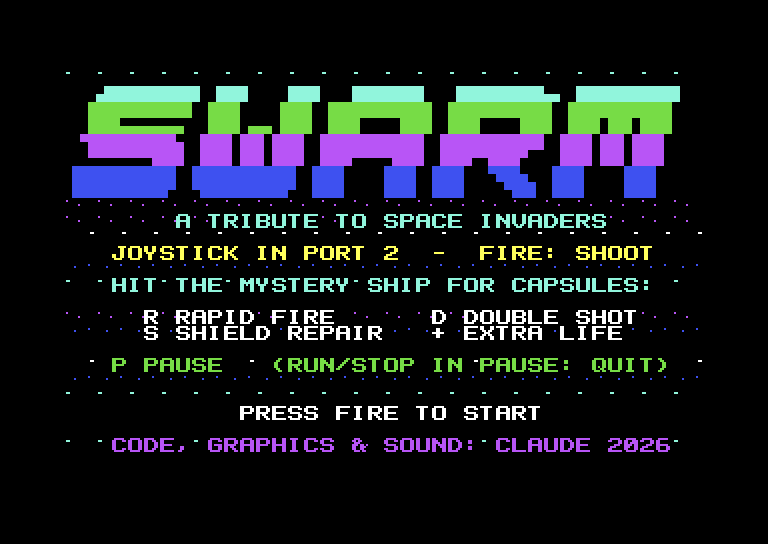
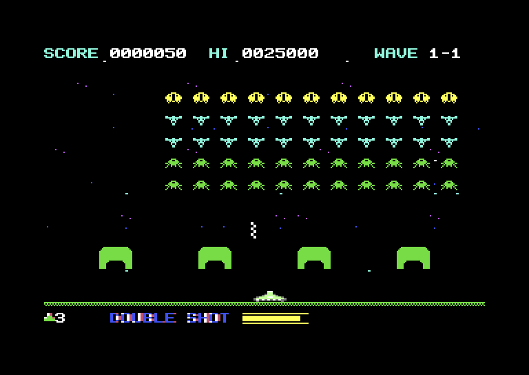
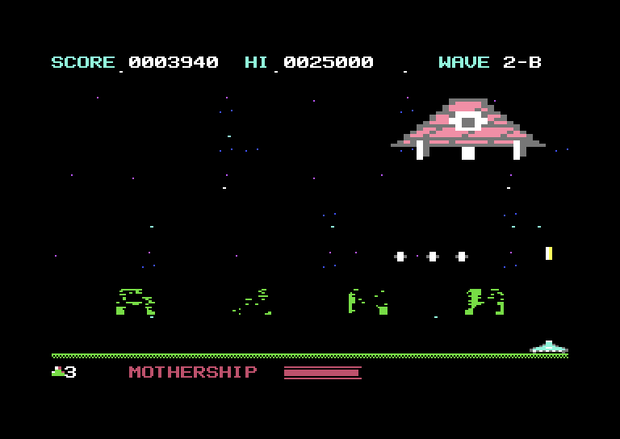
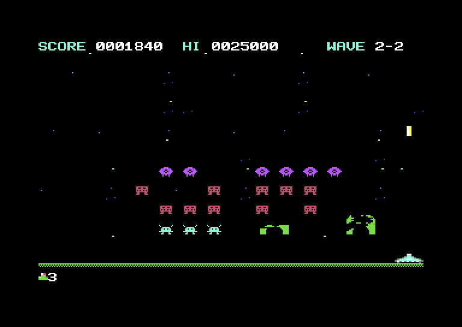
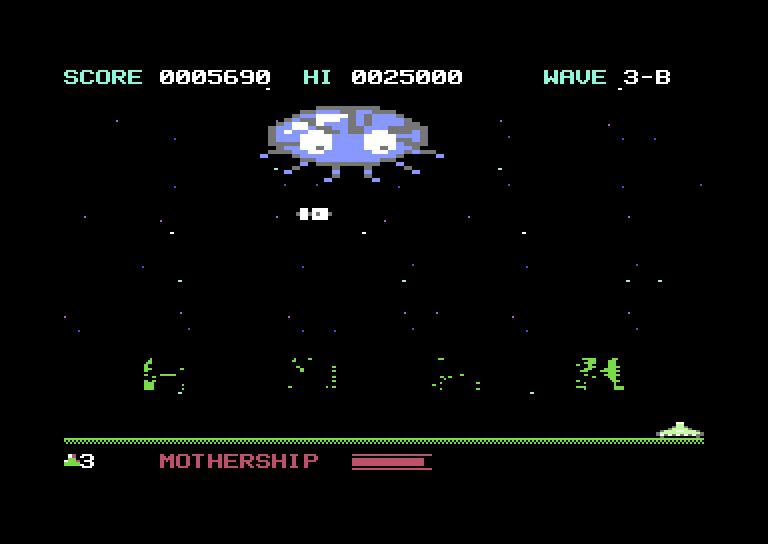

# SWARM - Alien Invasion Shooter for the Commodore C64
SWARM is a fixed-screen alien invasion shooter for the Commodore C64, written from scratch in 6502 assembler. 55 aliens march in formation, step down a row whenever they touch the edge of the screen and get faster with every loss. Defend the ground with your laser cannon, hide behind the bunkers and shoot the mystery ship for power-up capsules. Three sectors with their own alien species and a mothership at the end of each sector are waiting. The game is a tribute to the arcade classic of 1978, all graphics, aliens and music are original.

- Three sectors with four waves each and three mothership bosses
- Nine original alien designs, each animated in two phases
- Pixel-accurate bunker erosion from both sides
- Mystery ship with power-up capsules: rapid fire, double shot, bunker repair, extra life
- Marching beat that speeds up with the swarm, plus title, wave, boss and ending music
- Ending sequence and hiscore table
- Disk version with fastloader, Magic Desk cartridge, single PRG and turbo tape



# How to Play
## Controls
Plug a joystick into **port 2**.

| Input | Action |
|:-|:-|
| Joystick left/right | move the cannon |
| Fire | shoot |
| `P` | pause |
| `RUN/STOP` (during pause) | quit the game and return to the title screen |

## The Game
The swarm of 5 x 11 aliens marches from side to side and moves one row down at every turn. The fewer aliens are left, the faster they march. If they reach the ground, the game is over. Four bunkers protect your cannon, but every shot, yours and theirs, eats away at them pixel by pixel.

| Sector | Name | Aliens | Mothership |
|:-:|:-|:-|:-|
| 1 | The Beetle Front | armoured beetles, wasps, spiders | HIVE CARRIER |
| 2 | The Machine Wall | eye drones, cube bots, antenna droids | BATTLE STATION |
| 3 | The Crystal Void | crystals, moths, jellyfish | SWARM QUEEN |

The first sector is the gentlest: the aliens fire less often and their shots are slower. In the later sectors the plasma shots are aimed at your cannon.

## Scoring and Capsules
The top row is worth 30 points, the middle rows 20, the bottom rows 10 (more in later sectors). The mystery ship crossing the top of the screen is worth 50 to 300 points and often drops a capsule:

| Capsule | Effect |
|:-:|:-|
| `R` | rapid fire: two shots at once for 15 seconds |
| `D` | double shot for 15 seconds |
| `S` | repairs the bunkers |
| `+` | extra life |

Destroying a mothership gives a bonus of 5000, 10000 or 15000 points. An extra life is awarded every 20000 points. Good scores are entered into the hall of fame with your initials (joystick up/down selects the letter, fire goes to the next one); the table is kept until the computer is switched off.

## Hidden Cheat
Type `CANNON` on the title screen. A red message confirms the cheat mode. Your cannon is now invincible (it blinks), the keys `1` to `3` on the title screen select the start sector and `N` during the game skips the current wave or boss.



# How it Works
## Memory Map
| Address | Content |
|:-|:-|
| `$0810-$3FFF` | game code |
| `$4000-$47FF` | charset with the pre-shifted aliens and the bunkers (VIC bank 1) |
| `$4800-$4BFF` | screen |
| `$5000-$7FFF` | sprite data |
| `$8000-$BFFF` | title/ending screens, music player, generated tables, alien designs, music |

## The Alien Formation
The 55 aliens are drawn with characters, not sprites. Since the formation moves in steps of two pixels, every alien type exists in the charset in four pre-shifted versions (0, 2, 4 and 6 pixels) and in two animation phases. Moving the formation therefore only means writing new character codes into the screen; only the span that actually changes is redrawn. The fewer aliens are alive, the shorter the interval between two steps. Hits are calculated from the formation position and the column and row spacing instead of using the VIC-II collision registers. At the start of each sector, the alien designs of that sector are copied into the charset.

## Bunkers
The four bunkers consist of characters that exist only once in the charset. When a shot hits a bunker, a small crater is cut directly into the character data, so the erosion is pixel-accurate. Alien shots eat from the top, your own shots from below.

## Sprites and Bosses
The cannon, all bullets, the mystery ship and the capsules are hardware sprites, the playfield needs no multiplexer. The motherships consist of two multicolour sprites, both expanded in X and Y, giving a 96 x 42 pixel boss with its own movement and attack patterns.

## Sound
One raster interrupt per frame plays the music and sound effects and animates the stars. During the waves a four-note marching beat is played, its tempo follows the speed of the swarm.

## Loaders
All three loaders share the same crunched game image. The game is packed with [TSCrunch](https://github.com/tonysavon/TSCrunch) into an image that can be decrunched in place, i.e. it is loaded directly below its final position and unpacked onto itself.

- **Disk:** the boot file transfers its drive code into the 1541 via `M-W` commands and starts it. The drive reads the sectors of the data file and sends every byte as four 2-bit pairs over the CLK and DATA lines of the serial bus. Each byte starts with a handshake, the four pairs follow with cycle-exact timing. The screen is switched off while loading, so that no badlines can disturb the timing. The loader works on PAL and NTSC machines. Both files are written with a sector interleave matched to the transfer speed.
- **Cartridge:** the boot code in bank 0 is started via the `CBM80` signature, copies the crunched image bank by bank from `$8000-$9FFF` into RAM, disables the cartridge by setting bit 7 of `$DE00` and jumps into the decruncher.
- **Tape:** a small boot program in standard KERNAL format is loaded first. It contains the turbo loader, which distinguishes short and long pulses with a CIA timer (threshold 280 cycles), assembles the bytes and verifies the loaded data with an XOR checksum. If the checksum does not match, the motor is stopped and the border turns red.



# Source Code
## Assembler Sources
The game is written in 6502 assembler for [64tass](https://sourceforge.net/projects/tass64/). `main.asm` includes all other files.

| File | Lines | Content |
|:-|-:|:-|
| `src/main.asm` | 274 | memory map, constants, variables, segment layout, includes |
| `src/game.asm` | 494 | game flow: sectors, waves, boss stage, lives, difficulty, pause, cheat keys |
| `src/formation.asm` | 563 | alien formation: 5 x 11 aliens with pre-shifted characters, marching, animation, hit test, alien shooters |
| `src/objects.asm` | 1109 | sprites, player cannon, bullets, bunker erosion, mystery ship, capsules, HUD |
| `src/boss.asm` | 321 | the three motherships (2 expanded sprites, 96 x 42 pixels) |
| `src/irq.asm` | 135 | one raster interrupt per frame: music, sound effects, star animation |
| `src/screens.asm` | 925 | title screen, stage intro, game over, ending, credits, hiscore entry |
| `src/sound.asm` | 492 | SID music player (3 voices, instruments, arpeggios, vibrato) and sound effects on voice 3 |
| `src/util.asm` | 227 | text output, BCD score handling, random numbers, keyboard scan, joystick |

## Python Tools
The Python scripts generate all data of the game and package the distribution formats.

| File | Content |
|:-|:-|
| `tools/sgen.py` | build script for all generated data: charset, pre-shifted aliens, sprites, tables |
| `tools/gfx.py` | shared graphics helpers and font |
| `tools/sgfx.py` | original alien designs, bunkers, cannon, mystery ship, motherships, title logo |
| `tools/music.py` | music and sound effect compiler |
| `tools/smusic.py` | all compositions of SWARM |
| `tools/package.py` | crunches the game and builds D64, BIN and CRT |
| `tools/d64.py` | minimal D64 image writer with custom sector interleave |
| `tools/crt.py` | writes the VICE CRT container for the Magic Desk ROM |
| `tools/mktap.py` | TAP v1 writer: KERNAL boot file plus turbo data block |

# Compiling the Source Code
## Requirements
- [64tass](https://sourceforge.net/projects/tass64/) cross assembler (version 1.59 or newer)
- [Python 3](https://www.python.org/) (only the standard library is needed for the build)
- [TSCrunch](https://github.com/tonysavon/TSCrunch) by Antonio Savona for crunching the game

## Building
All graphics, sprites, level data and music are generated by Python scripts at build time, there are no binary assets in the repository. A single script creates the game and all five distribution formats:
```
cd sources
./build.sh
```
If `tscrunch` is not in your `PATH`, pass its location: `TSCRUNCH=/path/to/tscrunch ./build.sh`. The finished files are placed in `sources/build/release`. Intermediate files (listings, label files, generated data) remain in `sources/build`, the label file `swarm.lbl` is handy for debugging with the VICE monitor.

The build runs the following steps:
1. `tools/sgen.py` generates the charset, the sprites, all tables, the level data and the music into `build/`.
2. `64tass` assembles `src/main.asm` into the uncompressed game `build/swarm.prg` (start address `$0810`).
3. `tools/package.py` crunches the game with TSCrunch into an in-place decrunching image and builds the D64 (with boot loader), the BIN and the CRT.
4. TSCrunch creates the self-extracting single file PRG.
5. The tape boot loader is assembled and `tools/mktap.py` writes the TAP image.

## Folder Structure
```
sources/
├── build.sh            build script for all formats
├── src/                6502 assembler sources (64tass)
│   ├── main.asm        memory map, includes
│   ├── game.asm        game flow
│   ├── formation.asm   alien formation
│   ├── objects.asm     sprites, bunkers, HUD
│   ├── ...             see table above
│   └── loader/
│       ├── boot.asm    disk boot program + 1541 drive code (2-bit fastloader)
│       ├── cart.asm    Magic Desk cartridge boot code
│       ├── tapeboot.asm turbo tape boot loader
│       └── decrunch.asm TSCrunch in-place decruncher
└── tools/              Python build tools
    ├── sgen.py         generates all game data
    ├── sgfx.py         graphics
    ├── smusic.py       music
    ├── gfx.py          graphics helpers
    ├── music.py        music compiler
    ├── package.py      crunching, D64, BIN and CRT creation
    ├── d64.py          minimal D64 writer with custom sector interleave
    ├── crt.py          Magic Desk CRT file writer
    └── mktap.py        TAP image writer (KERNAL boot file + turbo blocks)
```

# Using the Binaries
The [binaries](binaries/) folder contains the game in five ready-to-use formats. All of them start the same game; they only differ in the medium and the loader.

| File | Format | Loader | Typical use |
|:-|:-|:-|:-|
| `swarm.d64` | 1541 disk image | own 2-bit fastloader (~5 s) | emulators, real 1541 floppy, Ultimate 64/II |
| `swarm.crt` | Magic Desk cartridge (VICE CRT) | copies from ROM, starts in ~1 s | emulators, Ultimate 64/II, Kung Fu Flash |
| `swarm.bin` | raw 64 KB Magic Desk ROM | as above | burning an (E)EPROM for a real cartridge |
| `swarm.prg` | single self-extracting PRG | standard KERNAL loader | emulators, SD2IEC, any file based device |
| `swarm.tap` | tape image (TAP v1) | own turbo loader (~0:53 min) | emulators, Tapuino, real datasette |

## D64 - Disk Image with Fastloader
Load and start the game with:
```
LOAD"*",8,1
RUN
```
The first file is a tiny boot program. It uploads its own drive code into the 1541, which then sends the crunched game file (the second directory entry, `swarm data`) with a 2-bit protocol to the C64. The game is decrunched in place and starts automatically. Loading takes about five seconds instead of about 45 seconds with the standard loader.

Because the fastloader runs code inside the floppy drive, it needs a real 1541/1541-II/1571 or an accurate drive emulation (VICE with "True Drive Emulation", Ultimate 64/II, Pi1541). Pure file-based devices like the [SD2IEC](https://github.com/wagiminator/C64-Collection/tree/master/C64_SD2IEC_LP) cannot run drive code; please use the PRG file there.

**In an emulator:** drag and drop the D64 onto [VICE](https://vice-emu.sourceforge.io/) or open it in the [C64 Emulator Web App](https://wagiminator.github.io/apps/c64-emulator/) directly in your browser.

**On a real floppy disk:** write the D64 to a disk with a [DiskBuddy64](https://github.com/wagiminator/C64-Collection/tree/master/C64_DiskBuddy64), [DiskMaster64](https://github.com/wagiminator/C64-Collection/tree/master/C64_DiskMaster64) or [DumpMaster64](https://github.com/wagiminator/C64-Collection/tree/master/C64_DumpMaster64) adapter, either with the Python tools of the respective adapter or directly from the browser with the [C64 Disk Transfer Web App](https://wagiminator.github.io/apps/d64-transfer/). Alternatively, an [xu1541](https://github.com/wagiminator/C64-Collection/tree/master/C64_xu1541) with OpenCBM can be used. If you want to have a look at the disk structure or add the game to your own disk image, use the [C64 Disk Viewer](https://wagiminator.github.io/apps/d64-viewer/) and the [C64 Disk Editor](https://wagiminator.github.io/apps/d64-editor/).

## CRT and BIN - Magic Desk Cartridge
The game is also available as a 64 KB cartridge in Magic Desk format (eight 8 KB banks, bank register at `$DE00`). After switching on, the boot code in bank 0 copies the crunched game into RAM, switches the cartridge off and decrunches the game. It is ready about one second after power-on.

**In an emulator or on modern hardware:** the CRT file can be attached in VICE (`File` -> `Attach cartridge image`), in the [C64 Emulator Web App](https://wagiminator.github.io/apps/c64-emulator/), on an Ultimate 64/II or a Kung Fu Flash.

**As a real cartridge:** the BIN file is the raw 64 KB ROM image. Burn it into a 27C512/28C512 (E)EPROM and plug it into the [C64 64k/256k Cartridge](https://github.com/wagiminator/C64-Collection/tree/master/C64_Cartridge_64k_256k). For programming the (E)EPROM, a TL866/T48 programmer can be used together with the [XGecu Memory Programmer Web App](https://wagiminator.github.io/apps/tinypro/) or the Python tool [tinypro](https://pypi.org/project/tinypro/). If you want to combine several games on one cartridge with a selection menu, put the PRG files into the [C64 Cartridge Builder Web App](https://wagiminator.github.io/apps/cart-builder/).

## PRG - Single File
The PRG is the complete game as one self-extracting file. Load it with:
```
LOAD"SWARM",8
RUN
```
It works with every device that can load files with the standard KERNAL routines, e.g. an [SD2IEC](https://github.com/wagiminator/C64-Collection/tree/master/C64_SD2IEC_LP), an Ultimate 64/II, a Kung Fu Flash or a real floppy disk (copy it onto a disk with the [C64 Disk Editor](https://wagiminator.github.io/apps/d64-editor/) and the [C64 Disk Transfer Web App](https://wagiminator.github.io/apps/d64-transfer/)). Since the standard loader is slow, loading from a real 1541 takes considerably longer than the D64 version. A fastload cartridge like the [C64 FreeLoad Cartridge](https://github.com/wagiminator/C64-Collection/tree/master/C64_Cartridge_FreeLoad) speeds this up nicely. In emulators the PRG can simply be autostarted.

## TAP - Tape Image with Turbo Loader
Insert the tape (or attach the TAP file in your emulator), then press `SHIFT` + `RUN/STOP` (or type `LOAD` and later `RUN`) and press PLAY on the datasette. The KERNAL first loads a small boot loader. This turbo loader then switches the datasette motor on again and reads the crunched game in its own pulse format (bit 0 = 208 cycles, bit 1 = 352 cycles). Coloured stripes in the border show the loading progress, a red border indicates a loading error. The whole process takes about 0:53 minutes instead of about seven minutes with the standard KERNAL loader.

**In an emulator:** attach the TAP file to the datasette in VICE or load it into the [C64 Emulator Web App](https://wagiminator.github.io/apps/c64-emulator/).

**With a datasette emulator:** copy the TAP file onto the SD card of a [Tapuino](https://github.com/wagiminator/C64-Collection/tree/master/C64_Tapuino).

**On a real cassette:** record the TAP file onto a tape with a [TapeBuddy64](https://github.com/wagiminator/C64-Collection/tree/master/C64_TapeBuddy64), [TapeDump64](https://github.com/wagiminator/C64-Collection/tree/master/C64_TapeDump64) or [DumpMaster64](https://github.com/wagiminator/C64-Collection/tree/master/C64_DumpMaster64), either with the Python tools of the respective adapter or directly from the browser with the [C64 Tape Transfer Web App](https://wagiminator.github.io/apps/tap-transfer/).

# References, Links and Notes
1. [64tass Cross Assembler](https://sourceforge.net/projects/tass64/)
2. [TSCrunch by Antonio Savona](https://github.com/tonysavon/TSCrunch)
3. [VICE - the Versatile Commodore Emulator](https://vice-emu.sourceforge.io/)
4. [C64 Emulator Web App](https://wagiminator.github.io/apps/c64-emulator/)
5. [C64 Disk Transfer Web App](https://wagiminator.github.io/apps/d64-transfer/)
6. [C64 Tape Transfer Web App](https://wagiminator.github.io/apps/tap-transfer/)
7. [C64 Cartridge Builder Web App](https://wagiminator.github.io/apps/cart-builder/)
8. [XGecu Memory Programmer Web App](https://wagiminator.github.io/apps/tinypro/)
9. [C64 Collection (adapters and cartridges)](https://github.com/wagiminator/C64-Collection)
10. [Christian Bauer: The MOS 6567/6569 video controller (VIC-II)](https://www.zimmers.net/cbmpics/cbm/c64/vic-ii.txt)
11. [Codebase64 Wiki](https://codebase64.org/)




# License


This work is licensed under Creative Commons Attribution-ShareAlike 3.0 Unported License.
(http://creativecommons.org/licenses/by-sa/3.0/)
