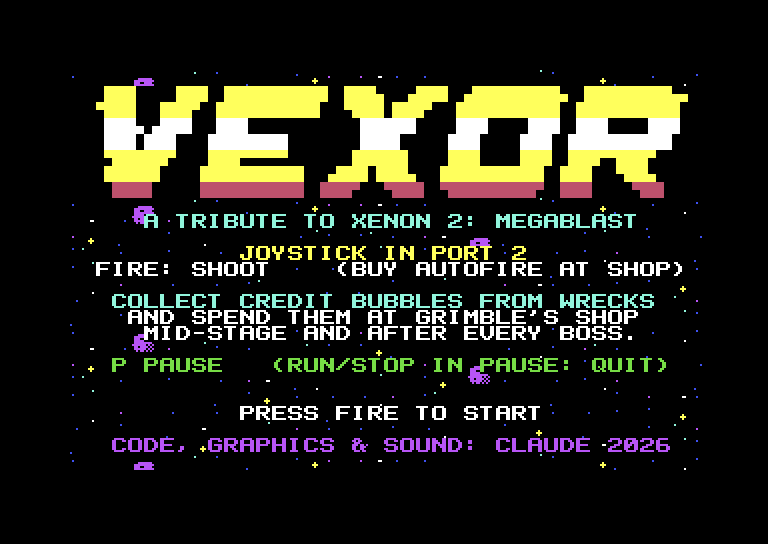
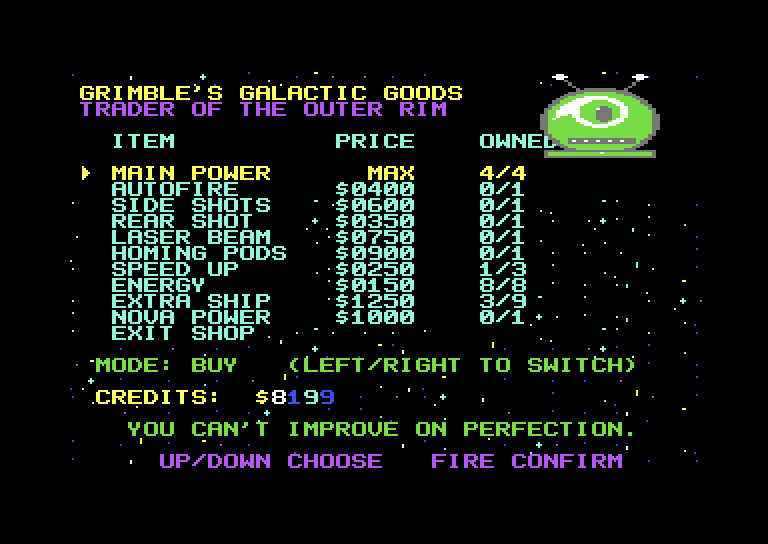
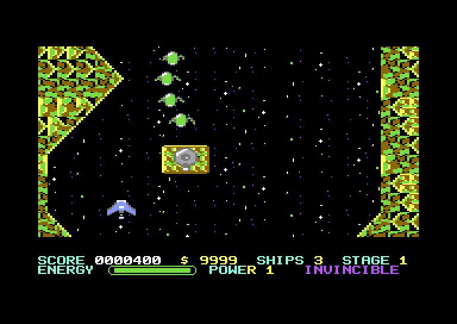
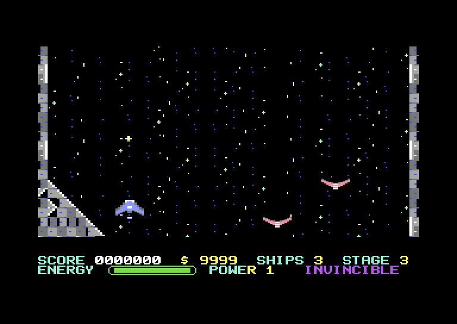
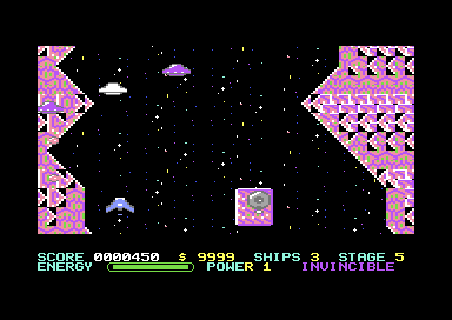

# VEXOR - Vertical Scrolling Shoot'em-up for the Commodore C64
VEXOR is a vertically scrolling shoot'em-up for the Commodore C64 with a trading post between the battles. Shoot down the alien swarm, collect the credit bubbles left behind by the wrecks and spend them at Grimble's shop on new weapons, autofire, speed and energy. Five stages with five huge bosses are waiting. The game is a tribute to the great vertical shooters of the Amiga and C64 era, all graphics, characters and music are original.

- Five stages with five end bosses, ending sequence and hiscore table
- Grimble's trading post in the middle of every stage and after each boss: buy and sell ten items
- Energy system instead of one-hit kills, walls block the ship
- Smooth vertical scrolling with double-buffered screens at 50 frames per second
- Three-layer parallax starfield with a fixed, flicker-free bottom edge
- Sprite multiplexer with up to 40 virtual sprites
- Own SID music player with title, stage, shop, boss and ending music plus sound effects
- Disk version with fastloader, Magic Desk cartridge, single PRG and turbo tape



# How to Play
## Controls
Plug a joystick into **port 2**.

| Input | Action |
|:-|:-|
| Joystick | move the ship in eight directions |
| Fire | shoot; holding the button gives a slow autofire, fast autofire can be bought in the shop |
| `P` | pause |
| `RUN/STOP` (during pause) | quit the game and return to the title screen |

## The Game
Destroyed enemies leave credit bubbles worth $25 or $100, capsules with an `E` refill your energy. Enemy bullets and collisions cost energy, the ship is lost when the energy bar is empty. The walls of the landscape cannot be passed: if the scrolling landscape pushes you against the bottom of the screen, you lose energy.

Flyers, swoopers, divers, side attackers, risers, mines, turrets, rock pods and tumbling rocks attack in changing formations. Every stage ends with a boss:

| Stage | Name | Boss |
|:-:|:-|:-|
| 1 | Bio Caverns | GORLOX - wide sweeps, three-way spread |
| 2 | Crystal Reef | MEDUSOID - sweeping and bobbing, aimed bursts |
| 3 | Mecha Docks | SKULLMECH - tracks the player, triple cannons |
| 4 | Lava Core | PLASMA EYE - figure eight, rotating bullet rings |
| 5 | Alien Hive | MOTHER WORM - bullet rings, aimed shots, summons risers |

After the last boss the ending and credits follow. Good scores are entered into the hall of fame (top 5) with your initials; the table is kept until the computer is switched off.

## Grimble's Galactic Goods
In the middle of each stage and after every boss, Grimble opens his shop. Choose an item with up/down, switch between BUY and SELL with left/right and confirm with fire. "EXIT SHOP" continues the game. Items you own can be sold back for half of their price.

| Item | Price | Max | Effect |
|:-|-:|:-:|:-|
| Main Power | $300 per level | 4 | upgrades the main gun |
| Autofire | $400 | 1 | fast autofire while holding fire |
| Side Shots | $600 | 1 | additional shots to the left and right |
| Rear Shot | $350 | 1 | additional shot backwards |
| Laser Beam | $750 | 1 | fast laser shots that even pass through walls |
| Homing Pods | $900 | 1 | missiles that steer towards enemies |
| Speed Up | $250 per level | 3 | faster ship |
| Energy | $150 | - | refills the energy bar |
| Extra Ship | $1250 | 9 | one more ship |
| Nova Power | $1000 | 1 | 20 seconds of fully upgraded weapons at the start of the next stage |



## Hidden Cheat
Type `BITMAP` on the title screen. A jingle and a message confirm the cheat mode. Your ship is now invincible, you start with 9999 credits, the keys `1` to `5` on the title screen select the start stage and `N` during the game ends the current stage.

# How it Works
## Memory Map
| Address | Content |
|:-|:-|
| `$0810-$3FFF` | game code (main loop, scrolling, sprites, enemies, bosses, HUD) |
| `$4000-$47FF` | charset (VIC bank 1) |
| `$4800-$4BFF` | screen A |
| `$4C00-$4FFF` | screen B |
| `$5000-$7FFF` | sprite data (plus an empty sprite used below the playfield) |
| `$8000-$BFFF` | shop, title/ending screens, music player, generated tables, level data, music |
| `$C800-$CFFF` | backup of screen and colour RAM while the shop is open |
| `$E000-$FFFF` | colour RAM shift code, generated at runtime (KERNAL switched off) |

## Scrolling Engine
The playfield has 21 character rows and scrolls downwards with the vertical fine scroll bits of `$D011` in 24-row mode, so the upper border hides the incoming row. As in ZYRON, two screens are used: while one is visible and fine scrolled, the other one is filled step by step with the content shifted down by one row, and the new row is generated at the top. At the coarse step, the IRQ switches `$D018` to the other screen and an unrolled, runtime-generated routine at `$E000` shifts the colour RAM while the beam is in the lower border and the vertical blank. The landscape (side walls and islands) is generated row by row from run lists created by `tools/vlevels.py`, enemy waves are triggered by row-based events.

## Fixed Bottom Edge
With vertical scrolling, the character rows (and with them the badlines) move with the fine scroll value, so a normal raster split to the HUD would make the lower edge of the playfield jump up and down by up to eight lines. VEXOR draws the edge at a fixed raster line instead: an IRQ at line 214 switches the VIC-II into the invalid ECM+BMM mode, which displays only black, timed to land in the horizontal blanking between two lines. Sprites that are already being displayed cannot be switched off via `$D015`, so in the same moment the pointers of all eight hardware sprites are bent to an empty sprite before the VIC fetches the data of the next line. If line 214 is a badline, the CPU is halted until cycle 55, so a second handler variant (selected via the IRQ vector when the interrupt is scheduled) skips the delay loop. At line 222 the HUD IRQ sets the vertical scroll to 7, still in black, and switches back to text mode right before the first HUD line at 223 with a 7-cycle polling loop.

## Parallax Background
Empty cells of the playfield are filled with background characters forming three star layers (far, mid and near), each a strip one character wide and eight characters high (64 pixels). Each screen column starts at its own phase, so the starfield looks irregular. Since a vertical rotation would mean moving 64 bytes per layer, only the few star pixels are updated: each star is erased at its old position and drawn at the new one. The layers move at 1/4, 2/5 and 2/3 of the terrain speed.

## Raster Interrupts and Sprite Multiplexer
- **Top IRQ (line 30):** sets the fine scroll and the screen of the frame and the pointers of the first eight sprites.
- **Multiplexer IRQs:** reuse every free hardware sprite for the next virtual sprite further down. Sprites that would be written after their own start line (and could not show anyway) are dropped, so that the multiplexer never delays the bottom edge.
- **Bottom edge IRQ (line 214) and HUD IRQ (line 222):** see above. The HUD IRQ also takes over the next frame's data prepared by the main loop, writes the positions of the first eight sprites, shifts the colour RAM at a coarse step, moves the parallax stars and plays music and sound.

The main loop collects up to 40 virtual sprites per frame, sorts them with a bucket sort by their Y coordinate and builds the list for the multiplexer.

## Loaders
All three loaders share the same crunched game image. The game is packed with [TSCrunch](https://github.com/tonysavon/TSCrunch) into an image that can be decrunched in place, i.e. it is loaded directly below its final position and unpacked onto itself.

- **Disk:** the boot file transfers its drive code into the 1541 via `M-W` commands and starts it. The drive reads the sectors of the data file and sends every byte as four 2-bit pairs over the CLK and DATA lines of the serial bus. Each byte starts with a handshake, the four pairs follow with cycle-exact timing. The screen is switched off while loading, so that no badlines can disturb the timing. The loader works on PAL and NTSC machines. Both files are written with a sector interleave matched to the transfer speed.
- **Cartridge:** the boot code in bank 0 is started via the `CBM80` signature, copies the crunched image bank by bank from `$8000-$9FFF` into RAM, disables the cartridge by setting bit 7 of `$DE00` and jumps into the decruncher.
- **Tape:** a small boot program in standard KERNAL format is loaded first. It contains the turbo loader, which distinguishes short and long pulses with a CIA timer (threshold 280 cycles), assembles the bytes and verifies the loaded data with an XOR checksum. If the checksum does not match, the motor is stopped and the border turns red.



# Source Code
## Assembler Sources
The game is written in 6502 assembler for [64tass](https://sourceforge.net/projects/tass64/). `main.asm` includes all other files.

| File | Lines | Content |
|:-|-:|:-|
| `src/main.asm` | 352 | memory map, constants, variables, segment layout, includes |
| `src/game.asm` | 340 | game flow: new game, stage start, mid-stage shop, main loop, pause, cheat keys |
| `src/irq.asm` | 626 | menu IRQ and game IRQ chain (top, multiplexer, bottom edge, HUD), parallax stars, colour shift code generator |
| `src/scroll.asm` | 580 | vertical scrolling engine: wall/island generation, double-buffered screen shift, terrain lookup, level events |
| `src/sprites.asm` | 265 | virtual sprite list, bucket sort, multiplexer preparation |
| `src/player.asm` | 569 | player ship, energy, wall handling, all weapons |
| `src/enemies.asm` | 1103 | enemy types, spawners, credit bubbles, capsules, enemy bullets, collisions |
| `src/boss.asm` | 547 | the five end bosses, their movement and attack patterns |
| `src/shop.asm` | 535 | Grimble's trading post: item tables, buying, selling, shop screen |
| `src/hud.asm` | 244 | score, credits, ships, stage, energy bar and power display |
| `src/screens.asm` | 922 | title screen, stage intro, game over, ending, credits, hiscore entry |
| `src/sound.asm` | 495 | SID music player (3 voices, instruments, arpeggios, vibrato) and sound effects on voice 3 |
| `src/util.asm` | 325 | text output, BCD score handling, random numbers, keyboard scan, joystick |

## Python Tools
The Python scripts generate all data of the game and package the distribution formats.

| File | Content |
|:-|:-|
| `tools/vgen.py` | build script for all generated data: charset, sprites, tables, colours, parallax layers |
| `tools/gfx.py` | shared graphics helpers and font (from ZYRON) |
| `tools/vgfx.py` | procedural graphics: terrain sets, parallax stars, sprites, bosses, Grimble the trader, title logo |
| `tools/vlevels.py` | vertical level generator: wall and island runs and enemy events of the five stages |
| `tools/music.py` | music and sound effect compiler (shared with ZYRON) |
| `tools/vmusic.py` | all compositions of VEXOR |
| `tools/package.py` | crunches the game and builds D64, BIN and CRT |
| `tools/d64.py` | minimal D64 image writer with custom sector interleave |
| `tools/crt.py` | writes the VICE CRT container for the Magic Desk ROM |
| `tools/mktap.py` | TAP v1 writer: KERNAL boot file plus turbo data block |

# Compiling the Source Code
## Requirements
- [64tass](https://sourceforge.net/projects/tass64/) cross assembler (version 1.59 or newer)
- [Python 3](https://www.python.org/) (only the standard library is needed for the build)
- [TSCrunch](https://github.com/tonysavon/TSCrunch) by Antonio Savona for crunching the game

## Building
All graphics, sprites, level data and music are generated by Python scripts at build time, there are no binary assets in the repository. A single script creates the game and all five distribution formats:
```
cd sources
./build.sh
```
If `tscrunch` is not in your `PATH`, pass its location: `TSCRUNCH=/path/to/tscrunch ./build.sh`. The finished files are placed in `sources/build/release`. Intermediate files (listings, label files, generated data) remain in `sources/build`, the label file `vexor.lbl` is handy for debugging with the VICE monitor.

The build runs the following steps:
1. `tools/vgen.py` generates the charset, the sprites, all tables, the level data and the music into `build/`.
2. `64tass` assembles `src/main.asm` into the uncompressed game `build/vexor.prg` (start address `$0810`).
3. `tools/package.py` crunches the game with TSCrunch into an in-place decrunching image and builds the D64 (with boot loader), the BIN and the CRT.
4. TSCrunch creates the self-extracting single file PRG.
5. The tape boot loader is assembled and `tools/mktap.py` writes the TAP image.

## Folder Structure
```
sources/
├── build.sh            build script for all formats
├── src/                6502 assembler sources (64tass)
│   ├── main.asm        memory map, includes
│   ├── game.asm        game flow
│   ├── irq.asm         raster IRQs, multiplexer, parallax
│   ├── scroll.asm      scrolling engine
│   ├── shop.asm        trading post
│   ├── ...             see table above
│   └── loader/
│       ├── boot.asm    disk boot program + 1541 drive code (2-bit fastloader)
│       ├── cart.asm    Magic Desk cartridge boot code
│       ├── tapeboot.asm turbo tape boot loader
│       └── decrunch.asm TSCrunch in-place decruncher
└── tools/              Python build tools
    ├── vgen.py         generates all game data
    ├── vgfx.py         graphics
    ├── vlevels.py      levels
    ├── vmusic.py       music
    ├── gfx.py          graphics helpers
    ├── music.py        music compiler
    ├── package.py      crunching, D64, BIN and CRT creation
    ├── d64.py          minimal D64 writer with custom sector interleave
    ├── crt.py          Magic Desk CRT file writer
    └── mktap.py        TAP image writer (KERNAL boot file + turbo blocks)
```

# Using the Binaries
The [binaries](binaries/) folder contains the game in five ready-to-use formats. All of them start the same game; they only differ in the medium and the loader.

| File | Format | Loader | Typical use |
|:-|:-|:-|:-|
| `vexor.d64` | 1541 disk image | own 2-bit fastloader (~5 s) | emulators, real 1541 floppy, Ultimate 64/II |
| `vexor.crt` | Magic Desk cartridge (VICE CRT) | copies from ROM, starts in ~1 s | emulators, Ultimate 64/II, Kung Fu Flash |
| `vexor.bin` | raw 64 KB Magic Desk ROM | as above | burning an (E)EPROM for a real cartridge |
| `vexor.prg` | single self-extracting PRG | standard KERNAL loader | emulators, SD2IEC, any file based device |
| `vexor.tap` | tape image (TAP v1) | own turbo loader (~1:15 min) | emulators, Tapuino, real datasette |

## D64 - Disk Image with Fastloader
Load and start the game with:
```
LOAD"*",8,1
RUN
```
The first file is a tiny boot program. It uploads its own drive code into the 1541, which then sends the crunched game file (the second directory entry, `vexor data`) with a 2-bit protocol to the C64. The game is decrunched in place and starts automatically. Loading takes about five seconds instead of about 45 seconds with the standard loader.

Because the fastloader runs code inside the floppy drive, it needs a real 1541/1541-II/1571 or an accurate drive emulation (VICE with "True Drive Emulation", Ultimate 64/II, Pi1541). Pure file-based devices like the [SD2IEC](https://github.com/wagiminator/C64-Collection/tree/master/C64_SD2IEC_LP) cannot run drive code; please use the PRG file there.

**In an emulator:** drag and drop the D64 onto [VICE](https://vice-emu.sourceforge.io/) or open it in the [C64 Emulator Web App](https://wagiminator.github.io/apps/c64-emulator/) directly in your browser.

**On a real floppy disk:** write the D64 to a disk with a [DiskBuddy64](https://github.com/wagiminator/C64-Collection/tree/master/C64_DiskBuddy64), [DiskMaster64](https://github.com/wagiminator/C64-Collection/tree/master/C64_DiskMaster64) or [DumpMaster64](https://github.com/wagiminator/C64-Collection/tree/master/C64_DumpMaster64) adapter, either with the Python tools of the respective adapter or directly from the browser with the [C64 Disk Transfer Web App](https://wagiminator.github.io/apps/d64-transfer/). Alternatively, an [xu1541](https://github.com/wagiminator/C64-Collection/tree/master/C64_xu1541) with OpenCBM can be used. If you want to have a look at the disk structure or add the game to your own disk image, use the [C64 Disk Viewer](https://wagiminator.github.io/apps/d64-viewer/) and the [C64 Disk Editor](https://wagiminator.github.io/apps/d64-editor/).

## CRT and BIN - Magic Desk Cartridge
The game is also available as a 64 KB cartridge in Magic Desk format (eight 8 KB banks, bank register at `$DE00`). After switching on, the boot code in bank 0 copies the crunched game into RAM, switches the cartridge off and decrunches the game. It is ready about one second after power-on.

**In an emulator or on modern hardware:** the CRT file can be attached in VICE (`File` -> `Attach cartridge image`), in the [C64 Emulator Web App](https://wagiminator.github.io/apps/c64-emulator/), on an Ultimate 64/II or a Kung Fu Flash.

**As a real cartridge:** the BIN file is the raw 64 KB ROM image. Burn it into a 27C512/28C512 (E)EPROM and plug it into the [C64 64k/256k Cartridge](https://github.com/wagiminator/C64-Collection/tree/master/C64_Cartridge_64k_256k). For programming the (E)EPROM, a TL866/T48 programmer can be used together with the [XGecu Memory Programmer Web App](https://wagiminator.github.io/apps/tinypro/) or the Python tool [tinypro](https://pypi.org/project/tinypro/). If you want to combine several games on one cartridge with a selection menu, put the PRG files into the [C64 Cartridge Builder Web App](https://wagiminator.github.io/apps/cart-builder/).

## PRG - Single File
The PRG is the complete game as one self-extracting file. Load it with:
```
LOAD"VEXOR",8
RUN
```
It works with every device that can load files with the standard KERNAL routines, e.g. an [SD2IEC](https://github.com/wagiminator/C64-Collection/tree/master/C64_SD2IEC_LP), an Ultimate 64/II, a Kung Fu Flash or a real floppy disk (copy it onto a disk with the [C64 Disk Editor](https://wagiminator.github.io/apps/d64-editor/) and the [C64 Disk Transfer Web App](https://wagiminator.github.io/apps/d64-transfer/)). Since the standard loader is slow, loading from a real 1541 takes considerably longer than the D64 version. A fastload cartridge like the [C64 FreeLoad Cartridge](https://github.com/wagiminator/C64-Collection/tree/master/C64_Cartridge_FreeLoad) speeds this up nicely. In emulators the PRG can simply be autostarted.

## TAP - Tape Image with Turbo Loader
Insert the tape (or attach the TAP file in your emulator), then press `SHIFT` + `RUN/STOP` (or type `LOAD` and later `RUN`) and press PLAY on the datasette. The KERNAL first loads a small boot loader. This turbo loader then switches the datasette motor on again and reads the crunched game in its own pulse format (bit 0 = 208 cycles, bit 1 = 352 cycles). Coloured stripes in the border show the loading progress, a red border indicates a loading error. The whole process takes about 1:15 minutes instead of about seven minutes with the standard KERNAL loader.

**In an emulator:** attach the TAP file to the datasette in VICE or load it into the [C64 Emulator Web App](https://wagiminator.github.io/apps/c64-emulator/).

**With a datasette emulator:** copy the TAP file onto the SD card of a [Tapuino](https://github.com/wagiminator/C64-Collection/tree/master/C64_Tapuino).

**On a real cassette:** record the TAP file onto a tape with a [TapeBuddy64](https://github.com/wagiminator/C64-Collection/tree/master/C64_TapeBuddy64), [TapeDump64](https://github.com/wagiminator/C64-Collection/tree/master/C64_TapeDump64) or [DumpMaster64](https://github.com/wagiminator/C64-Collection/tree/master/C64_DumpMaster64), either with the Python tools of the respective adapter or directly from the browser with the [C64 Tape Transfer Web App](https://wagiminator.github.io/apps/tap-transfer/).

# References, Links and Notes
1. [64tass Cross Assembler](https://sourceforge.net/projects/tass64/)
2. [TSCrunch by Antonio Savona](https://github.com/tonysavon/TSCrunch)
3. [VICE - the Versatile Commodore Emulator](https://vice-emu.sourceforge.io/)
4. [C64 Emulator Web App](https://wagiminator.github.io/apps/c64-emulator/)
5. [C64 Disk Transfer Web App](https://wagiminator.github.io/apps/d64-transfer/)
6. [C64 Tape Transfer Web App](https://wagiminator.github.io/apps/tap-transfer/)
7. [C64 Cartridge Builder Web App](https://wagiminator.github.io/apps/cart-builder/)
8. [XGecu Memory Programmer Web App](https://wagiminator.github.io/apps/tinypro/)
9. [C64 Collection (adapters and cartridges)](https://github.com/wagiminator/C64-Collection)
10. [Christian Bauer: The MOS 6567/6569 video controller (VIC-II)](https://www.zimmers.net/cbmpics/cbm/c64/vic-ii.txt)
11. [Codebase64 Wiki](https://codebase64.org/)




# License


This work is licensed under Creative Commons Attribution-ShareAlike 3.0 Unported License.
(http://creativecommons.org/licenses/by-sa/3.0/)
