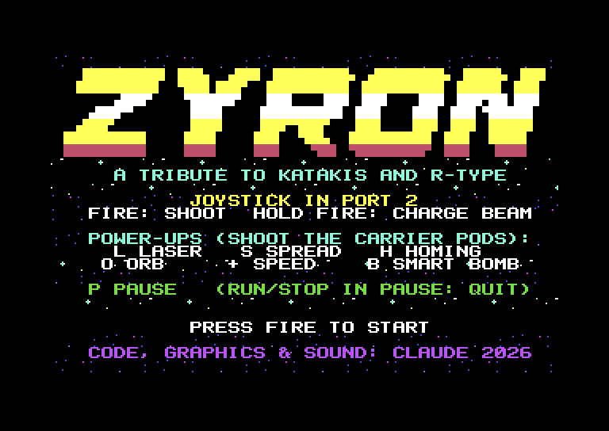
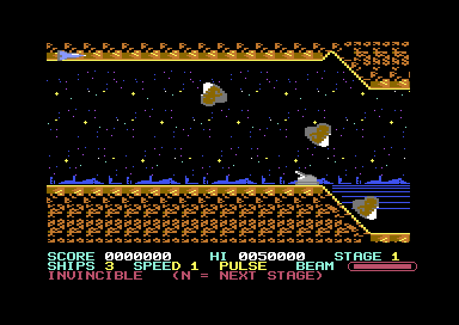
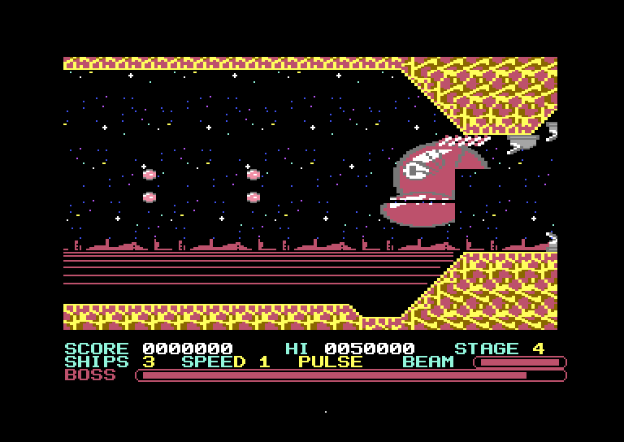
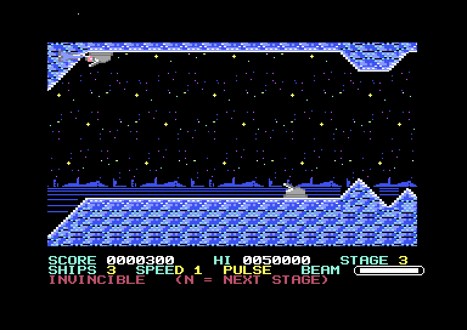
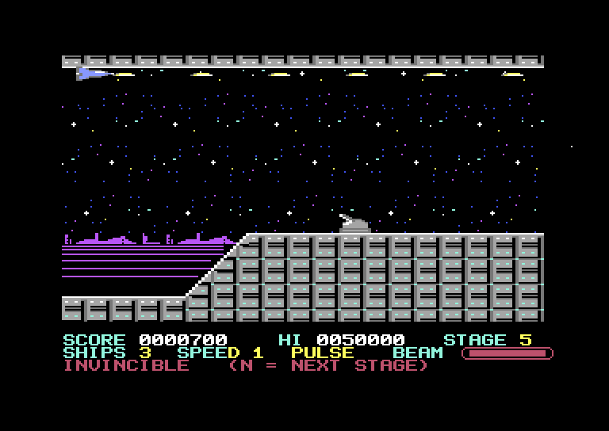

# ZYRON - Horizontal Scrolling Shoot'em-up for the Commodore C64
ZYRON is a horizontally scrolling shoot'em-up for the Commodore C64, written from scratch in 6502 assembler. Six stages lead through caves, asteroid fields, crystal landscapes and alien fortresses, each one guarded by a huge end boss. Collect weapon pods, charge up the wave beam and fight your way through the invasion. The game is a tribute to the great horizontal shooters of the late eighties, all graphics, enemies and music are original.

- Six stages with six end bosses, ending sequence and hiscore table
- Four weapon systems with two power levels each, orb satellite, speed-ups and smart bombs
- Charge beam: hold fire to load the wave beam
- Smooth full-screen scrolling with double-buffered screens at 50 frames per second
- Three-layer parallax background: two irregular star fields and a skyline silhouette
- Sprite multiplexer with up to 40 virtual sprites
- Own SID music player with title, stage, boss and ending music plus sound effects
- Disk version with fastloader, Magic Desk cartridge, single PRG and turbo tape



# How to Play
## Controls
Plug a joystick into **port 2**.

| Input | Action |
|:-|:-|
| Joystick | move the ship in eight directions |
| Fire (tap or hold) | shoot, holding the button gives autofire |
| Fire (hold), then release | when the BEAM bar is full: fire the wide wave beam |
| `P` | pause |
| `RUN/STOP` (during pause) | quit the game and return to the title screen |

## Weapons and Power-Ups
Carrier pods fly through every stage. Shoot them and they leave a capsule behind, fly over it to collect it. Collecting the same weapon twice upgrades it to its second level ("+").

| Capsule | Effect |
|:-:|:-|
| `L` | **Laser:** fast piercing beam straight ahead, level 2 fires a double laser |
| `S` | **Spread:** three-way fan, level 2 fires a five-way fan |
| `H` | **Homing:** missiles that steer towards the nearest target |
| `O` | **Orb:** a satellite that follows your ship, fires along and blocks enemy bullets |
| `+` | **Speed:** faster ship movement |
| `B` | **Smart bomb:** destroys all enemies and enemy bullets on the screen |

You start with the pulse cannon. An extra ship is awarded every 50,000 points.

## Stages
Touching the landscape destroys the ship, the collision check is pixel-accurate, including the slopes. Drones, darts, gun turrets, hoppers, mines, chasers and tumbling rocks attack in changing formations. At the end of every stage, scrolling stops and the boss appears.

| Stage | Name | Boss |
|:-:|:-|:-|
| 1 | Asteroid Outpost | GORGAX - vertical sine movement, three-way spread shots |
| 2 | Biomech Caverns | OCULUS - figure eight, aimed bursts, blinking eye |
| 3 | Crystal Fields | CRYOSTAR - slow sine, rotating bullet rings |
| 4 | Magma Reactor | MAGMAWYRM - tracks the player and dashes forward |
| 5 | Iron Fortress | DREADNOUGHT - three cannons and a drone launcher |
| 6 | The Hive Core | HIVE MOTHER - bullet rings, aimed shots and chasers |

After the sixth boss the ending and credits follow. Good scores are entered into the hall of fame (top 5) with your initials; the table is kept until the computer is switched off.

## Hidden Cheat
Type `MANFRED` on the title screen. A jingle and a message confirm the cheat mode. Your ship is now invincible, the keys `1` to `6` on the title screen select the start stage and `N` during the game skips to the next stage.



# How it Works
## Memory Map
| Address | Content |
|:-|:-|
| `$0810-$3FFF` | game code (main loop, scrolling, sprites, enemies, bosses, HUD) |
| `$4000-$47FF` | charset (VIC bank 1) |
| `$4800-$4BFF` | screen A |
| `$4C00-$4FFF` | screen B |
| `$5000-$7FFF` | sprite data |
| `$8000-$CEFF` | title/ending screens, music player, generated tables, level data, music |
| `$E000-$FFFF` | colour RAM shift code, generated at runtime (KERNAL switched off) |

## Scrolling Engine
The playfield consists of 21 character rows that scroll horizontally with the VIC-II fine scroll register `$D016`. Every eight pixels, the whole screen has to move by one character. Copying 840 characters in one frame is not possible on top of the game logic, so two screens are used: while the visible screen is fine scrolled, the invisible back buffer is filled step by step with the content shifted one column to the left. The copy work is spread over several frames of the eight pixel cycle, the new column on the right is generated in another frame. At the coarse step, the IRQ switches `$D018` to the other screen. The colour RAM cannot be double buffered, so it is shifted by a long block of unrolled `LDA/STA` code that is generated at start-up (`$E000`). The interrupt below the playfield runs it while the raster beam travels through the lower border and the vertical blank, so the shift is finished before the beam reaches the playfield again.

The landscape is not stored as a map. The level generator (`tools/levels.py`) describes each stage as a list of runs with ceiling and floor heights and slopes, plus a list of events (enemy waves, carriers, the boss trigger) bound to map columns. During the game, `scroll.asm` builds each new column from this data and picks the matching characters for flat ground, slopes and the inner rock textures.

## Parallax Background
The empty space behind the landscape is filled with background characters. Their definitions in the charset are rotated pixel by pixel with `ROR`/`ROL` chains, which moves the whole background layer without touching the screen memory. There are three layers, each an 8-character-wide (64 pixel) strip: far stars, mid stars (with a few crosses and dashes) and a skyline of hills with spires and antennas above a scanline haze. Every screen row starts at a different phase of its strip, so the stars look irregular. Each layer has its own speed accumulator; the rotation needed in a frame is the difference between the terrain scroll position and the layer position, so the layers move at 1/4, 2/5 and 2/3 of the terrain speed. When the terrain stops at a boss, the layers stop as well.

## Raster Interrupts and Sprite Multiplexer
In game mode, an IRQ chain runs every frame:
- **Top IRQ (line 42):** sets the fine scroll and the screen of the frame and enables the sprites.
- **Multiplexer IRQs:** whenever a hardware sprite is free again, it is reused for the next virtual sprite further down the screen.
- **Split IRQ (line 221):** switches to a fixed text mode for the HUD, takes over the next frame's data prepared by the main loop (double buffered with a `ready` flag), writes the first eight sprites of the next frame, shifts the colour RAM at a coarse step, rotates the parallax layers and plays music and sound.

The main loop collects up to 40 virtual sprites per frame (ship, orb, eight player bullets, ten enemies, eight enemy bullets, boss parts), sorts them with a bucket sort by their Y coordinate and builds the list for the multiplexer.

## Sound
The music player in `sound.asm` plays the music data created by the music compiler (`tools/music.py`) from note patterns written in Python. It supports instruments with ADSR, pulse width modulation, arpeggios, vibrato and drums. The sound effects use voice 3 and temporarily take it over from the music.

## Loaders
All three loaders share the same crunched game image. The game is packed with [TSCrunch](https://github.com/tonysavon/TSCrunch) into an image that can be decrunched in place, i.e. it is loaded directly below its final position and unpacked onto itself.

- **Disk:** the boot file transfers its drive code into the 1541 via `M-W` commands and starts it. The drive reads the sectors of the data file and sends every byte as four 2-bit pairs over the CLK and DATA lines of the serial bus. Each byte starts with a handshake, the four pairs follow with cycle-exact timing. The screen is switched off while loading, so that no badlines can disturb the timing. The loader works on PAL and NTSC machines. Both files are written with a sector interleave matched to the transfer speed.
- **Cartridge:** the boot code in bank 0 is started via the `CBM80` signature, copies the crunched image bank by bank from `$8000-$9FFF` into RAM, disables the cartridge by setting bit 7 of `$DE00` and jumps into the decruncher.
- **Tape:** a small boot program in standard KERNAL format is loaded first. It contains the turbo loader, which distinguishes short and long pulses with a CIA timer (threshold 280 cycles), assembles the bytes and verifies the loaded data with an XOR checksum. If the checksum does not match, the motor is stopped and the border turns red.



# Source Code
## Assembler Sources
The game is written in 6502 assembler for [64tass](https://sourceforge.net/projects/tass64/). `main.asm` includes all other files.

| File | Lines | Content |
|:-|-:|:-|
| `src/main.asm` | 358 | memory map, constants, variables, segment layout, includes |
| `src/game.asm` | 292 | game flow: new game, stage start, main loop, stage logic, pause, cheat keys |
| `src/irq.asm` | 463 | menu IRQ and game IRQ chain (top, multiplexer, HUD split), parallax rotation, colour shift code generator |
| `src/scroll.asm` | 508 | scrolling engine: level init, column generation, double-buffered screen shift, terrain lookup, level events |
| `src/sprites.asm` | 274 | virtual sprite list, bucket sort, multiplexer preparation |
| `src/player.asm` | 768 | player ship, terrain collision, weapons, charge beam, orb satellite |
| `src/enemies.asm` | 1282 | enemy types, spawners, enemy bullets, power-up capsules, collisions |
| `src/boss.asm` | 616 | the six end bosses, their movement and attack patterns |
| `src/hud.asm` | 274 | score, ships, weapon, speed and beam bar display |
| `src/screens.asm` | 923 | title screen, stage intro, game over, ending, credits, hiscore entry |
| `src/tables.asm` | 0 | placeholder for hand-written tables (the tables are generated) |
| `src/sound.asm` | 494 | SID music player (3 voices, instruments, arpeggios, vibrato) and sound effects on voice 3 |
| `src/util.asm` | 306 | text output, BCD score handling, random numbers, keyboard scan, joystick |

## Python Tools
The Python scripts generate all data of the game and package the distribution formats.

| File | Content |
|:-|:-|
| `tools/gen.py` | build script for all generated data: charset, sprites, tables, colours, parallax layers |
| `tools/gfx.py` | procedural graphics: font, terrain characters, parallax layers, sprites, bosses, title logo |
| `tools/levels.py` | level generator: terrain runs and enemy events of the six stages |
| `tools/music.py` | music and sound effect compiler plus all compositions |
| `tools/package.py` | crunches the game and builds D64, BIN and CRT |
| `tools/d64.py` | minimal D64 image writer with custom sector interleave |
| `tools/crt.py` | writes the VICE CRT container for the Magic Desk ROM |
| `tools/mktap.py` | TAP v1 writer: KERNAL boot file plus turbo data block |

# Compiling the Source Code
## Requirements
- [64tass](https://sourceforge.net/projects/tass64/) cross assembler (version 1.59 or newer)
- [Python 3](https://www.python.org/) (only the standard library is needed for the build)
- [TSCrunch](https://github.com/tonysavon/TSCrunch) by Antonio Savona for crunching the game

## Building
All graphics, sprites, level data and music are generated by Python scripts at build time, there are no binary assets in the repository. A single script creates the game and all five distribution formats:
```
cd sources
./build.sh
```
If `tscrunch` is not in your `PATH`, pass its location: `TSCRUNCH=/path/to/tscrunch ./build.sh`. The finished files are placed in `sources/build/release`. Intermediate files (listings, label files, generated data) remain in `sources/build`, the label file `zyron.lbl` is handy for debugging with the VICE monitor.

The build runs the following steps:
1. `tools/gen.py` generates the charset, the sprites, all tables, the level data and the music into `build/`.
2. `64tass` assembles `src/main.asm` into the uncompressed game `build/zyron.prg` (start address `$0810`).
3. `tools/package.py` crunches the game with TSCrunch into an in-place decrunching image and builds the D64 (with boot loader), the BIN and the CRT.
4. TSCrunch creates the self-extracting single file PRG.
5. The tape boot loader is assembled and `tools/mktap.py` writes the TAP image.

## Folder Structure
```
sources/
├── build.sh            build script for all formats
├── src/                6502 assembler sources (64tass)
│   ├── main.asm        memory map, includes
│   ├── game.asm        game flow
│   ├── irq.asm         raster IRQs, multiplexer, parallax
│   ├── scroll.asm      scrolling engine
│   ├── ...             see table above
│   └── loader/
│       ├── boot.asm    disk boot program + 1541 drive code (2-bit fastloader)
│       ├── cart.asm    Magic Desk cartridge boot code
│       ├── tapeboot.asm turbo tape boot loader
│       └── decrunch.asm TSCrunch in-place decruncher
└── tools/              Python build tools
    ├── gen.py          generates all game data
    ├── gfx.py          graphics
    ├── levels.py       levels
    ├── music.py        music compiler
    ├── package.py      crunching, D64, BIN and CRT creation
    ├── d64.py          minimal D64 writer with custom sector interleave
    ├── crt.py          Magic Desk CRT file writer
    └── mktap.py        TAP image writer (KERNAL boot file + turbo blocks)
```

# Using the Binaries
The [binaries](binaries/) folder contains the game in five ready-to-use formats. All of them start the same game; they only differ in the medium and the loader.

| File | Format | Loader | Typical use |
|:-|:-|:-|:-|
| `zyron.d64` | 1541 disk image | own 2-bit fastloader (~5 s) | emulators, real 1541 floppy, Ultimate 64/II |
| `zyron.crt` | Magic Desk cartridge (VICE CRT) | copies from ROM, starts in ~1 s | emulators, Ultimate 64/II, Kung Fu Flash |
| `zyron.bin` | raw 64 KB Magic Desk ROM | as above | burning an (E)EPROM for a real cartridge |
| `zyron.prg` | single self-extracting PRG | standard KERNAL loader | emulators, SD2IEC, any file based device |
| `zyron.tap` | tape image (TAP v1) | own turbo loader (~1:15 min) | emulators, Tapuino, real datasette |

## D64 - Disk Image with Fastloader
Load and start the game with:
```
LOAD"*",8,1
RUN
```
The first file is a tiny boot program. It uploads its own drive code into the 1541, which then sends the crunched game file (the second directory entry, `zyron data`) with a 2-bit protocol to the C64. The game is decrunched in place and starts automatically. Loading takes about five seconds instead of about 45 seconds with the standard loader.

Because the fastloader runs code inside the floppy drive, it needs a real 1541/1541-II/1571 or an accurate drive emulation (VICE with "True Drive Emulation", Ultimate 64/II, Pi1541). Pure file-based devices like the [SD2IEC](https://github.com/wagiminator/C64-Collection/tree/master/C64_SD2IEC_LP) cannot run drive code; please use the PRG file there.

**In an emulator:** drag and drop the D64 onto [VICE](https://vice-emu.sourceforge.io/) or open it in the [C64 Emulator Web App](https://wagiminator.github.io/apps/c64-emulator/) directly in your browser.

**On a real floppy disk:** write the D64 to a disk with a [DiskBuddy64](https://github.com/wagiminator/C64-Collection/tree/master/C64_DiskBuddy64), [DiskMaster64](https://github.com/wagiminator/C64-Collection/tree/master/C64_DiskMaster64) or [DumpMaster64](https://github.com/wagiminator/C64-Collection/tree/master/C64_DumpMaster64) adapter, either with the Python tools of the respective adapter or directly from the browser with the [C64 Disk Transfer Web App](https://wagiminator.github.io/apps/d64-transfer/). Alternatively, an [xu1541](https://github.com/wagiminator/C64-Collection/tree/master/C64_xu1541) with OpenCBM can be used. If you want to have a look at the disk structure or add the game to your own disk image, use the [C64 Disk Viewer](https://wagiminator.github.io/apps/d64-viewer/) and the [C64 Disk Editor](https://wagiminator.github.io/apps/d64-editor/).

## CRT and BIN - Magic Desk Cartridge
The game is also available as a 64 KB cartridge in Magic Desk format (eight 8 KB banks, bank register at `$DE00`). After switching on, the boot code in bank 0 copies the crunched game into RAM, switches the cartridge off and decrunches the game. It is ready about one second after power-on.

**In an emulator or on modern hardware:** the CRT file can be attached in VICE (`File` -> `Attach cartridge image`), in the [C64 Emulator Web App](https://wagiminator.github.io/apps/c64-emulator/), on an Ultimate 64/II or a Kung Fu Flash.

**As a real cartridge:** the BIN file is the raw 64 KB ROM image. Burn it into a 27C512/28C512 (E)EPROM and plug it into the [C64 64k/256k Cartridge](https://github.com/wagiminator/C64-Collection/tree/master/C64_Cartridge_64k_256k). For programming the (E)EPROM, a TL866/T48 programmer can be used together with the [XGecu Memory Programmer Web App](https://wagiminator.github.io/apps/tinypro/) or the Python tool [tinypro](https://pypi.org/project/tinypro/). If you want to combine several games on one cartridge with a selection menu, put the PRG files into the [C64 Cartridge Builder Web App](https://wagiminator.github.io/apps/cart-builder/).

## PRG - Single File
The PRG is the complete game as one self-extracting file. Load it with:
```
LOAD"ZYRON",8
RUN
```
It works with every device that can load files with the standard KERNAL routines, e.g. an [SD2IEC](https://github.com/wagiminator/C64-Collection/tree/master/C64_SD2IEC_LP), an Ultimate 64/II, a Kung Fu Flash or a real floppy disk (copy it onto a disk with the [C64 Disk Editor](https://wagiminator.github.io/apps/d64-editor/) and the [C64 Disk Transfer Web App](https://wagiminator.github.io/apps/d64-transfer/)). Since the standard loader is slow, loading from a real 1541 takes considerably longer than the D64 version. A fastload cartridge like the [C64 FreeLoad Cartridge](https://github.com/wagiminator/C64-Collection/tree/master/C64_Cartridge_FreeLoad) speeds this up nicely. In emulators the PRG can simply be autostarted.

## TAP - Tape Image with Turbo Loader
Insert the tape (or attach the TAP file in your emulator), then press `SHIFT` + `RUN/STOP` (or type `LOAD` and later `RUN`) and press PLAY on the datasette. The KERNAL first loads a small boot loader. This turbo loader then switches the datasette motor on again and reads the crunched game in its own pulse format (bit 0 = 208 cycles, bit 1 = 352 cycles). Coloured stripes in the border show the loading progress, a red border indicates a loading error. The whole process takes about 1:15 minutes instead of about seven minutes with the standard KERNAL loader.

**In an emulator:** attach the TAP file to the datasette in VICE or load it into the [C64 Emulator Web App](https://wagiminator.github.io/apps/c64-emulator/).

**With a datasette emulator:** copy the TAP file onto the SD card of a [Tapuino](https://github.com/wagiminator/C64-Collection/tree/master/C64_Tapuino).

**On a real cassette:** record the TAP file onto a tape with a [TapeBuddy64](https://github.com/wagiminator/C64-Collection/tree/master/C64_TapeBuddy64), [TapeDump64](https://github.com/wagiminator/C64-Collection/tree/master/C64_TapeDump64) or [DumpMaster64](https://github.com/wagiminator/C64-Collection/tree/master/C64_DumpMaster64), either with the Python tools of the respective adapter or directly from the browser with the [C64 Tape Transfer Web App](https://wagiminator.github.io/apps/tap-transfer/).

# References, Links and Notes
1. [64tass Cross Assembler](https://sourceforge.net/projects/tass64/)
2. [TSCrunch by Antonio Savona](https://github.com/tonysavon/TSCrunch)
3. [VICE - the Versatile Commodore Emulator](https://vice-emu.sourceforge.io/)
4. [C64 Emulator Web App](https://wagiminator.github.io/apps/c64-emulator/)
5. [C64 Disk Transfer Web App](https://wagiminator.github.io/apps/d64-transfer/)
6. [C64 Tape Transfer Web App](https://wagiminator.github.io/apps/tap-transfer/)
7. [C64 Cartridge Builder Web App](https://wagiminator.github.io/apps/cart-builder/)
8. [XGecu Memory Programmer Web App](https://wagiminator.github.io/apps/tinypro/)
9. [C64 Collection (adapters and cartridges)](https://github.com/wagiminator/C64-Collection)
10. [Christian Bauer: The MOS 6567/6569 video controller (VIC-II)](https://www.zimmers.net/cbmpics/cbm/c64/vic-ii.txt)
11. [Codebase64 Wiki](https://codebase64.org/)




# License


This work is licensed under Creative Commons Attribution-ShareAlike 3.0 Unported License.
(http://creativecommons.org/licenses/by-sa/3.0/)
