# Commodore C64 Games
Collection of original games for the Commodore C64, written from scratch in 6502 assembler with a lot of help by Claude Opus 5.5. Every game comes with its complete source code and is available as disk image with fastloader, as Magic Desk cartridge (CRT for emulators, BIN for burning an EPROM), as single PRG file and as tape image with turbo loader. All graphics, characters and music are original; the games are tributes to the classics that inspired them.

# [ZYRON](C64_Zyron/)
A horizontally scrolling shoot'em-up with six stages and six huge end bosses. Collect weapon pods for laser, spread shot, homing missiles and the orb satellite, hold the fire button to charge the wave beam and fight your way through caves, crystal fields and alien fortresses. Smooth double-buffered scrolling, a three-layer parallax background and a sprite multiplexer with up to 40 sprites. A tribute to Katakis and R-Type.

[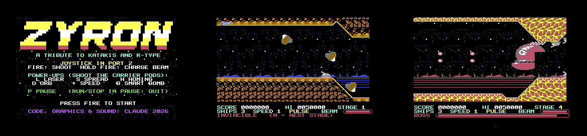](https://wagiminator.github.io/apps/c64-emulator/?file=https://raw.githubusercontent.com/wagiminator/C64-Games/main/C64_Zyron/binaries/zyron.crt)

[▶ Play ZYRON in the browser](https://wagiminator.github.io/apps/c64-emulator/?file=https://raw.githubusercontent.com/wagiminator/C64-Games/main/C64_Zyron/binaries/zyron.crt)

# [VEXOR](C64_Vexor/)
A vertically scrolling shoot'em-up with a trading post. Shoot the alien swarm, collect the credit bubbles of the wrecks and spend them at Grimble's shop on bigger guns, side shots, lasers, homing pods, autofire and energy. Five stages with five end bosses, a three-layer parallax starfield and a flicker-free fixed playfield edge despite vertical scrolling. A tribute to Xenon 2: Megablast.

[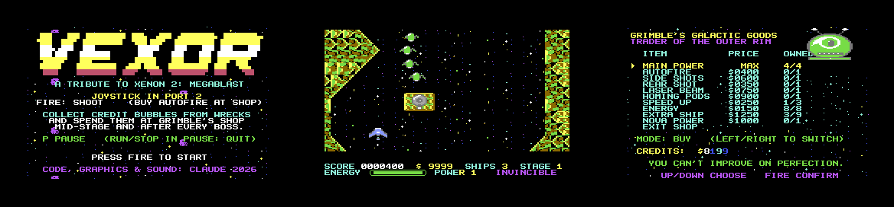](https://wagiminator.github.io/apps/c64-emulator/?file=https://raw.githubusercontent.com/wagiminator/C64-Games/main/C64_Vexor/binaries/vexor.crt)

[▶ Play VEXOR in the browser](https://wagiminator.github.io/apps/c64-emulator/?file=https://raw.githubusercontent.com/wagiminator/C64-Games/main/C64_Vexor/binaries/vexor.crt)

# [SWARM](C64_Swarm/)
A fixed-screen alien invasion shooter. 55 aliens march in formation, step down at every turn and get faster with every loss. Hide behind bunkers that erode pixel by pixel, shoot the mystery ship for power-up capsules and defeat three motherships in three sectors with their own alien species. A tribute to Space Invaders.

[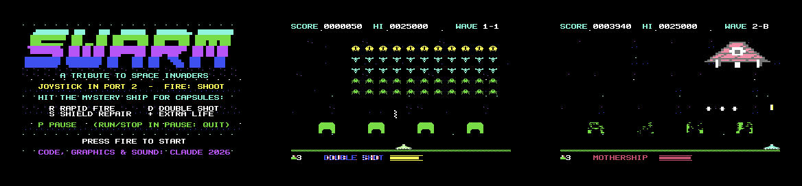](https://wagiminator.github.io/apps/c64-emulator/?file=https://raw.githubusercontent.com/wagiminator/C64-Games/main/C64_Swarm/binaries/swarm.crt)

[▶ Play SWARM in the browser](https://wagiminator.github.io/apps/c64-emulator/?file=https://raw.githubusercontent.com/wagiminator/C64-Games/main/C64_Swarm/binaries/swarm.crt)

# [GULP!](C64_Gulp/)
Eat or be eaten! An underwater feeding game in which a small fish grows by eating smaller fish while fleeing from the bigger ones. Frenzy multiplier, jellyfish, golden fish, pearls and three zones from the coral reef to the deep sea, each ending with a giant boss that can only be defeated with a power bite. A tribute to Feeding Frenzy.

[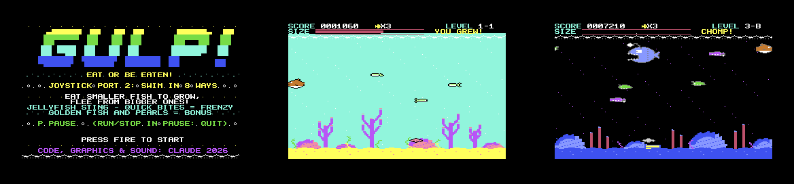](https://wagiminator.github.io/apps/c64-emulator/?file=https://raw.githubusercontent.com/wagiminator/C64-Games/main/C64_Gulp/binaries/gulp.crt)

[▶ Play GULP! in the browser](https://wagiminator.github.io/apps/c64-emulator/?file=https://raw.githubusercontent.com/wagiminator/C64-Games/main/C64_Gulp/binaries/gulp.crt)

# [THORN](C64_Thorn/)
Defend your garden against the undead! Collect sunlight, plant flowers that spit, freeze, block and explode, and stop the zombies in five lanes before they reach your house. Ten levels from day to night with six plants, four kinds of zombies, lawn mowers as the last line of defence and the Grave King as final boss. A tribute to Plants vs. Zombies.

[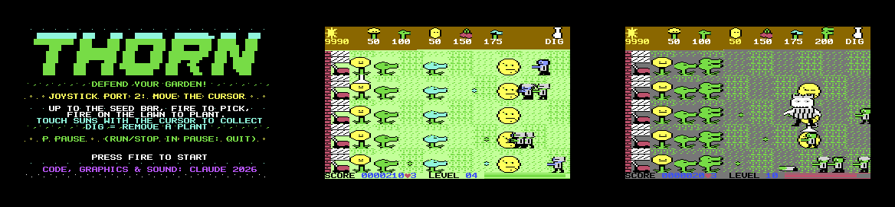](https://wagiminator.github.io/apps/c64-emulator/?file=https://raw.githubusercontent.com/wagiminator/C64-Games/main/C64_Thorn/binaries/thorn.crt)

[▶ Play THORN in the browser](https://wagiminator.github.io/apps/c64-emulator/?file=https://raw.githubusercontent.com/wagiminator/C64-Games/main/C64_Thorn/binaries/thorn.crt)

# [SUNRUSH](C64_Sunrush/)
Chase the sun! A pseudo 3D racing game with ten stages arranged as a pyramid: at every checkpoint the road forks and you choose your route to one of four goals. Smooth curves and stripes from a raster line program that changes scroll position and colours on every line, scaled sprites for palms, rocks and traffic, a radio with three tunes and a race against the clock. A tribute to Out Run.

[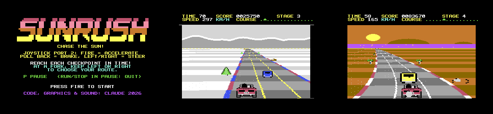](https://wagiminator.github.io/apps/c64-emulator/?file=https://raw.githubusercontent.com/wagiminator/C64-Games/main/C64_Sunrush/binaries/sunrush.crt)

[▶ Play SUNRUSH in the browser](https://wagiminator.github.io/apps/c64-emulator/?file=https://raw.githubusercontent.com/wagiminator/C64-Games/main/C64_Sunrush/binaries/sunrush.crt)

# [SKYHOP](C64_Skyhop/)
Bounce up to the moon! An endless jumping game: hop from platform to platform, higher and higher through five sky zones, with springs, propeller hats and jetpacks, moving, breaking and vanishing platforms, monsters to stomp or shoot and black holes to avoid. Smooth vertical scrolling over checkered paper with double-buffered screens, an ending on the moon at 50000 points. A tribute to Doodle Jump.

[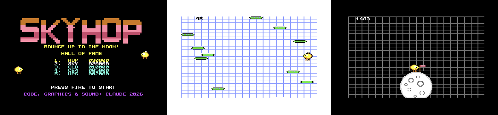](https://wagiminator.github.io/apps/c64-emulator/?file=https://raw.githubusercontent.com/wagiminator/C64-Games/main/C64_Skyhop/binaries/skyhop.crt)

[▶ Play SKYHOP in the browser](https://wagiminator.github.io/apps/c64-emulator/?file=https://raw.githubusercontent.com/wagiminator/C64-Games/main/C64_Skyhop/binaries/skyhop.crt)

# [JETDASH](C64_Jetdash/)
Fly through the lab! A side-scrolling jetpack game: hold fire to fly, dodge zappers, homing missiles and laser beams, collect coins and grab gadget boxes for a copter or a gravity belt. Five zones from the lab to the server hall and an escape into the open sky after 5000 metres. Smooth double-buffered horizontal scrolling with generated copy code and pixel-exact collisions. A tribute to Jetpack Joyride.

[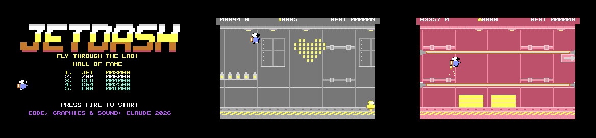](https://wagiminator.github.io/apps/c64-emulator/?file=https://raw.githubusercontent.com/wagiminator/C64-Games/main/C64_Jetdash/binaries/jetdash.crt)

[▶ Play JETDASH in the browser](https://wagiminator.github.io/apps/c64-emulator/?file=https://raw.githubusercontent.com/wagiminator/C64-Games/main/C64_Jetdash/binaries/jetdash.crt)

# [GUMDROP](C64_Gumdrop/)
A sweet match-three puzzle: swap neighbouring sweets to line up three or more, create striped blasters, bombs and rainbow drops and set off cascades. Twenty levels with score and ice goals, a limited number of moves and three lives. Multicolour bitmap board with smoothly falling sweets that alternate between two colour slots. A tribute to Candy Crush Saga.

[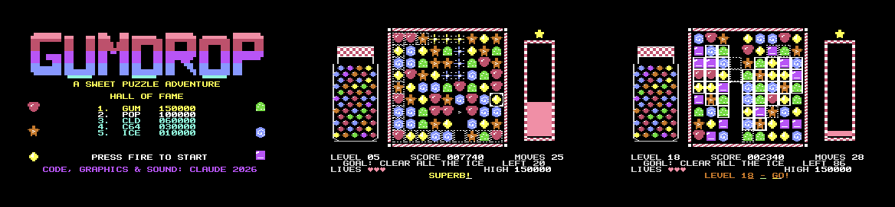](https://wagiminator.github.io/apps/c64-emulator/?file=https://raw.githubusercontent.com/wagiminator/C64-Games/main/C64_Gumdrop/binaries/gumdrop.crt)

[▶ Play GUMDROP in the browser](https://wagiminator.github.io/apps/c64-emulator/?file=https://raw.githubusercontent.com/wagiminator/C64-Games/main/C64_Gumdrop/binaries/gumdrop.crt)

# [NIGHTHOLD](C64_Nighthold/)
Survive the night! A horde survival game: walk across a haunted heath while your weapons fight on their own against up to 80 bats, zombies, skeletons, ghosts, ghouls and wraiths. Collect gems, level up and choose from five weapons and four items, defeat three bosses and hold out ten minutes until dawn. Smooth eight-way scrolling with two completely rebuilt screens and creatures made of characters. A tribute to Vampire Survivors.

[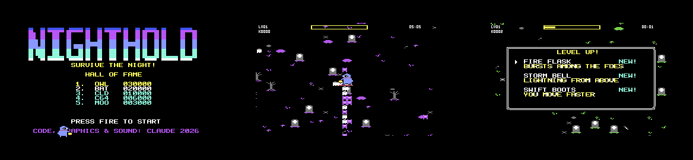](https://wagiminator.github.io/apps/c64-emulator/?file=https://raw.githubusercontent.com/wagiminator/C64-Games/main/C64_Nighthold/binaries/nighthold.crt)

[▶ Play NIGHTHOLD in the browser](https://wagiminator.github.io/apps/c64-emulator/?file=https://raw.githubusercontent.com/wagiminator/C64-Games/main/C64_Nighthold/binaries/nighthold.crt)

# [FLEETFOOT](C64_Fleetfoot/)
Run for your life! An endless runner in pseudo 3D: change lanes, jump over hurdles, slide under bars and dodge blocks while a giant boulder rolls behind you. Coins, magnets, spring boots, a score star and an amulet on the way through five lands from the temple to the fire mountain. Track stripes rendered into the charset by generated code that races the raster beam, far objects drawn into characters, near objects as scaled and multiplexed sprites. A tribute to Subway Surfers and Temple Run.

[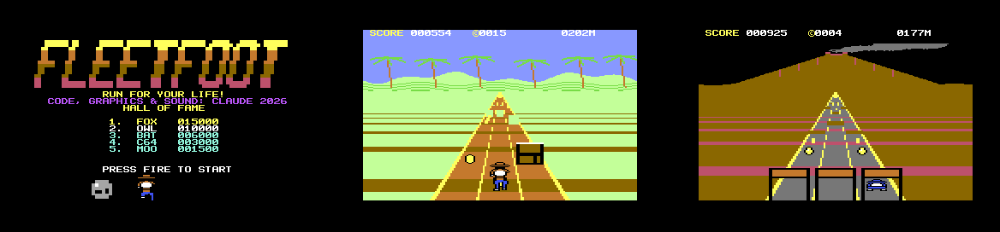](https://wagiminator.github.io/apps/c64-emulator/?file=https://raw.githubusercontent.com/wagiminator/C64-Games/main/C64_Fleetfoot/binaries/fleetfoot.crt)

[▶ Play FLEETFOOT in the browser](https://wagiminator.github.io/apps/c64-emulator/?file=https://raw.githubusercontent.com/wagiminator/C64-Games/main/C64_Fleetfoot/binaries/fleetfoot.crt)

# Playing the Games
Each game folder contains a `binaries` folder with five formats:

| Format | How to use |
|:-|:-|
| `D64` | disk image with fastloader: `LOAD"*",8,1` and `RUN`; for emulators or real floppies via [DiskBuddy64](https://github.com/wagiminator/C64-Collection/tree/master/C64_DiskBuddy64), [DiskMaster64](https://github.com/wagiminator/C64-Collection/tree/master/C64_DiskMaster64), [DumpMaster64](https://github.com/wagiminator/C64-Collection/tree/master/C64_DumpMaster64) and the [C64 Disk Transfer Web App](https://wagiminator.github.io/apps/d64-transfer/) |
| `CRT` | Magic Desk cartridge for emulators, Ultimate 64/II and Kung Fu Flash |
| `BIN` | raw 64 KB ROM image for the [C64 64k/256k Cartridge](https://github.com/wagiminator/C64-Collection/tree/master/C64_Cartridge_64k_256k), programmable with the [XGecu Memory Programmer Web App](https://wagiminator.github.io/apps/tinypro/) |
| `PRG` | single self-extracting file for SD2IEC, Ultimate, Kung Fu Flash or any disk; several PRGs can be combined on one cartridge with the [C64 Cartridge Builder Web App](https://wagiminator.github.io/apps/cart-builder/) |
| `TAP` | tape image with turbo loader for emulators, the [Tapuino](https://github.com/wagiminator/C64-Collection/tree/master/C64_Tapuino) or real tapes via [TapeBuddy64](https://github.com/wagiminator/C64-Collection/tree/master/C64_TapeBuddy64), [TapeDump64](https://github.com/wagiminator/C64-Collection/tree/master/C64_TapeDump64) and the [C64 Tape Transfer Web App](https://wagiminator.github.io/apps/tap-transfer/) |

The quickest way to try a game is the [C64 Emulator Web App](https://wagiminator.github.io/apps/c64-emulator/), which runs every one of these formats directly in the browser: the play links above (and a click on a screenshot) load the cartridge of the game straight from this repository and start it. Keyboard as joystick in port 2: numpad 8 4 6 2 with fire on 0 or 5, or connect a gamepad; click the screen once for sound. The README of each game explains the formats, the gameplay, the inner workings and the build process in detail.

# Building from Source
Every game is built with a single script from its `sources` folder. You need [64tass](https://sourceforge.net/projects/tass64/), [Python 3](https://www.python.org/) and [TSCrunch](https://github.com/tonysavon/TSCrunch). All graphics, levels and music are generated by Python scripts during the build.
```
cd C64_Zyron/sources
./build.sh
```

# License


This work is licensed under Creative Commons Attribution-ShareAlike 3.0 Unported License.
(http://creativecommons.org/licenses/by-sa/3.0/)
